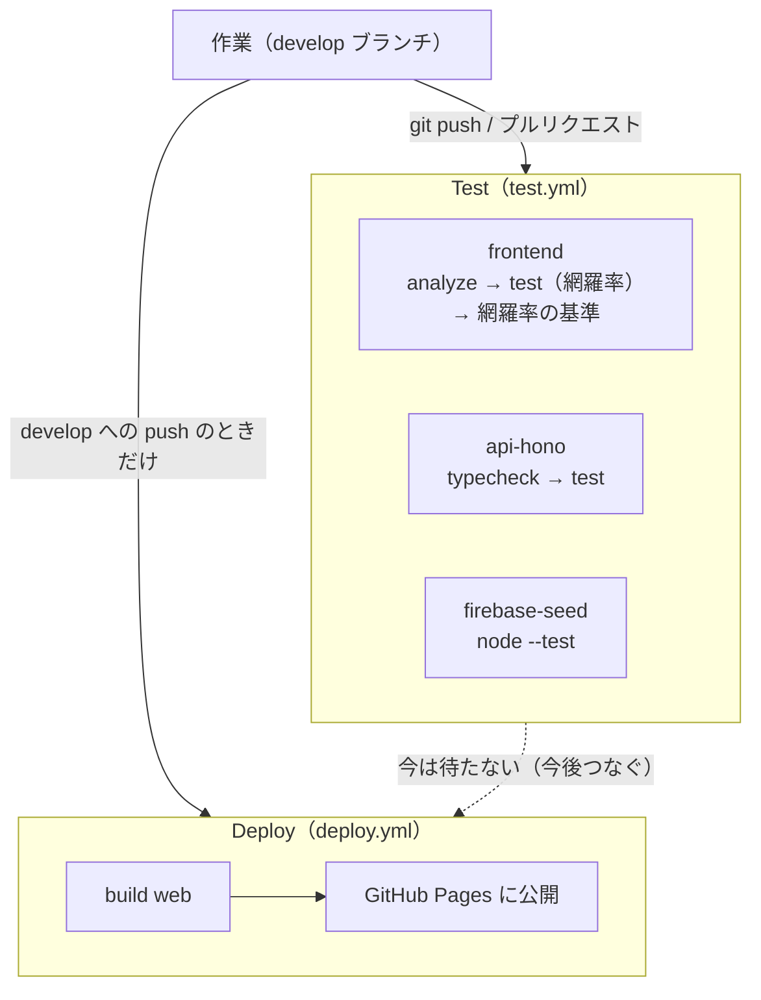
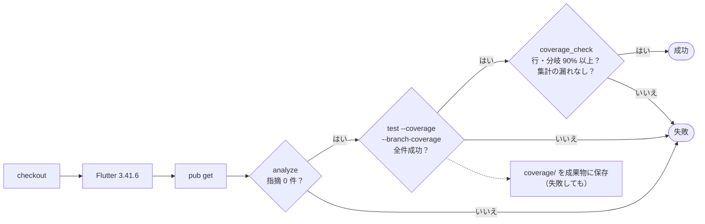

# CI の設計

> GitHub Actions のワークフロー、いつ・何を・どの順で実行し、何をもって失敗とするか。今の状況は [CI の状況](ci-status.md)、これからの改善は [今後の動き](../roadmap.md)。

---

## 1. 全体の流れ



| ワークフロー | ファイル | いつ動くか | 目的 |
|---|---|---|---|
| Test | `.github/workflows/test.yml` | `develop` / `main` への push、プルリクエスト、手動（workflow_dispatch） | 静的解析・テスト・網羅率の基準を確かめる |
| Deploy | `.github/workflows/deploy.yml` | `develop` への push、手動 | Flutter Web をビルドして GitHub Pages に公開する |

## 2. Test（test.yml）

| 設定 | 値 | 理由 |
|---|---|---|
| 権限 | `contents: read` | 読むだけ。書き込む権限は渡さない |
| 同時実行 | `group: test-${{ github.ref }}`、`cancel-in-progress: true` | 同じブランチに続けて push したら、古い実行を止める |
| 実行環境 | `ubuntu-latest` | |
| シークレット | なし | 外部のサービスを使わない |

### ジョブ：frontend（`frontend/` で実行）



| 順 | ステップ | 内容 | 失敗する条件 |
|---|---|---|---|
| 1 | checkout | `actions/checkout@v4` | |
| 2 | Flutter の用意 | `subosito/flutter-action@v2`、Flutter **3.41.6**（ローカルと同じ版）、stable、キャッシュあり | 版が取れない |
| 3 | `flutter pub get` | 依存関係（`pubspec.lock` のとおり） | 解決できない |
| 4 | `flutter analyze` | 静的解析 | 指摘が 1 件でもある |
| 5 | テスト（網羅率も記録） | `flutter test --coverage --branch-coverage` → `coverage/lcov.info` | テストが 1 件でも失敗 |
| 6 | 網羅率の確認 | `dart run tool/coverage_check.dart --min-line 90 --min-branch 90`。結果を Actions の実行のサマリーにも出す（`tee -a "$GITHUB_STEP_SUMMARY"`。`shell: bash` で pipefail を付け、tee を挟んでも失敗が伝わる） | 行・分岐のどちらかが 90% 未満、分岐の情報がない、集計に入っていないファイルがある |
| 7 | 網羅率のファイルを保存 | `coverage/`（`lcov.info`・`uncovered.txt`）を成果物 `frontend-coverage` として保存。**失敗しても保存する**（`if: always()`）。通っていない行を手元で見るため | |

### ジョブ：api-hono（`services/api-hono/` で実行）

| 順 | ステップ | 内容 | 失敗する条件 |
|---|---|---|---|
| 1 | checkout | | |
| 2 | Node の用意 | `actions/setup-node@v4`、Node **22** | |
| 3 | 依存関係 | `package-lock.json` があれば `npm ci`（版をそろえる）、なければ `npm install` | 解決できない |
| 4 | `npm run typecheck` | `tsc`（型の確認だけ。出力しない） | 型の誤りがある |
| 5 | `npm test` | `node --test`（単体・ルート。Emulator の上のテストは環境変数がないので飛ばす。段階 7 で Emulator を起動して動かす） | テストが失敗 |

### ジョブ：firebase-seed（リポジトリの直下で実行）

| 順 | ステップ | 内容 | 失敗する条件 |
|---|---|---|---|
| 1 | checkout | | |
| 2 | Node の用意 | `actions/setup-node@v4`、Node **22** | |
| 3 | `node --test firebase/seed/seed.test.mjs` | Firebase Emulator にサンプルを入れるスクリプトのテスト（偽物の Emulator に送った中身を確かめる。パッケージはいらない） | テストが失敗 |

3 つのジョブ（frontend・api-hono・firebase-seed）は並んで動く（どれかが失敗しても、ほかは最後まで動く）。Firebase Emulator そのものは CI では起動しない（段階 7 で、Emulator を使った各サービスのテストと一緒に足す）。

## 3. Deploy（deploy.yml）

| 順 | ステップ | 内容 |
|---|---|---|
| 1 | checkout | |
| 2 | Flutter の用意 | `subosito/flutter-action@v2`、Flutter stable の 3.x |
| 3 | `flutter pub get` | `frontend/` で |
| 4 | `flutter create . --platforms web` | 足りない web のファイルだけ作る（`web/index.html` は Git で管理しているので上書きしない） |
| 5 | `flutter build web --release --base-href "/dev-portfolio-site/"` | GitHub Pages のパスに合わせる |
| 6 | 成果物のアップロード → 公開 | `actions/upload-pages-artifact@v3` → `actions/deploy-pages@v4`（環境 `github-pages`） |

- 権限：`contents: read`・`pages: write`・`id-token: write`。同時実行は `group: pages` で、古いデプロイは止める
- **develop への push は、そのまま公開ページに反映される**

## 4. ローカルでの同じ確認

CI と同じことを、push の前に手元で確かめられる。

```bash
cd frontend
flutter pub get && flutter analyze
flutter test --coverage --branch-coverage
dart run tool/coverage_check.dart --min-line 90 --min-branch 90

cd ../services/api-hono
npm install && npm run typecheck && npm test
node --test ../../firebase/seed/seed.test.mjs
```

## 5. 失敗したときの見方

| どこで | 見るところ |
|---|---|
| analyze | ログの指摘（ファイル名・行番号） |
| テスト | ログの `[E]` の行と、その上の `EXCEPTION CAUGHT`（Expected / Actual、`reason:`） |
| 網羅率 | 実行のサマリーの表（基準に届かないファイル）、成果物 `frontend-coverage` の `uncovered.txt`（通っていない行番号） |
| 集計に入っていないファイル | `dart run tool/coverage_check.dart --update-imports` をして、`test/all_files_loaded_test.dart` をコミットする |

## 6. 決まりごと

- ワークフローで使う Flutter の版は、ローカル・Docker（`frontend/Dockerfile` の `FLUTTER_VERSION`）とそろえる（今は 3.41.6）。上げるときは 3 か所を一緒に変える
- 網羅率の基準（90%）を下げない。届かないときはテストを足す
- `.github/` のファイルは、Claude のファイルを書き戻す仕組みでは書き込めない（手元のシェルで書く）
