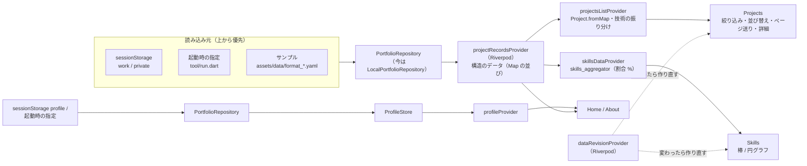

# データの流れ

> 読み込み・検証・保存・集計・Excel / PDF の入出力・YAML のスキーマ。データの形や流れを変えるときは必ずここを読み、変えたら直す。
> API（`services/api-hono/`）は、まだ frontend から呼んでいない（表示は assets と sessionStorage から）。API の仕様は `docs/design.md` の「API（services/api-hono）」。

## 全体

- **YAML のアップロード**: Header のダイアログでファイルを選択 → `_validateAgainstTemplate` で検証（`projects` 配列、各要素に `title` が必須、Work は `workflow` 必須、Private は `workflow` があると NG）→ `PortfolioRepository.instance.saveProjectsText`（`lib/data/`。今の実装は sessionStorage。テストではメモリ）に保存 → `onYamlStateChanged` → `dataRevisionProvider`（Riverpod、`lib/state/providers.dart`）を 1 増やす → `HomePage` がそれを見て `ValueKey` を変え、Skills/Projects を作り直して再読込させる。
- **スキル集計**: カテゴリごとに出現回数を数え、合計に対する % にする。`利用なし` は除外。`workflow` は true の割合（%）。
- **Skills・Tools の振り分け**（`utils/tech_catalog.dart` の `redistributeProject`）：読み込んだ Work / Private の skills / tools に書かれた、よく知られた技術（`_known`・`_languages`。表記ゆれは無視）は本来の分類へ移してから使う（React → frontend_frameworks、Django → backend_frameworks、Docker → container、tools の Python → skills、Lambda → aws_services ＋ cloud_platforms に AWS）。`Project.fromMap` と Skills の集計（`skills_{work,private}.dart` の `redistributeProjects`）の両方で行う。保存されている YAML 自体は書き換えない。移した先の「利用なし」は外し、空になった分類は「利用なし」。Excel からの振り分け（`skill_sheet.dart`）も同じ一覧（`classifyTech`）を使う。
- **Tools のグループ分け**（`tech_catalog.dart` の `ToolGroup` / `toolGroupOf`）：Tools は名前から推測して バージョン管理・エディタ / 開発ツール・環境 / ミドルウェア・CI/CD / 構成管理・プロジェクト管理 / 連絡・デザイン・その他 に分ける（よく知られた名前の一覧 `_toolNames` → なければ名前に含まれる言葉 `_toolHints` → その他）。Skills のカテゴリは `tools_vcs` などグループごと（`splitToolGroups` で数える。パネルでは「ツール」の見出しの下）、Projects のフィルターも Tools をグループごとの見出しに分ける（選んだ値は同じ `tools` のキーで絞り込む）。YAML には書かない（表示のときに推測）。
- **Skills のグループ分け**（`tech_catalog.dart` の `SkillGroup` / `skillGroupOf`）：Tools と同じく名前から推測して プログラミング言語・マークアップ / スタイルシート・データ形式 / クエリ・アーキテクチャ / 設計・ライブラリ・その他 に分ける（一覧 `_skillNames` → 版付きの言語（python3 など）→ 含まれる言葉 `_skillHints` → 小文字の `_` `-` 区切りや `○○.js` はライブラリ → その他）。Skills のカテゴリは `skills_lang` などグループごと（`splitSkillGroups`。パネルでは「スキル」の見出しの下）、Projects のフィルターも Skills をグループごとに分ける（書いたままの名前で見分ける）。
- Skills・Tools のグループ分けは、案件の詳細ダイアログ（「Skills：プログラミング言語」などの見出しごとにタグ）と、［データ］の 1 件の入力フォーム（Skills・Tools をグループごとのボタンに分け、候補もグループごと。保存するときに skills / tools に 1 つにまとめる）でも同じ。
- **技術名の表記ゆれ**（`utils/skill_name.dart`）：Skills の集計と Projects のフィルター（候補・絞り込み）では、全角→半角、前後の余分な記号（`;` `:` `.` `/` など。先頭の `.` は .NET のため残す）を外し、大文字・小文字と空白を無視して同じものにまとめる（MAC / mac / mac. / mac/、PYTHON3 / Python３ は同じ。Python と Python3 のように数字が違えば別）。キャメルケース・スネークケースの違い（`_` `-` `.` も無視）もまとめる。aws_services / azure_services / gcp_services では先頭の AWS / Amazon / Azure / GCP / Google Cloud なども無視し、外した名前で表示する（AWS Lambda / Lambda）。表示はよく知られた名前なら正式な書き方（`_officialNames`）、それ以外は大文字と小文字が混ざった書き方 → 多い書き方の順（小文字だけなら単語の頭を大文字、`_` は空白）。プロジェクト詳細のタグは書いたまま表示する。
- **プロジェクトのフィルタ**: `ProjectFilterState`（`selectedFilters`：キーは camelCase、例: `serverOS`, `backendFrameworks`／`fromYear`・`toYear`：期間（年）／`ongoingOnly`：進行中のみ）。`ProjectFilterLogic.apply` は選択した値をすべて含むか（AND、部分一致）で判定する。workflow は日本語ラベルを英語キーに変換してから照合する。
- 一覧の並びはツールバーの［並び替え］（`sections/projects/sort/project_sort.dart` の `ProjectSort`：開始が古い順（はじめ）/ 新しい順・終了が新しい順・期間が長い / 短い順・名前順）。期間が読めないものは最後、同じ値は名前順。詳細の ‹ › も同じ順。Work / Private を切り替えても並びはそのまま、変えたら 1 ページ目に戻る。
- 期間（`Project.periodStart` / `periodEnd` / `hasValidPeriod`）は文字の中の年月を順に読む（`2020-03`・`2020/3`・`2020年3月`・全角の数字も可）。終わりが読めなければ進行中ではなく開始と同じ月とみなす（進行中は「現在」/ present のときだけ）。

## Work / Private YAML のアップロード画面

- `sections/header/yaml_upload_dialog.dart` の `showYamlUploadDialog`（PC / スマホのヘッダーで共通。検証は `isValidProjectsYaml`）。
- 見た目と流れはプロフィール入力画面と同じ（部品は `widgets/upload_parts.dart`）：見出し＋ⓘ ／ 説明 ／ 番号付きの手順 ／ 選んだファイルの状態 ／［テンプレートを保存］［ファイルを選択］［アップロード］。
  1. 「ファイルを選択」でその場で検証。間違っていれば理由を出し、「アップロード」は押せない。
  2. 「アップロード」→ `confirmUpload` で中身（プロジェクト一覧 / プロフィールの各項目）を確認し、OK のときだけ反映。
  3. 反映中は `runReloading`：起動時と同じ全画面ローディング（M3 Circular）を最低 `AppSizes.reloadMinDuration`（5 秒）、最大 `reloadMaxDuration`（8 秒）出してから画面に戻す。
- **上書きの確認**（`utils/projects_diff.dart` の `diffProjects`、画面は `upload_parts.dart` の `confirmOverwrite`）：Work / Private のアップロードと、入力画面で一緒に書いた Work / Private は、確認画面の OK のあと、今表示している内容（ローダーが返すもの。サンプルも含む）と比べ、違いがあれば「上書きされます」と追加・削除・変更のタイトルを出し、［上書きしてアップロード］のときだけ反映する。比べるときはタイトル（同名は出てきた順）で対応づけ、書き方だけの違い（YAML / JSON、末尾の改行、数値と文字列、空のリンク、キーの順番、並び順）は無視する。
- **テンプレートはそろえておく**：プロフィールのテンプレートに入れた Work / Private と、単独の Work / Private のテンプレート（YAML / Markdown）は同じ内容にする（`projects_diff_test` などで確認。片方を変えたら全部そろえる）。
- **プロフィールのファイルに Work / Private も書ける**（`utils/profile_bundle.dart` の `readProfileBundle`、分け方は `data_format.dart` の `normalizeProfileBundle`）：YAML はトップの `work:` / `private:`（プロジェクトの並び、または `projects:` を持つ形）、Markdown は `# work` / `# private` の下に見出しを 1 段深くして（`##` プロジェクト、`###` details）書く。プロフィールのテンプレート（`format_profile.yaml` / `.md`）には Work / Private のテンプレートと同じ全項目のサンプルを最初から入れてある（中身が単独のテンプレートと一致することをテストで確認）。入力画面は 1 回のアップロードでプロフィール・Work・Private を反映し、`onProjectsChanged`（HomePage が Skills / Projects を作り直す）を呼ぶ。`tool/run.dart` は `assets/profile/work.yaml` / `private.yaml` に書き出し（なければ前回分を消す）、ローダーは「セッション → 起動時の指定（`ProfileStore.startupProjects`）→ メモリ → サンプル」の順に読む。Markdown のエラーの行番号は元のファイルのまま（ほかの区切りを空行にして読む）。
- **YAML と Markdown の両方に対応**（`utils/data_format.dart`。Flutter に依存しないので `tool/run.dart` からも使う）：`normalizeInput` が形式を見分け（拡張子 → なければ中身。YAML の「キー: 値」として読める・行頭に `projects:` などがある → YAML、`# 見出し` がある → Markdown）、Markdown は同じ中身の **JSON 文字列**（＝YAML として読める）に変換する。以降の検証・保存（sessionStorage）・表示は YAML と同じ処理。Markdown の書き方の誤りは `MarkdownTexts`（行番号付き）。テンプレートは `assets/data/format_*.md`（YAML 版と同じ中身になることをテストで確認）。アップロード画面のテンプレートは形式（YAML / Markdown）を切り替えて保存・コピーできる。
- **ファイルを保存・選択できない人向けに、テキストでも使える**（3 画面共通、`UploadSourcePanel`）：テンプレートは［保存］か［コピー］（クリップボード）、データは［ファイルを選択］か［テキストを貼り付け］（`showPasteYamlDialog`。クリアボタン・入力欄の × 付き）。貼り付けたテキストもファイルと同じ検証 → 確認画面 → 反映の流れ。ボタンは本文に置き、下のボタンは［キャンセル］［アップロード］だけ。
- **テンプレートの保存ボタンは各画面に 1 か所だけ**（ⓘ の説明画面には置かない。Work / Private・プロフィールとも）。

## スキルシート（Excel）からの入力（2026-11-05〜）

- 最初の入力画面で「入力方法」を選ぶ（`AppSegment`。はじめは YAML / Markdown。切り替えると選択中のファイルは取り消す）。
- Excel のとき：［Excel テンプレートを保存］（`assets/data/format_skill_sheet.xlsx` を `FileSaver.saveBytesAs` で名前を付けて保存。アセットは `loadAssetBytes`）／［Excel を選択］（`.xlsx` / `.xlsm`）→ `convertSkillSheet`（`utils/skill_sheet.dart`）が YAML（プロフィール＋work / private）を作る → `readProfileBundle` で YAML と同じく確かめる → 確認画面 → 上書きの確認 → 反映。［作った YAML を保存］で次回の起動用に保存できる。`tool/run.dart` も `.xlsx` を受け付ける。
- 読み取り（`utils/xlsx_reader.dart`）：`archive` で zip を開き `xml` で読む最小限の実装（共有文字列・インライン文字列・数式の計算結果。ふりがな `rPh` は除く。書式・結合は見ない）。
- 変換のルール（見出しの文字で探す。セル番地に依存しない）：
  - 氏名＝「氏名」の右のセル。経験＝「過去の開発経験」「直近の開発経験」を含むセル（表の見出しより上）。それぞれ「領域：説明」の行 → `about.past` / `about.recent`、「主な使用技術・開発環境：」以降の「分類：A、B」→ `about.past_tech` / `recent_tech`。
  - Excel にない Home の項目は作る：`role`＝`ExcelTexts.defaultRole`、`tagline`＝直近の「言語」、`card`＝直近の技術（`SkillSheetLimits`）、`intro`・`domains`＝経験の領域。
  - 個人の項目：「ふりがな」「性別」「年齢」「生年月日」「国籍」「配偶者」「最寄駅」「学歴」（`ExcelTexts.sheetLabels`）の右の値 → プロフィールの `sheet:`（右が次の見出しなら空。年齢は生年月日が読めないときだけ持つ）。画面には出さず、［ダウンロード］で書く。
  - 役割・規模（「役割」「規模」を含む見出しの列。`roleAndScaleOf`）：枠の中のセルを行ごとに見て、「役割：」「規模：」などの見出しがあればそれに従い、なければ人数（「10名」「5人」）や「規模」「体制」を含む行を規模（`scale`、複数行は「 / 」でつなぐ）、ほかを役割（`role`。「 / 」「・」「、」で分ける）。
  - プロジェクト＝「プロジェクト名」で始まる見出しの行（作業工程の小見出しは次の行）。「No.」の列に値がある行から次の番号の前までが 1 件。名前の列の 1 行目＝title、2 行目以降＝業務概要（description は「概要：」の 1 行目、details は全体、link は URL）。期間は最初の 2 つの年月（全角の数字・1 つのセルに「2020/03～2020/10」も可。終わりがなければ `現在`）。
  - 技術：セル内の見出し（「使用言語：」「FW・MW・ツール等：」「AI：」「AWS Service;」など。区切りは `：` `:` `；` `;`。`;` はわかる見出しのときだけ見出し扱いで、「Git; GitHub」は 2 項目。`_modeOfLabel`）で分類を切り替える（見出しの下の項目のあとの空行で元に戻る）。見出しのない項目は、`_known` の名前は各分類へ（クラウドのサービスは `cloud_platforms` にも足す）。知らない名前は使用言語の列 → `skills`、それ以外 → `tools`。「（補足）」は外す（サーバ OS・DB は残す）。空の分類は `利用なし`。
  - プロジェクト名に「プライベート」「個人開発」（`ExcelTexts.privateMarkers`）が入っていれば Private（印はタイトルから外し、workflow は書かない）。
- テンプレートの中身（氏名・経験・プロジェクト 2 件）は、プロフィール / Work / Private のテンプレートのサンプルと同じ内容にしてある（`skill_sheet_test` で、作った Work / Private が `format_work.yaml` / `format_private.yaml` と details 以外一致するかを確認）。テンプレートを変えたらそろえる。
- 作った YAML は `utils/yaml_writer.dart`（`toYaml`）で人が読める形に書く。

## ［ダウンロード］：スキルシートを Excel / PDF で保存（2026-11-05〜、`sections/header/download_menu.dart`）

- メニューで Excel / PDF を選ぶ → **先に**「名前を付けて保存」のダイアログ（`FileSaver.saveGeneratedBytesAs`。showSaveFilePicker はボタンを押した直後でないと開けないので、作る前に開く）→ 保存先が決まったら全画面ローディングで作って書き込む（`buildSkillSheetBytes`。名前は `skill_sheet_YYYYMMDD.xlsx|pdf`）→ 画面の下に SnackBar（保存した／ダウンロードした／やめた／失敗）。ダイアログが使えないブラウザ（Firefox / Safari）は作ってから通常のダウンロード。テスト用の `file_saver_stub.dart` は `make` を呼び、保存した中身を `FileSaver.lastSaved` に残す。
- 書く中身（`currentSkillSheetData`）：今のプロフィール（`ProfileStore`）の氏名と、過去・直近の開発経験（`experienceTextOf`）、今の Work と Private（`loadYamlString` → `redistributeProjects`、開始の古い順。Work が先、No. は通し番号）。
- Excel（`utils/skill_sheet_writer.dart` の `fillSkillSheet`）：テンプレートの zip の sheet XML だけを書き換え、ほかのファイル（スタイル・印刷設定など）はそのまま。
  - プロジェクトの表は見出しの文字で探し、1 件目のブロック（11〜15 行）をひな形として件数分複製する。後ろの行は行数の差だけずらし、結合・入力規則（`dataValidation` の sqref）も付け直す。表の中のハイパーリンクは外す。
  - 値はインライン文字列で書く。ブロックの最後の行は、文字が入りきらないときだけ高さを足す（`estimateTextHeight`）。日付の数式（YEAR / MONTH / DAY(TODAY())）は表示用の値を出力日にする。
  - Private は案件名に【個人開発】を付け、作業工程の ● は書かない（読み込み `convertSkillSheet` で同じ中身に戻る。`skill_sheet_writer_test` で確認）。
  - ふりがな・性別・年齢・生年月日・国籍・配偶者・最寄駅・学歴：プロフィールの `sheet`（読み込んだ Excel に書かれていたもの）をそのまま、見出しの結合の右隣に書く。ないものは空（テンプレートのサンプルは残さない）。生年月日が読めれば、生年月日と年齢はテンプレートと同じ数式（`"1990"&"年"&…`・`DATEDIF(DATE(…),TODAY(),"Y")`）にして、表示用の値は出力日で計算する（オーナーの指定、2026-11-05）。
  - 業務概要（`skillSheetSummary`）：ふつうは「概要：説明」「内容：詳細」「URL：リンク」。詳細が Excel から読み込んだもの（「概要：」の行がある＝セル全体）なら詳細をそのまま書き、見出しを重ねない。リンクが詳細にすでにあれば「URL：」を足さない（2026-11-05、URL・概要が二重になる不具合を修正）。
  - 役割・規模：枠の 2 行目の大きいセル（テンプレートの「PG」の場所）に「PL / SE」、次の行に「規模：20名」。1 行目のセルは空にする。
- PDF（`utils/skill_sheet_pdf.dart` の `skillSheetPdf`、`pdf` パッケージ）：書き込んだ Excel の列幅・行の高さ・結合・罫線・塗り・フォント・配置・折り返し・縮小・余白・水平中央・フッター（&P/&N）を `utils/xlsx_layout.dart` で読み、A4 にそのまま描く（幅が入らなければ縮小）。改ページは行の境目。フォントは `assets/fonts/ipagp.ttf`（太字は塗り＋線で表す）。
- 保存ダイアログが開けなかったとき（SecurityError など）も通常のダウンロードにする（`file_saver_web.dart`）。
- PDF では空白（半角・全角スペース・タブ）は描かずに幅だけ空ける（`isSkillSheetBlank`。IPA P ゴシックの全角スペースが「、」の形で出て、タイトルが「、Skill Sheet、」になっていた）。
- PDF の折り返しは `skillSheetWrap`：禁則処理あり（「、」「。」「）」・小さい仮名・長音は行の先頭に置かず前の行にぶら下げる。「（」「「」は行の最後に置かず次の行へ）。2026-11-05、行の先頭に「、」が来るとの指摘で追加。
- PDF の配置（縮める倍率・ページの分け方）は `SkillSheetPdfGeometry`、フッターの文字は `skillSheetFooterText` に分けてあり、テストで確かめる。
- 案件が 0 件なら、作業工程の選択肢（dataValidation）も外す（空の sqref は Excel が「修復」を出す）。

## プロフィール YAML（Home / About、2026-11-03〜）

- ひな形：`assets/data/format_profile.yaml`（`home:` name★ / role★ / tagline★ / card、`about:` intro★ / domains / strengths / style / closing。★は必須、ほかは空なら表示しない）。
- トップの `sheet:`（任意）：スキルシートだけの個人の項目（furigana / gender / age / birthday / nationality / spouse / station / education。`ExcelTexts.sheetLabels`）。画面には出さず、［ダウンロード］のスキルシートに書く。Excel から読むと入る。テンプレート（format_profile.*）にはサンプルを入れてある。
- `about:` には、ほかに recent / past（直近 / 過去の開発経験。複数行）・recent_tech / past_tech（分類 → 技術の並び）も書ける（Excel から作ると入る。About に「直近の開発経験」「過去の開発経験」の行として表示）。テンプレート（format_profile.*）には入れていない。Markdown の `## recent_tech` の下は「- キー: 値」のキーが英数字だけなので、日本語の分類名は書けない（YAML なら書ける）。
- 読み込み順（`lib/data/local_portfolio_repository.dart`。`ProfileStore` は表示中のプロフィールを持つだけで、読み書きは Repository に任せる）：
  1. `dart run tool/run.dart xxx.yaml` で起動 → スクリプトが `assets/profile/profile.yaml` にコピーし `--dart-define=PROFILE_FROM_ARG=true` を付けて `flutter run -d chrome` を実行 → アプリはこの印があるときだけそのファイルを読む。
  2. 入力画面でアップロード済み → `sessionStorage['profile']`。
  3. どちらもない → `HomePage` が最初に `showProfileSetupDialog`（`widgets/profile_setup_dialog.dart`）を出す。正しい YAML を読み込むまで閉じられない（barrierDismissible: false / PopScope）。ⓘ で書き方の説明とテンプレートの保存。
- 検証は `Profile.parse`（`models/profile.dart`）。知らないキー・必須の空・型違いはエラー（Work / Private の YAML を選んでも弾く）。
- `assets/profile/profile.yaml` は個人情報なので `.gitignore` 済み（フォルダは `.gitkeep` で保持）。
- `flutter run -d chrome xxx.yaml` のように flutter run へ直接 YAML は渡せない（引数は起動する Dart ファイル扱い）ため、`tool/run.dart` を使う。
- 注意：CI（GitHub Pages）は印なしでビルドするので、公開サイトでは入力画面が出る。

## YAML スキーマ（1 プロジェクト）

| キー | 型 | 備考 |
|---|---|---|
| title / description / details / link | String | `details` は複数行 `\|` |
| role | List<String> | 役割（PM・PL・SE・PG など）。詳細に表示、フィルター「役割」（選んだものをすべて担当） |
| scale | String | 規模（例：全体 20名（チーム 5名））。詳細に文章で表示。最初の「N名 / N人」で区分（`AppTexts.scaleBuckets`）し、フィルター「規模（人数）」（選んだ区分のどれか） |
| server_os, db, tools, backend_frameworks, frontend_frameworks, ui_frameworks, testing_frameworks, cloud_platforms, aws_services, azure_services, gcp_services, container, container_orchestration, ai_services, skills | List<String> | 該当しない場合は `- 利用なし` |
| period | `[YYYY-MM, YYYY-MM]` | 終わりに `現在` / `present` を書くと進行中扱い |
| workflow（**Work のみ**） | Map<String,bool> | requirements, basic_design, detailed_design, implementation_unit_test, integration_test, system_test, maintenance_operation |

カテゴリを追加するときに変更が必要な場所: `projects_model.dart`（フィールド・fromMap・getter）、`project_filter_state.dart`、`project_filter_logic.dart`、`skills_{work,private}.dart`、`skills_section.dart`（`_baseCategories` / `_labelOverrides`）、フィルタパネルの UI、両方の YAML。
