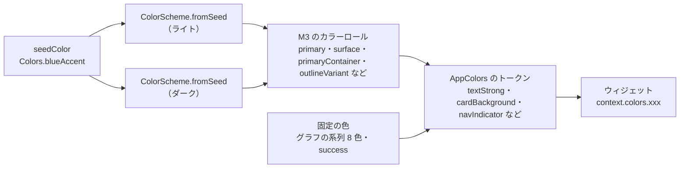

# デザインシステムとスタイル

> 色・文字・形・余白・部品の決まりと、それをどこに書くか。CSS・ライブラリを何に使っているかは [ライブラリとスタイリング](libraries-and-styling.md)。Flutter には CSS がないので、**`lib/theme/` と `lib/constants/` が CSS（スタイルシート）の役割**をする。画面の構成や操作の流れは [UI / UX](ui-ux.md)、表示の速さは [パフォーマンス](performance.md)。
> 2026-11-06 時点のコードから書き起こした。値を変えたら、ここも直す。

---

## 1. 原則

- **Material 3（M3）に合わせる**。色・文字・形・部品は M3 の仕組みと標準の部品を使い、独自の見た目は最小限にする。
- **1 つのブランド色から全体を作る**。ライト / ダークとも、ブランド色（seed）から M3 の ColorScheme を作り、各所の色はそこから割り当てる。
- **見た目の値はウィジェットに直接書かない**。色・文字・角丸・余白・文言・ブレークポイントは、決まった場所（4 章）にまとめ、ウィジェットからは名前で参照する。
- **ライトとダークを同時に作る**。色を足すときは、両方の値を必ず入れる。

## 2. CSS との対応

Web の CSS に慣れた人向けに、同じ役割のものを並べる。

| CSS でいうと | このプロジェクト | 例 |
|---|---|---|
| カスタムプロパティ（`--color-primary`） | `AppColors` のトークン（`context.colors.primary`） | `context.colors.textSecondary` |
| `:root` と `@media (prefers-color-scheme: dark)` | `AppColors.light` / `AppColors.dark`（`ThemeController` で切替） | ヘッダーの ☀️ / 🌙 |
| クラス（`.card`・`.tag`） | `AppStyles` の関数（`AppStyles.card(context)`・`AppStyles.skillTag(context)`） | 何度も使う見た目をまとめる |
| フォントの指定・`font-size` の段階 | M3 のタイプスケール（`Theme.of(context).textTheme`）＋ `AppStyles` | `AppStyles.title`・`AppStyles.body` |
| `border-radius` の段階 | `AppStyles.radiusSm`〜`radiusFull` | 角丸 4 / 8 / 12 / 16 / 28 / 全円 |
| `margin` / `padding` / `gap` の段階 | `AppSizes.space2`〜`space48` | 余白 |
| `@media (min-width: …)` | `sections/config/*_config.dart` のブレークポイント＋ `LayoutBuilder` | 600px でヘッダーを切り替える |
| `transition` の時間 | `AppSizes` の `Duration` | スクロール 500ms |
| 文言（HTML の中の文字） | `AppTexts`（`lib/constants/app_texts.dart`） | ボタンの名前・エラー |

## 3. デザイントークン

### 3.1 色（`lib/theme/app_colors.dart`）

- **ブランド色**：`AppColors.seedColor = Colors.blueAccent`。変えるとライト・ダークの全体が追従する（起動時のローディングの色だけは `web/index.html` に近い値を直接書いているので、一緒に直す）。
- **トークンの分類**（名前は役割で付ける。色の名前では付けない）

| 分類 | 主なトークン | 使う場所 |
|---|---|---|
| 基本 | `scheme`・`scaffoldBackground`・`primary`・`accent`・`success`・`error` | テーマ全体、強調、成功・失敗 |
| 文字 | `textStrong`（見出し）・`textPrimary`（本文）・`textSecondary`（説明・期間・%）・`textTertiary`（補足）・`textSoft` | 文字の濃さを 5 段階で使い分ける |
| ヘッダー・メニュー | `headerBackground`・`headerForeground`・`navIndicator`・`navSelectedForeground`・`headerDivider`・`drawerHeader*` | トップアプリバー、ナビの選択中、スマホのメニュー |
| ダイアログ | `dialogBackground`・`codeBackground`・`codeBorder` | アップロード画面、書き方の説明のサンプル |
| セクション | `heroBackground`・`aboutBackground`・`projectsBackground`・`aboutDivider`・`aboutAccent`・`hero*Button*` | セクションごとの背景と、Home のボタン |
| カード | `cardBackground` ほか | List・Skills・Collection のカード |
| グラフ | `chartSeries`（8 色。`seriesColor(i)` で順に使う）・`chartTrack`・`chartHighlight` | 棒 / 円グラフの系列・下地・選択中の枠 |
| ページ送り | `paginationIcon`・`paginationInactiveText` | ‹ › と番号 |

- **グラフの系列色**：M3 にグラフ用のロールがないため、見分けやすいアクセント色を固定で使う（青・オレンジ・緑・紫・赤・ティール・黄・ピンクの順。9 件目からは繰り返し）。上位 10 件より多い分は「その他」にまとめるので、同じ色が隣り合うのは 9 件目以降だけ。

### 3.2 文字（タイポグラフィ）

- 土台は **M3 のタイプスケール**（`display` / `headline` / `title` / `body` / `label` の各 Large / Medium / Small）。フォントは指定していない（Flutter の既定の Roboto）。Flutter Web は、Roboto と、足りない文字（日本語など）の代わりのフォント（Noto）を、実行中に Google Fonts から取り寄せて描く（表示の速さへの影響は [パフォーマンス](performance.md#5-課題と改善案)）。
- `AppStyles` で、タイプスケールに**色と太さだけ**を足して使う。大きさを変えるのは、Home の名前など一部だけ（`sections/config/` の値）。

| 用途 | AppStyles | 土台 |
|---|---|---|
| 見出し・セクション名 | `title`・`aboutHeading`・`cardTitle`・`dialogTitle` | headline / title |
| 本文・説明 | `body`・`aboutDescription`・`cardDescription`・`helpBody`・`dialogBody` | body |
| 補足・期間・% | `secondary`・`tertiary`・`cardMeta`・`chartValue` | body / label |
| Home | `heroName`（display）・`heroRole`・`heroTagline` | display / title / body |
| タグ・バッジ | `skillTagText`・`countBadgeText`・`segmentCount` | label |
| コード（YAML のサンプル） | `codeText` | body（等幅） |
| 状態 | `dialogSuccess`・`dialogError`・`helpEmphasis` | body ＋ success / error の色 |

- PDF（スキルシート）は別で、同梱の **IPA P ゴシック**（`assets/fonts/ipagp.ttf`）を埋め込む。

### 3.3 形（角丸）

| 名前 | 値 | 主な使い道 |
|---|---|---|
| `radiusSm` | 4 | ツールチップ（M3 の Extra small）、進行中の札 |
| `radiusMd` | 8 | 技術のタグ、適用中の条件、工程、詳細のチップ、期間の枠 |
| `radiusLg` | 12 | カード（Skills など）、List の面とカード、コードブロック |
| `radiusXl` | 16 | Home のまとめ、フィルターのパネル、Collection のカード |
| `radiusXxl` | 28 | 案件の詳細のダイアログ（M3 の Extra large） |
| `radiusFull` | 999 | 件数のバッジ、Collection のカバーの札（ボタン・チップは M3 の既定の形） |

### 3.4 余白（スペーシング）

`AppSizes.space2 / 4 / 6 / 8 / 10 / 12 / 14 / 16 / 20 / 24 / 36 / 40 / 48`。4 の倍数を基本にし、細かい調整にだけ 2・6・10・14 を使う。セクション固有のまとまった値（カードの幅・グラフの半径など）は `sections/config/**/*_config.dart` に置く。

### 3.5 動き（時間）

| 名前 | 値 | 使う場所 |
|---|---|---|
| `scrollDuration` | 500ms | ナビで各セクションへスクロール |
| `revealFadeDuration` | 200ms | 重い描画のあとのフェード表示 |
| `filterPaddingDuration` | 150ms | フィルターの余白の変化 |

待ち時間（ローディングの最低表示時間など）は [パフォーマンス](performance.md#3-待ち時間の設計)。

## 4. スタイルを書く場所

| 書くもの | 場所 | してはいけないこと |
|---|---|---|
| 色 | `lib/theme/app_colors.dart`（`AppColors.light` / `dark`） | `Colors.xxx` / `Color(...)` を `lib/theme/` の外に書く |
| テーマ・切替 | `lib/theme/app_theme.dart`（`ThemeController`・`context.colors`・`context.isDark`） | `isDark` を引数でウィジェットに渡して回す |
| 何度も使う見た目 | `lib/theme/app_styles.dart` | 同じ `TextStyle` / `BoxDecoration` を複数のウィジェットに書く |
| 文言 | `lib/constants/app_texts.dart` | ウィジェットに日本語を直接書く |
| 余白・時間・汎用の大きさ | `lib/constants/app_sizes.dart` | 数値を直接書く（ページ計算の 0 / 1、% の 100 などのロジックの数は除く） |
| セクション固有のレイアウト | `lib/sections/config/**/*_config.dart` | ここに色や文言を置く |

詳しい規約（AI 向け）は [docs/claude/conventions.md](claude/conventions.md)。

## 5. 部品（コンポーネント）

M3 の標準の部品を使う。同じ役割には同じ部品を使い、見た目をそろえる。

| 役割 | 部品 | このプロジェクトでの入口 |
|---|---|---|
| 切替（2〜3 択） | SegmentedButton | `AppSegment`（Work / Private、棒 / 円、リスト / コレクション、入力方法） |
| 主な操作 | FilledButton / FilledButton.tonal | アップロード、反映、［データ］・［ダウンロード］（tonal） |
| 補助の操作 | OutlinedButton / TextButton | キャンセル、テンプレートの保存、戻る |
| 選ぶ（複数） | FilterChip | フィルターの技術・工程、タグの候補 |
| 選んでいる条件 | InputChip | 適用中のフィルター（× で外す） |
| 件数 | Badge | フィルターの適用数、入力した技術の数 |
| ナビ（スマホ） | NavigationDrawer | ヘッダーのメニュー |
| ポップアップ | Dialog（幅 600 以上）/ ボトムシート（未満） | `showAppFilterModal` |
| 全画面の詳細 | Full-screen dialog | 詳細（幅 1024 未満） |
| 読み込み中 | CircularProgressIndicator（2024 年版の見た目） | `AppLoadingIndicator` |
| 知らせ | SnackBar | 保存した・アップロードした・失敗した |

使わないもの：`ElevatedButton`（M3 では影で目立たせる場面が少ない）、M3 Expressive の形が変わる Loading indicator。

## 6. ダークモード

- `ThemeController.instance.toggle(bool)` で切り替え、`main.dart` が MaterialApp を作り直す（切替はアニメーションする）。
- 選んだテーマは保存しない（開き直すとライト）。OS の設定（`prefers-color-scheme`）にも合わせていない → [UI / UX の課題](ui-ux.md#8-課題)。
- ダークは同じ seed から作るので、トークンの名前は共通。ダークだけ控えめにしたい文字は `textSoft` を使う。

## 7. 変えるときの手順

| 変えたいこと | 手順 |
|---|---|
| ブランド色 | `AppColors.seedColor` を変える → `web/index.html` のローディングの色を近い値に → ライト / ダークで見た目を確かめる |
| 新しい色 | `AppColors` にフィールドを足し、light と dark の両方に値を入れる（M3 のロールから選ぶ） |
| 新しい見た目のまとまり | `AppStyles` に関数を足す（色は `context.colors`、文字は textTheme から） |
| 文字の大きさ | まず M3 のタイプスケールの別の段を使えないか考える。だめなら `sections/config/` に値を置く |
| ブレークポイント | `sections/config/` の値を変え、`home_page_test` の幅の組み合わせで崩れないか確かめる |
