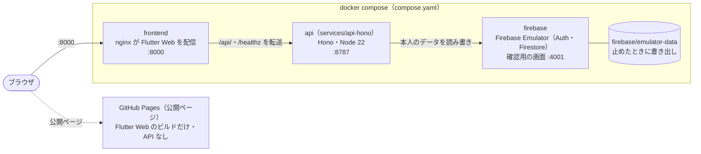
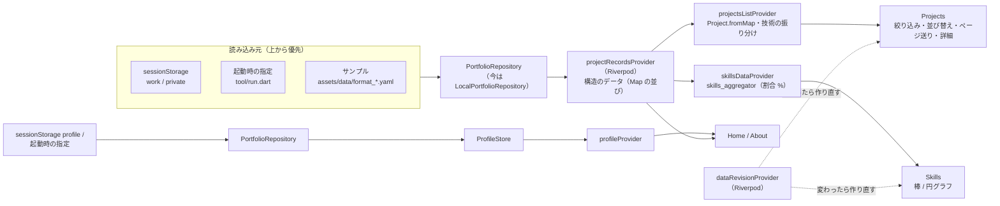
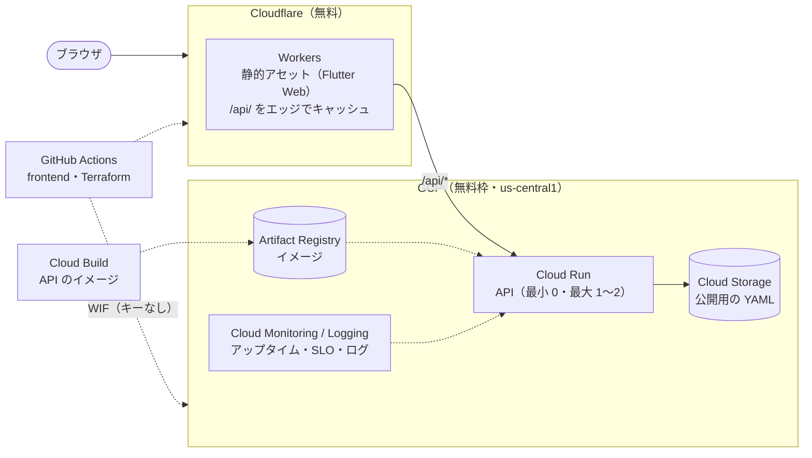

# 設計

> システムの構成、データの流れ、API（services/api-hono）、使っている技術、現状の課題と今後の計画。
> プロジェクトの紹介は [README](../README.md)。

## 構成

- **frontend**（`frontend/`）：画面のすべて。表示するデータは、リポジトリのサンプル（`assets/data/`）か、画面から読み込んだもの（ブラウザの sessionStorage）。Excel / PDF の作成もブラウザの中で行い、サーバーには何も送りません。
- **api**（`services/api-hono/`）：マイページの API（Hono・TypeScript）。プロフィール・スキル・職務経歴・表示設定・編集中のデータを、Firebase の ID トークンで本人を確かめてから Firestore（ローカルでは Emulator）に読み書きする。2026-11-06 に前の backend（Dart の shelf）を置き換えた。画面からはまだ呼んでいない（段階 5）。
- **データの流れ**（frontend）

---

## API（services/api-hono）

| メソッド・パス | ログイン | 中身 |
|---|---|---|
| `GET /healthz` | いらない | `{"status":"ok"}`（キャッシュしない） |
| `GET /api/public/:slug` | いらない | 公開ページのデータ（`publicPages/{slug}`）。CDN で 60 秒キャッシュ |
| `GET / PUT /api/me/draft` | 要る | 編集中のデータ全体。PUT は `{ data, updatedAt }`（読んだときの updatedAt と違えば 409） |
| `GET / PUT /api/me/profile`・`/skills`・`/display` | 要る | プロフィール・スキル・表示設定を置き換え |
| `GET / POST /api/me/projects`、`PUT / DELETE /api/me/projects/:id` | 要る | 職務経歴の一覧・追加（201）・置き換え・削除（204） |

- エラーは `{"error": {"code", "message", "details"?}}`：`unauthorized`（401）・`invalid_request`（400。`details` に入力の誤りの一覧）・`not_found`（404）・`conflict` / `duplicate_id`（409）・`internal`（500）
- ログイン：`Authorization: Bearer <Firebase の ID トークン>`。本物は Google の公開鍵で RS256 の署名を確かめ、Emulator は中身（宛先・発行元・期限・発行時刻・利用者）だけを確かめる
- 本人のデータだけ：読み書きする文書のパスは、確かめたトークンの uid から作る（`users/{uid}/drafts/current`）
- 書く前に形を確かめる（[データ設計](plan/data-model.md#2-項目と型) の 2.）。同時に変えたときは 409、まとまりごとの保存は読み直して 3 回までやり直す
- Firestore は REST で読み書きする（Admin SDK を使わないので Node・Cloudflare Workers のどちらでも動く）

| 環境変数 | 既定 | 内容 |
|---|---|---|
| `PORT` | `8787` | 待ち受けるポート（Cloud Run が自動で渡す） |
| `FIREBASE_PROJECT` | `demo-dev-portfolio` | プロジェクト（`demo-` は Emulator だけ） |
| `FIRESTORE_EMULATOR_HOST`・`FIREBASE_AUTH_EMULATOR_HOST` | なし | あれば Emulator につなぐ |
| `ALLOWED_ORIGIN` | なし | ブラウザから直接呼ぶときに許す Origin |

詳しくは [services/api-hono/README.md](../services/api-hono/README.md)。

---

## 技術スタック

| 分野 | 使っているもの |
|---|---|
| 画面 | **Flutter Web / Dart**（Dart SDK ^3.9.2、Material 3） |
| グラフ | [fl_chart](https://pub.dev/packages/fl_chart) |
| データ | [yaml](https://pub.dev/packages/yaml)（読み込み）、[archive](https://pub.dev/packages/archive) / [xml](https://pub.dev/packages/xml)（Excel .xlsx の読み書き）、[pdf](https://pub.dev/packages/pdf)（PDF の出力） |
| ブラウザ | [web](https://pub.dev/packages/web)（sessionStorage・ファイルの保存）、[file_picker](https://pub.dev/packages/file_picker)（ファイルの選択）、[url_launcher](https://pub.dev/packages/url_launcher)（公開ページへのリンク） |
| API | **TypeScript**・[Hono](https://hono.dev/) 4・Node 22（型を外してそのまま動かす）。Firestore・Firebase Auth は REST と Web Crypto（Admin SDK なし） |
| 実行環境 | **Docker / Docker Compose**（frontend は nginx、api は node:22-bookworm-slim、Firebase Emulator は Node 22 ＋ Java 21） |
| テスト | flutter_test、Node の標準のテスト（`node --test`。api・seed）、網羅率は `flutter test --coverage --branch-coverage` と `tool/coverage_check.dart` |
| CI / 公開 | **GitHub Actions**、**GitHub Pages** |

> ブラウザの機能（`package:web`：sessionStorage・ファイルの保存）を使っているため、frontend は **Web 専用**です（テストは VM で動きます）。

---

## 現状と課題

**現状**（2026-11-06）：リポジトリを `frontend/`（Flutter）と API に分け、Docker Compose で起動できるようにしました（API は同じ日に Dart の shelf から `services/api-hono/` の Hono に置き換え）。テストは正常系・異常系の両方を書き、網羅率は行 96.2%・分岐 90.4%（基準 90%）です。テストを足す中で見つけた不具合（円グラフの扇を押しても選べない、並び替えが毎回揺れる、スマホ幅のはみ出し、ページ送りの › が画面の外に出る）は直しました。ブラウザ・スマホでの見た目と操作は、引き続き実機での確認が必要です。

課題と今後の改善候補です（詳細は [docs/claude/status.md](claude/status.md)）。

**優先度 高**
- **画面での動作確認**：最近の変更は、実機（PC・タブレット・スマホ）での見た目と操作の確認がまだです
- **ローカルでビルドするとプロフィールが入る**：`assets/profile/profile.yaml` が残っていると `flutter build web` の成果物に含まれます（表示はしません）。Docker のビルドでは除いていますが、`flutter build web` を直接使うときは消してください
- **Work / Private の検証が浅い**：`projects` と `title`・`workflow` の有無しか確かめていないため、項目の型が違うと表示が崩れる可能性があります

**優先度 中**
- **期間で絞り込むと、期間を書いていない案件が必ず残る**
- **文字列の分割処理が複数ある**：値を文字で書くと、Skills のグラフでは空白でも区切られます（Projects のフィルターはカンマだけ）
- **Projects のページを切り替えても一覧の先頭に戻らない**
- **スマホでのグラフ操作**：棒グラフの強調表示はマウスを乗せたときだけで、タップには反応しません
- **Android で Google Drive のファイルを選べないことがある**：テキストの貼り付けで回避できます
- **frontend がまだ API を呼ばない**、**デプロイがテストの結果を待たない**
- **プロフィール YAML を書き換えたら起動し直しが必要**（`tool/run.dart` は起動時に 1 回読むだけ）

**優先度 低（仕様・整理）**
- **公開ページでは入力画面が出る**：プロフィールは各自がローカルで読み込む前提です
- **データはタブを閉じると消える**：アップロードした内容は sessionStorage にだけ保存しています
- **Web 専用**：ブラウザの機能（`package:web` / `dart:js_interop`）を使うため、Web 以外ではビルドできません
- **使っていない定数・依存パッケージが残っている**（`shared_preferences` など）
- **技術名の振り分け・グループ分けは名前からの推測**：一覧にない名前は、名前に含まれる言葉で推測し、わからなければ「その他」になります。合わないものは `lib/utils/tech_catalog.dart` の一覧に足してください

---

## 今後

目標の本番構成（費用ゼロ。まだ作っていない）：

- **frontend から API を読む**：Repository 層（`lib/data/`。構造のデータで受け渡す）・Riverpod（`lib/state/`。画面はすべて Provider から読む）・go_router（`lib/router/`）は入れた（2026-11-06）。次は API の Repository（構造のデータの 5 つ）を足し、読み先（サンプル・sessionStorage・API）を切り替える（画面は変えない）
- **費用をかけない本番構成**：配信は Cloudflare（Workers の静的アセット。`/api/` を Cloud Run へ転送してエッジでキャッシュ）、API は GCP の無料枠（Cloud Run・Artifact Registry・Cloud Storage、us-central1）
- **IaC と CI/CD**：Terraform（google / cloudflare プロバイダ、state は GCS、GitHub Actions からは Workload Identity Federation）、frontend と IaC は GitHub Actions、API のイメージは Cloud Build
- **監視**：Cloud Monitoring のアップタイムチェックと SLO（可用性・レイテンシ）のバーンレートアラート、構造化ログ（api は対応済み）、予算のアラート

テスト・CI を含めた進める順番は [今後の動き](roadmap.md)。
