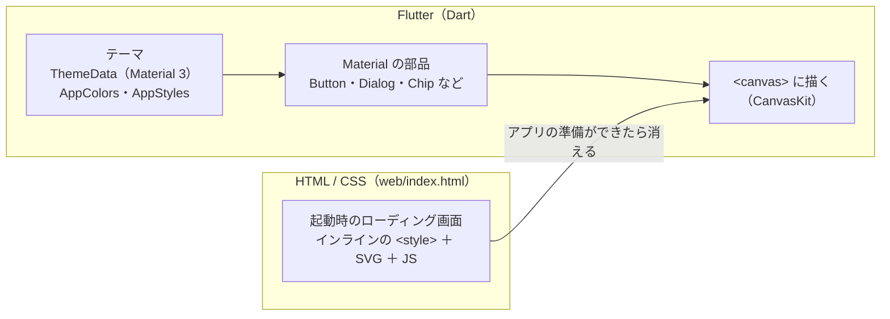

# ライブラリとスタイリング（CSS）

> CSS・CSS フレームワークを使っているか、見た目を何で作っているか、どのライブラリを・どの画面の・どこで・どう使っているか。色や文字の決まりは [デザインシステム](design-system.md)、画面の項目は [画面仕様書](screens/README.md)（画面 ID はそちらと同じ）。
> 2026-11-06 時点。版は `pubspec.lock`（frontend）・`backend/pubspec.lock` のとおり。

---

## 1. 結論：CSS フレームワークは使っていない

| 問い | 答え |
|---|---|
| CSS は使っているか | **起動時のローディング画面（`frontend/web/index.html`）だけ**。アプリの画面には CSS を使っていない |
| CSS フレームワーク（Tailwind・Bootstrap など）は | **使っていない** |
| では見た目は何で作っているか | **Flutter の Material（Material 3）**。Flutter SDK に含まれる UI フレームワークで、ボタン・ダイアログ・チップなどの部品と、テーマ（色・文字・形）の仕組みを持つ |
| アイコンは | **Material Icons**（Flutter に含まれるアイコンフォント。`pubspec.yaml` の `uses-material-design: true`）。`Icons.xxx` を 111 か所で使う |
| フォントは | 指定していない（Flutter の既定の Roboto。日本語など足りない文字は、実行中に Google Fonts から取り寄せる）。PDF だけ同梱の IPA P ゴシック |

### なぜ CSS を使わないのか

Flutter Web は、画面を HTML の要素と CSS で組み立てるのではなく、**自分で `<canvas>` に描く**（CanvasKit）。そのため、ブラウザの CSS はアプリの部品には効かない。見た目は Dart のコードで、Flutter のテーマと部品に指定する。

### CSS フレームワークと、このプロジェクトの対応

| CSS フレームワークの役割 | Tailwind / Bootstrap では | このプロジェクトでは |
|---|---|---|
| 部品（ボタン・ダイアログ・チップ） | `.btn`・`.modal` など | Flutter Material の部品（`FilledButton`・`AlertDialog`・`FilterChip` など） |
| デザイントークン（色・余白・角丸） | `tailwind.config` の theme | `AppColors`（色）・`AppSizes`（余白・時間）・`AppStyles`（角丸・文字・装飾） |
| ユーティリティ（その場の見た目） | `class="p-4 rounded-lg"` | 使わない。見た目は `AppStyles` の名前付きのスタイルにまとめる |
| レスポンシブ | `md:` などのブレークポイント | `LayoutBuilder` と `sections/config/*_config.dart` のブレークポイント |
| ダークモード | `dark:` | `AppColors.light` / `AppColors.dark` と `themeModeProvider`（Riverpod） |
| グリッド・並べ方 | `grid`・`flex` | `Row`・`Column`・`Wrap`・`Stack`（Flutter の部品） |

詳しくは [デザインシステム](design-system.md#2-css-との対応)。

## 2. CSS を使っている場所（web/index.html）

| 対象 | 中身 |
|---|---|
| 書き方 | `<head>` の中のインラインの `<style>`（外部の CSS ファイル・CSS フレームワークはなし） |
| 色 | CSS カスタムプロパティ `--m3-primary`・`--m3-secondary-container`・`--m3-surface`・`--m3-on-surface-variant`。値は Flutter 側の seed（`Colors.blueAccent`）から M3 が作る色の近似値を**手で書いている** |
| ダークモード | `@media (prefers-color-scheme: dark)` で、OS の設定に合わせて暗い色にする |
| レイアウト | `#app-loading` を `position: fixed; inset: 0` で画面全体に、`display: flex` で中央に置く |
| 動き | 消えるときに `transition: opacity 300ms ease-out`。円の回転は CSS アニメーションではなく、JS（`requestAnimationFrame`）で SVG の path を描き直す |
| 文字 | `font: 500 14px/20px system-ui, -apple-system, "Segoe UI", "Hiragino Sans", "Noto Sans JP", sans-serif`（OS のフォント） |

**注意**：ローディング画面は OS のダークモードに合わせて暗くなるが、アプリ本体は OS の設定に合わせず、いつもライトで始まる。ダークモードの端末では、暗いローディングのあとに明るいアプリに切り替わる（[UI / UX の課題](ui-ux.md#8-課題)）。

## 3. ライブラリの一覧

### frontend（`frontend/pubspec.yaml`）

| ライブラリ | 版 | 種類 | 何に使うか | 使っているファイル | 使っている画面 |
|---|---|---|---|---|---|
| **flutter**（material・widgets・services） | Flutter 3.41.6 | UI フレームワーク（SDK） | 画面の部品・テーマ・レイアウト・アニメーション・キーボード・クリップボード | `lib/` のほぼすべて | すべて |
| **fl_chart** | 1.2.0 | グラフ | **円グラフだけ**（棒グラフは自作） | `sections/skills/charts/pie_chart/pie_graph.dart` | SEC-03 Skills |
| **yaml** | 3.1.3 | データ | YAML の読み込み（プロフィール・Work / Private・検証・違いの判定） | `utils/*_yaml_loader.dart`・`data_format.dart`・`models/profile.dart` ほか 14 ファイル | すべて（データの読み込み） |
| **file_picker** | 8.3.7 | ブラウザの機能 | ファイル選択のダイアログ | `utils/file_pick.dart`（ここ 1 か所だけ。ほかは `pickFile` を使う） | DLG-01・DLG-03・DLG-07 |
| **url_launcher** | 6.3.2 | ブラウザの機能 | ［公開ページを見る］で新しいタブを開く | `sections/projects/views/project_list/project_list_modal_function.dart` | MDL-01 案件の詳細 |
| **web** | 1.1.1 | ブラウザの機能 | sessionStorage、イベントの送信、名前を付けて保存（`showSaveFilePicker`）、ダウンロード、ブラウザの拡大のキーを止める | `utils/browser/browser_web.dart`・`utils/file_saver_web.dart`（Web 専用。テストでは `*_stub.dart`） | すべて（保存）、MNU-01、MDL-01 |
| **archive** | 4.0.9 | ファイル | Excel（.xlsx は zip）を開く・書き直す | `utils/xlsx_reader.dart`・`skill_sheet_writer.dart`・`xlsx_layout.dart` | DLG-01（Excel の読み込み）・MNU-01 |
| **xml** | 6.6.1 | ファイル | Excel の中の XML を読む・書く | 同上 | 同上 |
| **pdf** | 3.12.0 | ファイル | スキルシートの PDF を作る（IPA P ゴシックを埋め込む） | `utils/skill_sheet_pdf.dart` | MNU-01 |
| **flutter_riverpod** | 3.3.2（`^3.0.0`） | 状態管理 | アプリ全体の状態（テーマ・Repository・データが変わった回数・プロフィール・Work / Private・Skills の集計・Projects の一覧）。`ProviderScope` は `main.dart` | `lib/state/providers.dart`・`main.dart`・`pages/home_page.dart`・`sections/{hero,about}_section.dart`・`skills_section.dart`・`projects_section.dart`・`header/header_parts.dart` | SCR-01 |
| **go_router** | 17.5.0（`>=16.0.0 <19.0.0`。18 は Flutter 3.44 以上が必要） | 画面の URL | URL と画面の対応（`/`、`ENABLE_ACCOUNT` のときだけ `/login`・`/me`・`/me/edit` の空の画面。`#` 付きの URL のまま）。ない URL は `/` へ | `lib/router/app_router.dart`・`pages/placeholder_page.dart`・`main.dart` | SCR-01・（準備中の画面） |
| image | 4.10.2 | （間接） | コードからは使っていない。pdf が使う画像ライブラリの版をそろえるために指定（`>=4.2.0 <4.11.0`） | ― | ― |
| cupertino_icons | 1.0.9 | アイコン | **使っていない**（Flutter のひな形のまま残っている） | ― | ― |
| shared_preferences | 2.5.5 | 保存 | **使っていない** | ― | ― |
| flutter_test | SDK | テスト | ウィジェット・単体のテスト | `test/` | ― |
| flutter_lints | 5.0.0 | 静的解析 | 解析のルール | `analysis_options.yaml` | ― |

### backend（`backend/pubspec.yaml`）

| ライブラリ | 版 | 何に使うか |
|---|---|---|
| shelf | 1.4.3 | HTTP サーバー、ミドルウェア（ログ・CORS）、応答 |
| shelf_router | 1.1.5 | ルーティング（`/healthz`・`/api/profile`・`/api/projects/<type>`） |
| yaml | 3.1.4 | `data/*.yaml` の読み込み |
| test | 1.33.0 | テスト |
| lints | 5.1.1 | 静的解析のルール |

### 実行環境・ツール

| もの | 版 | 何に使うか |
|---|---|---|
| nginx | 1.27-alpine | Docker で Flutter Web を配信し、`/api/` を backend へ転送（gzip・キャッシュの設定） |
| Dart（backend のイメージ） | 3.11 → scratch | `dart compile exe` の実行ファイルを最小のイメージで動かす |
| Flutter（frontend のイメージ） | ghcr.io/cirruslabs/flutter:3.41.6 | Docker の中で `flutter build web` |
| GitHub Actions | actions/checkout@v4・subosito/flutter-action@v2・dart-lang/setup-dart@v1・actions/upload-artifact@v4・actions/upload-pages-artifact@v3・actions/deploy-pages@v4 | CI とデプロイ |
| Mermaid | GitHub の表示 | ドキュメントの図 |

## 4. 画面ごとの使い方

画面 ID は [画面仕様書](screens/README.md#1-画面の一覧)と同じ。「Material」は Flutter の Material の部品、「自作」は Flutter の基本の部品（`Container`・`Stack` など）と `AppStyles` で作ったもの。

### メイン画面

| 画面 | 場所 | 使っているもの | どう使っているか |
|---|---|---|---|
| SCR-01 メイン画面 | 全体 | Material：`Scaffold`・`SingleChildScrollView` | 1 枚のページを縦に 1 本だけスクロール |
| SCR-01-H ヘッダー（PC） | バー | 自作（`Material` の面）＋ Material：`IconButton`・`Tooltip` | M3 の Small top app bar の見た目を自作。ナビの丸いインジケーターも自作 |
| | ［データ］ | Material：`FilledButton.tonalIcon` / `IconButton.filledTonal` | 幅 1100 以上は文字付き、未満はアイコンだけ |
| | テーマの切替 | Material：`Switch`（☀️ / 🌙 のアイコン付き） | |
| SCR-01-H ヘッダー（スマホ） | バー | Material：`AppBar`・`IconButton` | |
| | メニュー | Material：`NavigationDrawer`・`NavigationDrawerDestination` | 今見ているセクションを選択中に |
| SEC-01 Home | ボタン | Material：`FilledButton`（スキルを見る）・`OutlinedButton`（プロジェクトを見る） | |
| | まとめのカード | Material：`Material`＋`InkWell`（押せる面）、`Tooltip` | 形は `AppStyles.heroSummaryShape` |
| | 並べ方 | Flutter：`LayoutBuilder`・`Wrap`・`IntrinsicHeight` | 幅 720 で横 3 つ / 縦 |
| SEC-02 About | タグ・行 | 自作（`Container`＋`AppStyles.skillTag`）、Flutter：`Wrap`・`LayoutBuilder`・`IntrinsicHeight` | 締めの一言の縦線も自作 |
| SEC-03 Skills | Work / Private・棒 / 円 | Material：`SegmentedButton`（`AppSegment`） | |
| | ［カテゴリ］ | Material：`OutlinedButton.icon` | |
| | **円グラフ** | **fl_chart：`PieChart`** | 扇の色・太さ・選択中の枠を `PieChartSectionData` で指定。押す・マウスを乗せるは `PieTouchData` |
| | **棒グラフ** | **自作**：`Stack`＋`FractionallySizedBox`（割合の幅）＋`MouseRegion`（強調） | fl_chart は使っていない |
| | 凡例 | 自作：`MouseRegion`・`GestureDetector` | |
| POP-01 カテゴリの選択 | 開き方 | Material：`Dialog`（幅 600 以上）/ `showModalBottomSheet`（未満） | `showAppFilterModal` |
| | 選ぶ | Material：`FilterChip`（`FilterChipsSection`）・`TextButton`・`FilledButton` | |
| SEC-04 Projects | Work / Private・リスト / コレクション | Material：`SegmentedButton`（件数付き） | |
| | ［フィルター］ | Material：`OutlinedButton.icon`＋自作の件数の札（`AppStyles.countBadge`） | Material の `Badge` は使っていない |
| | ［並び］ | Material：`MenuAnchor`・`MenuItemButton` | |
| | 適用中の条件 | Material：`InputChip`（× で外す） | |
| | 一覧のカード | Material：`Material`＋`InkWell`、自作（年表の縦線・点、カバーの色） | カバーの色は案件名から決める（`projectColorSeed`） |
| | ページ送り | Material：`IconButton`（‹ ›）・`FilledButton`（今のページ）・`TextButton`（ほかのページ） | 番号は丸い 40px（`tapTargetSize: shrinkWrap`） |
| POP-02 フィルター | 期間 | Material：`RangeSlider` | |
| | 進行中のみ・技術・工程 | Material：`FilterChip` | |
| MDL-01 案件の詳細 | 開き方 | Material：`showDialog`（PC はダイアログ、未満は全画面の形） | |
| | ボタン | Material：`IconButton`・`IconButton.filledTonal`・`TextButton.icon`・`FilledButton` | |
| | キー操作 | Flutter：`CallbackShortcuts`・`Focus` | ブラウザの拡大のキーは `web` で止める |
| | 公開ページ | **url_launcher** | `canLaunchUrl` → `launchUrl`（新しいタブ） |
| | 読み上げ | Flutter：`Semantics` | 期間・工程を文章で読み上げる |

### ダイアログ

| 画面 | 場所 | 使っているもの | どう使っているか |
|---|---|---|---|
| DLG-01 入力画面 | 全体 | Material：`AlertDialog`、Flutter：`PopScope`（戻るで閉じない） | |
| | 入力方法 | Material：`SegmentedButton`（`FittedBox` で縮める） | |
| | ボタン | Material：`TextButton.icon`・`OutlinedButton.icon`・`FilledButton.icon` | |
| | ファイル | **file_picker**（`pickFile` 経由） | |
| | Excel の読み込み | **archive**・**xml**・**yaml** | zip を開き、シートの XML を読んで YAML を作る |
| | 保存 | **web**（`showSaveFilePicker`・ダウンロード） | テンプレート・作った YAML |
| | 次回の起動方法 | Material：`SelectableText` | |
| DLG-03 ［データ］ | 選択肢 | Material：`ListTile`・`CheckboxListTile` | |
| DLG-04 入力フォーム | 入力欄 | Material：`TextFormField`・`CheckboxListTile`（進行中）・`FilterChip`（工程） | |
| DLG-05 年月の選択 | 全体 | 自作（M3 の日付選択の見た目）＋ Material：`TextButton`・`IconButton` | |
| DLG-06 技術の入力 | 入力欄 | 自作の `TagInputField`（`TextField`＋`InputChip`＋候補の `ActionChip`）、Material：`FilterChip`（すでにある項目） | Flutter の `RawAutocomplete` は使わない（候補が出なくなるため） |
| DLG-07 アップロード画面 | 全体 | Material：`AlertDialog`・`SegmentedButton`・`TextButton.icon`・`FilledButton` | 部品は `widgets/upload_parts.dart` |
| DLG-09 貼り付け | 入力欄 | Material：`TextField` | クリップボードは Flutter の `services` |
| DLG-10〜12 確認 | 全体 | Material：`AlertDialog`・`Divider`・`CheckboxListTile`（DLG-12） | |
| MNU-01 ［ダウンロード］ | メニュー | Material：`MenuAnchor`・`MenuItemButton` | |
| | Excel / PDF | **archive**・**xml**（Excel）、**pdf**（PDF） | テンプレートの zip を書き直す／Excel の見た目を読んで A4 に描く |
| | 保存 | **web**（`showSaveFilePicker`、なければダウンロード） | |
| OVL-01 全画面ローディング | 表示 | Material：`CircularProgressIndicator`（`AppLoadingIndicator`。2024 年版の見た目）、Flutter：`AnimatedOpacity` | |
| 結果の知らせ | 画面の下 | Material：`SnackBar` | |
| 起動時のローディング | 全体 | **HTML・CSS・SVG・JS**（`web/index.html`） | 2 章 |

## 5. 整理したいこと

| 内容 | 案 |
|---|---|
| 使っていないライブラリ（cupertino_icons・shared_preferences） | `pubspec.yaml` から外す（`pubspec.lock` も更新） |
| ローディング画面の色を手で書いている | seed を変えたら、`web/index.html` の 4 色も直す（自動ではそろわない） |
| ローディング画面だけ OS のダークモードに合わせる | アプリも OS の設定を初期値にするか、ローディング画面をライトに固定してそろえる |
| フォントを指定していない | 日本語フォントを同梱して指定するか検討（[パフォーマンス](performance.md#5-課題と改善案)） |
