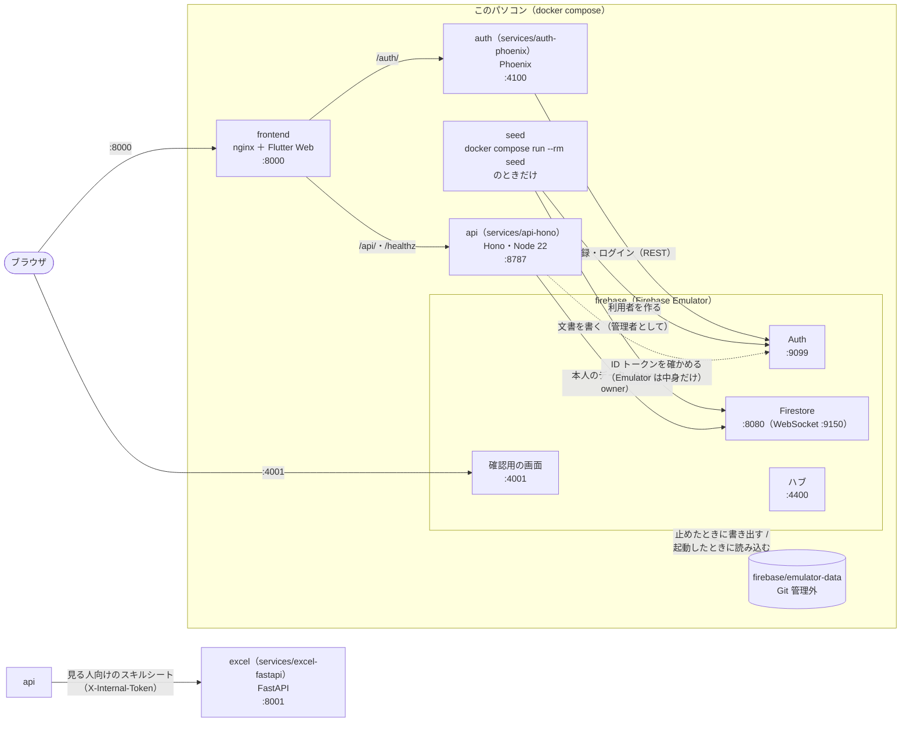
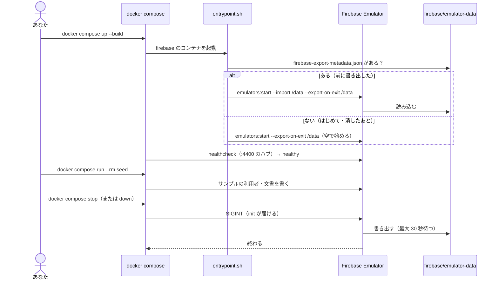

# ローカルのクラウド（Firebase Emulator と compose）

> 次の構成（[計画](plan/README.md)）の段階 2。本物のクラウドの代わりに、手元の Docker だけで Firebase（Auth・Firestore）を動かす。構成・ポート・起動から止めるまでの流れ・データの残り方・サンプル・つなぎ先・よくある失敗。
> 2026-11-06 時点。起動の仕方の要約は [開発ガイド](development.md#dockerfrontend--api--firebase-emulator)、Emulator のファイルの説明は [firebase/README.md](../firebase/README.md)。

---

## 1. 目的と決まり

| 決まり | 理由 |
|---|---|
| **費用はかからない・カードもいらない** | Emulator は手元のコンテナの中だけで動く。本物の Firebase のプロジェクトは作らない |
| **本物の Firebase にはつながらない** | プロジェクトの名前を `demo-dev-portfolio` にしている。`demo-` で始まる名前は Emulator だけで使える名前で、間違えて本物に書くことがない |
| **確認に使うデータはサンプルだけ** | 個人の情報（プロフィールの中身・スキルシート）を Emulator に入れない。サンプルは `firebase/seed/sample.json` の架空の人・案件 |
| **書き出したデータは Git に入れない** | `firebase/emulator-data/` は `.gitignore` 済み。サンプルでも入れない（止めるたびに作り直されるため） |
| **これから作るサービスもここにつなぐ** | Hono（段階 3）・Phoenix（段階 4）は、ローカルではこの Emulator を本物の代わりに使う（FastAPI（段階 6）は Firestore につながず、Hono から受け取る） |

## 2. 全体の構成



- auth（`services/auth-phoenix/`）は Auth Emulator に、api（`services/api-hono/`）は Emulator につなぐ（`FIRESTORE_EMULATOR_HOST=firebase:8080`・`FIREBASE_AUTH_EMULATOR_HOST=firebase:9099`）。Flutter の画面（frontend）は、**まだ api を呼んでいない**。データは今までどおり、同梱のサンプルとブラウザの sessionStorage。画面から Emulator（の上の API）を使うのは段階 5。
- compose の `seed` は `profiles: ["seed"]` なので、`docker compose up` では動かず、`docker compose run --rm seed` のときだけ動く。

## 3. ポート

| このパソコン側 | コンテナの中 | サービス | 中身 | 決めた理由 |
|---|---|---|---|---|
| 8000 | 80 | frontend | Flutter Web（nginx） | 前から |
| 8787 | 8787 | api | マイページの API（Hono） | `wrangler dev` の既定と同じ。前の backend（8080 → このパソコン側 8081）は 2026-11-06 に消した |
| 4001 | 4001 | firebase | 確認用の画面（Emulator UI） | 既定の 4000 は Phoenix の既定と重なるので 4001 |
| 9099 | 9099 | firebase | Auth | 既定のまま |
| 8080 | 8080 | firebase | Firestore | 既定のまま（各 SDK・ツールが既定で探す番号） |
| 9150 | 9150 | firebase | 確認用の画面が Firestore の様子を見る WebSocket | 既定のまま。ブラウザから直接つなぐので外に出す |
| 4400 | 4400 | firebase | ハブ（動いているエミュレーターの一覧） | 既定のまま。compose の healthcheck が使う |
| ― | 4500 | firebase | ログ | 外には出さない |
| 4100 | 4100 | auth | 認証（Phoenix） | Phoenix の既定の 4000 は Emulator の確認用の画面の既定と重なるので 4100 |
| 8001 | 8001 | excel | 見る人向けのスキルシート（PDF。FastAPI）。api から呼ぶ | 既定の 8000 は frontend と重なる |

`flutter run -d chrome` で画面を開くときのポートは、起動のたびに変わる。決めたいときは `--web-port 5000` のように、上の表にない番号を付ける。

`services/api-hono` を Docker なしで動かすときは、`FIRESTORE_EMULATOR_HOST=localhost:8080 FIREBASE_AUTH_EMULATOR_HOST=localhost:9099 npm run dev`（[services/api-hono/README.md](../services/api-hono/README.md)）。

## 4. ファイル

```
dev-portfolio-site/
├── compose.yaml              # frontend・api・firebase・seed
├── firebase/
│   ├── Dockerfile            # Node 22 ＋ Java 21 ＋ firebase-tools 15.34.0（版は固定）
│   ├── firebase.json         # エミュレーターのポート。0.0.0.0 で待つ（コンテナの外から見るため）
│   ├── firestore.rules       # セキュリティルール（画面からの読み書きは全部断る）
│   ├── entrypoint.sh         # 起動：書き出したデータがあれば読み込み、止めたときに書き出す
│   ├── seed/
│   │   ├── seed.mjs          # サンプルを入れるスクリプト（パッケージなし。Node 22 の fetch）
│   │   ├── sample.json       # サンプル（架空の人・案件）
│   │   └── seed.test.mjs     # スクリプトのテスト（偽物の Emulator に送った中身を確かめる）
│   ├── emulator-data/        # 書き出したデータ（Git 管理外。最初の起動で空のフォルダができる）
│   └── README.md
└── services/                 # これから作るサービスの置き場所（今は README だけ）
    ├── auth-phoenix/
    ├── api-hono/
    └── excel-fastapi/
```

イメージの中身：

| もの | 版 | なぜ |
|---|---|---|
| `node:22-bookworm-slim` | Node 22 | firebase-tools が動く。seed もこのイメージで動かす |
| `eclipse-temurin:21-jre` から Java だけ写す | Java 21 | firebase-tools 15 のエミュレーターは Java 21 以上が必要（Firestore の本体が Java） |
| `firebase-tools` | 15.34.0（2026-10-15） | 版を固定する。上げるときは [リリースノート](https://firebase.google.com/support/release-notes/cli) を見て `Dockerfile` の `FIREBASE_TOOLS_VERSION` を変える |
| Firestore の本体・確認用の画面 | firebase-tools が決める版 | ビルドのとき（`firebase setup:emulators:*`）に取っておき、起動のたびに取りに行かない |

## 5. 起動から止めるまで



### 5.1 データが残るかどうか

| 操作 | 書き出す | 次の起動 |
|---|---|---|
| `docker compose stop` / `docker compose stop firebase` | する | 書き出した内容から始まる |
| `docker compose down` | する（止めてからコンテナを消す） | 同上（`emulator-data/` はこのパソコンのフォルダなので残る） |
| `docker compose restart firebase` | する | 同上 |
| Ctrl + C（`docker compose up` を前で動かしているとき） | する（compose が止める） | 同上 |
| `docker compose kill`、Docker の強制終了、パソコンの電源を切る | **しない** | 最後に書き出した内容から（そのあとの変更は消える） |
| `rm -rf firebase/emulator-data` | ― | 空から始まる（サンプルは `seed` で入れ直す） |

- 書き出すのは止めたときだけ。動いている間の変更は、止めるまでファイルに残らない。
- 書き出しは数秒かかる。compose は最大 30 秒待つ（`stop_grace_period: 30s`）。それより長いと強制終了になり、書き出せない。

## 6. サンプル

`make seed`（`docker compose run --rm seed`）で入れる。何度実行しても同じ中身になる（あれば上書き。前に増えた版・ほかの名前の公開ページは消す）。

| 種類 | 中身 |
|---|---|
| Auth の利用者 | `sample@example.com` / `sample-password`（Emulator の中だけのアカウント）、名前「サンプル 太郎」 |
| 公開ページの名前（slug） | `sample` |
| Firestore の文書（5 つ） | `users/{uid}`（slug・作った日・版の番号）、`users/{uid}/drafts/current`（編集中のデータ）、`users/{uid}/versions/1`（保存した版）、`slugs/sample`（→ uid）、`publicPages/sample`（公開する項目だけ） |
| データの中身 | プロフィール（Home・About・スキルシートだけの項目はふりがな・最寄駅だけ）、主な技術、Work 1 件・Private 1 件（どちらもテンプレートのサンプルと同じ架空の案件）、表示設定 |

- 形は [データ設計](plan/data-model.md#3-firestore-のコレクション) のとおり。
- 公開ページの文書（`publicPages/sample`）には、スキルシートだけの項目（`sheet`）を**入れない**。表示設定で隠したプロジェクトも入れない。
- スクリプトは、Emulator だけで使える「管理者」の印（`Authorization: Bearer owner`）で書く。セキュリティルールは画面からの読み書きを全部断るが、この印があれば通る。本物の Firebase ではこの印は使えない。
- つなぎ先（`FIREBASE_AUTH_EMULATOR_HOST`・`FIRESTORE_EMULATOR_HOST`）が指定されていないと、何もせずに止まる（本物に書かないため）。

## 7. つなぎ先（これから作るサービス・手元のツール）

Firebase の SDK・ツールは、次の環境変数があれば本物ではなく Emulator につなぐ。

| 環境変数 | コンテナの中から（compose のサービス） | このパソコンから（手元で起動したツール） |
|---|---|---|
| `FIREBASE_AUTH_EMULATOR_HOST` | `firebase:9099` | `localhost:9099` |
| `FIRESTORE_EMULATOR_HOST` | `firebase:8080` | `localhost:8080` |
| プロジェクト（`GCLOUD_PROJECT` など） | `demo-dev-portfolio` | `demo-dev-portfolio` |

- コンテナどうしはサービスの名前（`firebase`）でつなぐ。`localhost` はそのコンテナ自身を指すので使えない。
- Firestore の REST：`http://<つなぎ先>/v1/projects/demo-dev-portfolio/databases/(default)/documents/...`
- Auth の REST：`http://<つなぎ先>/identitytoolkit.googleapis.com/v1/accounts:...?key=<何でもよい>`

## 8. セキュリティルール

`firebase/firestore.rules` は、画面（ブラウザ）からの直接の読み書きを**全部断る**。読み書きはすべて Hono の API がサービスアカウントで行う案（[決めること](plan/decisions.md#d-05-firestore-に誰がつなぐか) の D-05）に合わせている。

- D-05 で「画面から直接つなぐ」に決めたら、ここを `users/{uid}` 以下は本人だけ・`publicPages` は誰でも読める、のように書き換える（[データ設計](plan/data-model.md#5-セキュリティルール案)）。
- ルールのテストは、Emulator を使うテストと一緒に段階 7 で CI に足す。

## 9. よく使う操作

```bash
# リポジトリの直下で
docker compose up --build                 # 全部（初回は firebase のイメージのビルドに数分）
docker compose up -d firebase             # Emulator だけを裏で
docker compose ps                         # 状態（firebase が healthy なら使える）
docker compose run --rm seed              # サンプルを入れる
open http://localhost:4001                # 確認用の画面（Auth の利用者・Firestore の文書）
docker compose logs -f firebase           # Emulator のログ
docker compose stop                       # 止める（データを書き出す）
rm -rf firebase/emulator-data             # データを消して空から（止めてから）
node --test firebase/seed/seed.test.mjs   # seed のテスト（Node 22。Docker はいらない）
docker compose build --no-cache firebase  # firebase-tools の版を変えたあと
```

## 10. よくある失敗と対処

| 起きること | 原因 | 対処 |
|---|---|---|
| `Bind for 0.0.0.0:8080 failed: port is already allocated` | 8080（または 4001・9099 など）を、ほかのアプリが使っている | `docker compose down` で前のものを止める。`lsof -i :8080` で使っているものを探す。 |
| `Cannot connect to the Docker daemon` | Docker（Rancher Desktop）が起動していない・接続先が違う | Rancher Desktop を起動する。`docker context ls` で接続先を確かめる |
| イメージのビルドで `npm install` や `setup:emulators` が失敗する | ネットワークにつながらない（プロキシ・社内のネットワーク） | つながる場所でビルドする。一度ビルドすれば、起動にはネットワークはいらない |
| `firebase` がいつまでも `healthy` にならない | Firestore の本体（Java）の起動が遅い・失敗している | `docker compose logs firebase` を見る。Java の版のエラーなら `Dockerfile` の Java が 21 か確かめる。メモリが少ないときは Docker に割り当てを増やす |
| 確認用の画面は開くが、Firestore の画面が読み込み中のまま | ブラウザが 9150（WebSocket）につなげない | 9150 が compose の `ports` にあるか、ほかのアプリが使っていないか確かめる |
| 止めて起動し直したら、データが消えている | `docker compose kill`・強制終了で書き出さなかった、または書き出しが 30 秒に間に合わなかった | `docker compose stop` で止める。ログに書き出しのエラーがないか見る。`emulator-data/` に `firebase-export-metadata.json` があるか確かめる |
| 起動に失敗し、ログに読み込み（import）のエラー | 書き出しの途中で止まり、`emulator-data/` が壊れた | 止めてから `rm -rf firebase/emulator-data` して、`seed` で入れ直す |
| `api` が `unhealthy`、ログに `EACCES: permission denied, open '/app/src/server.ts'` | 手元のファイルが自分だけ読める権限（600）のまま写され、コンテナの `node` ユーザーが読めない | `services/api-hono/Dockerfile` で `COPY --chown=node:node` にした（2026-11-06）。`docker compose build api` で作り直す |
| `seed` が「FIREBASE_AUTH_EMULATOR_HOST と FIRESTORE_EMULATOR_HOST を指定してください」で止まる | compose を通さずに `node seed.mjs` を実行した | `docker compose run --rm seed` で実行する。手元で動かすなら 2 つを `localhost:9099`・`localhost:8080` で指定する |
| `seed` が `EMAIL_EXISTS` 以外の Auth のエラーで止まる | Emulator がまだ起動しきっていない | `docker compose ps` で `healthy` を待ってからもう一度 |

## 11. 確かめたこと・確かめ方

| 確かめること | 状態 |
|---|---|
| seed のスクリプトのテスト（6 件） | 成功（2026-11-06、Node 22） |
| compose の設定（サービスの一覧、このパソコン側のポートが重ならない） | 確認済み（2026-11-06） |
| 起動のスクリプト（データがあるとき・ないときに渡す引数） | 偽物の firebase コマンドで確認済み（2026-11-06） |
| `docker compose up --build` で起動する | オーナーの手元で起動（2026-11-06。「おそらく問題ない」との報告。下の 4 つを通しての記録はまだ） |

起動を確かめるときは、次の順に見る。

1. `docker compose ps` で `firebase` が `healthy`。
2. http://localhost:4001 で Auth と Firestore が動いている。
3. `docker compose run --rm seed` で「書きました」が 5 行出て、確認用の画面に `sample@example.com` と 5 つの文書が見える。`publicPages/sample` に `sheet` がない。
4. `docker compose stop` のあと `firebase/emulator-data/firebase-export-metadata.json` ができていて、`docker compose up -d firebase` で起動し直してもサンプルが残っている。

## 12. これから

| 段階 | ここに足すもの |
|---|---|
| 3（済み） | `services/api-hono/`（Firestore Emulator につなぐ API）を compose に足し、`backend/` を消した |
| 4（済み） | `services/auth-phoenix/`（Auth Emulator につなぐ認証）を compose に足した |
| 5 | Flutter の画面から API を呼ぶ（ローカルでは Emulator のデータが画面に出る） |
| 6 | `services/excel-fastapi/`（見る人向けのスキルシート（Excel・PDF） だけ。[D-06](plan/decisions.md#d-06-fastapi-に任せる範囲)） |
| 7 | CI で Emulator を起動し、各サービスのテストとセキュリティルールのテストを動かす |
