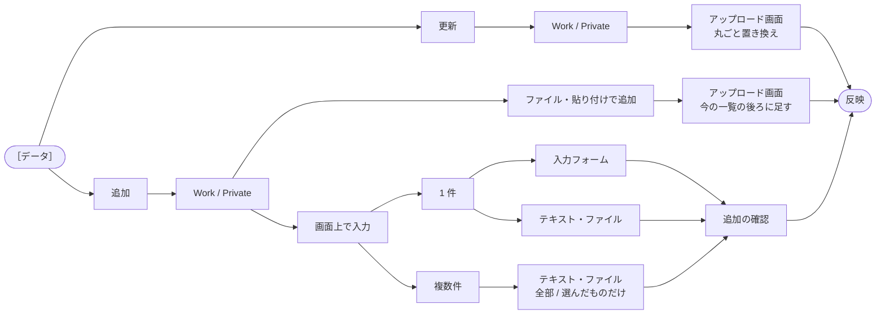
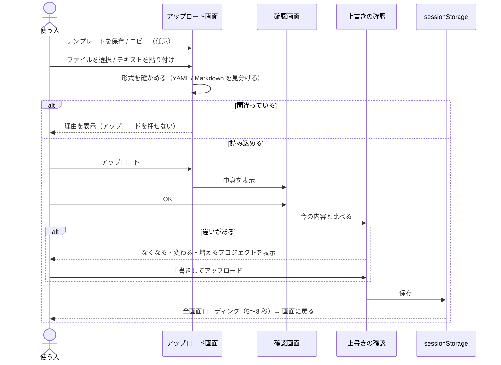

# 操作説明書

> 画面の使い方と、表示するデータ（プロフィール・Work / Private）の書き方、見た目や文言を変える場所。
> プロジェクトの紹介は [README](../README.md)。

## 使い方（自分のデータで表示する）

このサイトは、**リポジトリをローカルに落として、自分の YAML を読み込んで使う**ことを想定しています。
公開ページを開くと、最初に「あなたのことを教えてください」（プロフィールの入力画面）が出ます。

### 1. プロフィール（Home / About）

起動時に YAML を指定すると、その内容で Home と About を表示します（入力画面は出ません）。

```bash
cd frontend
dart run tool/run.dart my_profile.yaml   # Markdown なら my_profile.md、スキルシート（Excel）なら skill_sheet.xlsx
```

- `flutter run -d chrome my_profile.yaml` のように flutter run へ直接 YAML は渡せない（引数は起動する Dart ファイルとして扱われる）ため、このスクリプトを使います。中で `flutter run -d chrome` を実行するので、`r`（ホットリロード）などもそのまま使えます。2 つ目以降の引数は flutter run に渡します（例：`dart run tool/run.dart my_profile.yaml --release`）
- YAML を指定しない（`dart run tool/run.dart` や `flutter run -d chrome`）と、起動後に入力画面が出ます。**正しい YAML を読み込むまで閉じられません**
- 指定した YAML は `assets/profile/profile.yaml` にコピーされます。個人情報なので Git には含めません（`.gitignore` 済み）
- **プロフィールのファイルに Work / Private も書ける**：同じファイルに書いておくと、起動時の指定でも入力画面のアップロードでも、1 回で Home / About と Skills / Projects がまとめて切り替わります（あとで個別にアップロードしなくてよい。書き方は下の「データの書き方」）

### 1'. スキルシート（Excel）から作る

入力画面の「入力方法」で **Excel（スキルシート）** を選ぶと、Excel のスキルシートから Home / About と Work / Private をまとめて作れます。

1. 「Excel テンプレートを保存」でひな形（`assets/data/format_skill_sheet.xlsx`）を名前を付けて保存（同じ形式のスキルシートがあれば不要）
2. Excel で書き換えて保存
3. 「Excel を選択」で読み込み → 確認画面 → OK で反映。中身から YAML を作り、YAML で読み込んだときと同じ確認をします。「作った YAML を保存」で保存しておくと、次回はその YAML（または Excel そのもの）を `tool/run.dart` に指定して起動できます

| 作るもの | Excel から読み取る項目 |
|---|---|
| スキルシートだけの項目 | ふりがな・性別・年齢・生年月日・国籍・配偶者・最寄駅・学歴 → `sheet:`（画面には出さず、［ダウンロード］のスキルシートにそのまま書きます） |
| Home / About | 氏名 → `name`、過去 / 直近の開発経験（「領域：説明」の行）→ `past` / `recent`、それぞれの「主な使用技術・開発環境」（「言語：A、B」の行）→ `past_tech` / `recent_tech`。紹介文（`tagline`）は直近の言語から、自己紹介（`intro`）と得意な領域（`domains`）は経験の領域から作ります。職種（`role`）は「エンジニア」固定（YAML を保存して書き換えられます） |
| Work / Private | プロジェクト名 → `title`、期間 → `period`、業務概要 → `description`（「概要：」の 1 行目）・`details`（全体）・`link`（URL）、役割 / 規模 → `role`（PG・SE など）・`scale`（「10名」など人数のある行。「役割：」「規模：」と書いてもよい）、サーバ OS → `server_os`、DB → `db`、FW・MW ツール等と使用言語 → 知っている名前は各分類（Django → `backend_frameworks`、Docker → `container`、「AI：」の行 → `ai_services` など）、それ以外は `tools` / `skills`、作業工程（● など）→ `workflow` |

- プロジェクト名に「**プライベート**」か「**個人開発**」が入っているものだけ Private になります（印はタイトルから外し、作業工程は使いません）
- セルの位置ではなく見出しの文字（「氏名」「プロジェクト名」「No.」など）で探すので、行や列が多少ずれても読めます。1 件は「No.」に番号がある行から次の番号の前の行まで
- `.xls`（古い形式）は読めません。Excel で `.xlsx` として保存し直してください

### スキルシートのダウンロード：ヘッダーの［ダウンロード］

今表示しているプロフィールと Work / Private を、スキルシート（`assets/data/format_skill_sheet.xlsx` の書式のまま）に書き込んで保存します。

- **Excel**：テンプレートの書式（列幅・罫線・結合・印刷設定など）を変えずに書き込みます。案件の数だけ行が増えます
- **PDF**：書き込んだ Excel と同じ見た目の PDF（A4）を直接保存します
- どちらも「名前を付けて保存」のダイアログで保存先と名前を選びます（Chrome / Edge。Firefox / Safari は通常のダウンロード）
- 保存したかどうかは画面の下に表示されます
- ふりがな・性別・生年月日・国籍・配偶者・最寄駅・学歴は、読み込んだスキルシート（Excel）に書かれていたものをそのまま書きます（YAML / Markdown のプロフィールなら `sheet:` に書いたもの。ないものは空欄）。年齢は生年月日から、出力した日の年齢になります
- 役割・規模は、各プロジェクトの `role` / `scale` を書きます
- PDF の日本語フォントに [IPA P ゴシック](https://moji.or.jp/ipafont/)（IPA フォントライセンス v1.0。`assets/fonts/` に条文）を使っています

### 2. プロジェクト（Work / Private）：ヘッダーの［データ］

ヘッダーの［データ］ボタンから、プロジェクトを追加・更新できます。何も読み込まない場合は、リポジトリにある `assets/data/format_*.yaml`（サンプル）を表示します。
1 つの画面の中で順に選び（上に「追加 › Work › …」、［戻る］で前へ）、どの道を通っても反映の前に確認画面を出します。



| 選ぶもの | 動き |
|---|---|
| **更新** → Work / Private | これまでのアップロード画面で、ファイルや貼り付けた内容に丸ごと置き換えます |
| **追加** → Work / Private → ファイル・貼り付けで追加 | 同じアップロード画面で読み込み、今の一覧の後ろに足します |
| **追加** → … → 画面上で入力 → 1 件 → 入力フォーム | 項目ごとに入力します（下の表） |
| **追加** → … → 画面上で入力 → 1 件 / 複数件 → テキスト | YAML / Markdown を貼り付けるかファイルを選びます。テンプレートの保存・コピー、ⓘ の説明、［サンプルを入力欄に入れる］（複数件は 3 件入ったサンプル）もあります。複数件は「全部追加する」か「選んだものだけ追加する」を選べます |

- アップロード画面にも［戻る］があり、［データ］の 1 つ前の選択に戻れます
- 追加の確認画面では、今の件数・追加するもの・同じ名前があるときの注意を出します。サンプルを表示中なら「サンプルを外す」を選べます

**入力フォーム**

| 項目 | 入れ方 |
|---|---|
| プロジェクト名 | 必須 |
| 期間（開始・終了） | 欄を押すと、Material 3 の日付選択と同じ見た目で年と月を選ぶ画面が開きます（‹ › で年、年の部分で 12 年ずつの一覧）。終了は開始より前を選べません。進行中ならチェック |
| 技術 | Skills・Tools はグループごと、ほかは項目ごとの小さなボタン（入れた数をバッジで表示）。押すと入力欄と「すでにある項目」の一覧が開き、一覧を押すと追加・もう一度で外します。入力欄は打つと候補が出て、カンマか Enter で区切り、空の欄で Backspace 1 回目で直前を強調・2 回目で消します |
| 担当した工程 | Work のみ。チップで選びます |

### アップロード画面の流れ（プロフィール / Work / Private 共通）



1. **テンプレートを用意**：形式（YAML / Markdown）を選び、「テンプレートを保存」でひな形を「名前を付けて保存」（Chrome / Edge は保存ダイアログ、そのほかのブラウザは通常のダウンロード）、または「テンプレートをコピー」でクリップボードにコピー。ⓘ で書き方の説明を開けます
2. **データを読み込む**：「ファイルを選択」（`.yaml` / `.yml` / `.md` / `.markdown`）か、「テキストを貼り付け」で内容を貼り付けます（YAML か Markdown かは自動で見分けます。貼り付け画面にはクリアボタンがあります）。ファイルを保存・選択できない端末でも、コピー → メモアプリなどで書き換え → 貼り付け で使えます。読み込んだ時点で形式を確かめ、間違っていれば理由を表示します（このときは「アップロード」を押せません）
3. **アップロード**：確認画面で中身（プロフィールの各項目 / プロジェクトの一覧）を確認し、**OK のときだけ**反映します
4. **今の内容が上書きされるときは確かめる**：Work / Private（最初の入力画面で一緒に書いたものも）が今表示している内容と違うときは、なくなる・内容が変わる・追加されるプロジェクトを並べて「上書きされます」と知らせ、［上書きしてアップロード］を選んだときだけ反映します（［やめる］なら何も変えずに戻ります）。同じ内容なら確認は出しません
5. 反映中は全画面のローディングを数秒（5〜8 秒）表示し、描き直しが終わってから画面に戻ります

読み込んだデータはブラウザの **sessionStorage** にだけ保存されます。サーバーには送信されず、タブを閉じると消えます。

---

## データの書き方

データは **YAML** と **Markdown** のどちらでも書けます（中身は同じ。Markdown は読み込むときに YAML と同じ形に変換します）。
ひな形は `frontend/assets/data/` の `format_*.yaml` と `format_*.md` です。

### プロフィール（Home / About）

ひな形：`frontend/assets/data/format_profile.yaml`。★ は必須、それ以外は書かなければ表示しません。

```yaml
home:
  name: 山田 太郎                # ★ 名前
  role: Web / モバイルエンジニア   # ★ 職種
  tagline: |                    # ★ 紹介文
    Flutter と Dart を中心に開発しています。
  card:                         # （今は表示しません。書いてもエラーにはなりません）
    stack:
      - Flutter
      - Dart
about:
  intro: |                      # ★ 自己紹介
    受託開発の会社で Web アプリの設計から実装までを担当しています。
  domains: [Web, モバイル]       # 得意な領域（タグで表示）
  strengths: チーム開発、テスト設計  # 強み
  style: コード品質を重視しています  # 開発スタイル
  closing: ユーザー視点を大切に     # 締めの一言
```

知らない項目・必須の空欄・型の違い（文章の場所に箇条書きなど）はエラーになり、読み込みません。

Markdown で書く場合（`format_profile.md`）：

```markdown
# home
- name: 山田 太郎
- role: Web / モバイルエンジニア

## tagline
Flutter と Dart を中心に開発しています。

## card
- stack: Flutter, Dart

# about
- domains: Web, モバイル
- strengths: チーム開発、テスト設計

## intro
受託開発の会社で Web アプリの設計から実装までを担当しています。
```

- `# home` と `# about` に分け、1 行の項目は `- キー: 値`、複数行の文章は `## キー` の下に書きます（`- キー: 値` は `##` より前に書く）
- `card` は `## card` の下に `- キー: 値`（カンマ区切りは箇条書き）。`domains` はカンマ区切り
- `<!-- -->` の中はメモとして読み飛ばします

#### Work / Private も一緒に書く（任意）

プロフィールのファイルに足すと、1 回のアップロードで Skills と Projects もまとめて読み込みます。

YAML：トップに `work:` / `private:` を足し、その下に Work / Private のファイルの `projects:` の中身を書きます。

```yaml
home: ...
about: ...
work:
  - title: 業務のプロジェクト名
    workflow: { basic_design: true, implementation_unit_test: true }
private:
  - title: 個人開発のプロジェクト名
```

Markdown：`# work` / `# private` の見出しの下に、Work / Private のファイルより**見出しを 1 段深く**して書きます（プロジェクト名は `##`、詳細は `###`）。

```markdown
# home
...
# about
...
# work

## 業務のプロジェクト名
- workflow: 基本設計, 実装・単体テスト

### details
詳細

# private

## 個人開発のプロジェクト名
- skills: Dart
```

Work / Private のアップロードと同じ確認をします（Work は `workflow` が必要、Private は書かない）。

プロフィールのテンプレート（`format_profile.yaml` / `.md`）には、Work / Private のテンプレートと同じ全項目のサンプルが最初から入っています。書き換えて使い、要らないときは `work:` / `private:`（Markdown は `# work` / `# private`）ごと消してください。

### プロジェクト（Work / Private）

Work 用と Private 用でファイルが分かれています。

| ファイル | 用途 |
|---|---|
| `frontend/assets/data/format_work.yaml` | 業務のプロジェクト（`workflow` が必須） |
| `frontend/assets/data/format_private.yaml` | 個人開発のプロジェクト（`workflow` は書かない） |

```yaml
projects:
  - title: プロジェクト名            # 必須
    description: 一覧に出る一言説明
    details: |
      詳細モーダルに出る説明（複数行）
    period:
      - 2024-04                      # 開始（YYYY-MM）
      - 現在                         # 終了（YYYY-MM）。進行中なら「現在」
    link: https://example.com        # なければ ""
    role: [PL, SE]                   # 役割（詳細に表示・フィルターで絞り込める）
    scale: 全体 20名（チーム 5名）     # 規模（文章。最初の人数でフィルターの「規模（人数）」に分ける）
    server_os: [Linux]
    db: [PostgreSQL]
    tools: [Git, VSCode]
    backend_frameworks: [Django]
    frontend_frameworks: [React]
    ui_frameworks: [利用なし]        # 該当しない項目は「利用なし」（集計から除外）
    testing_frameworks: [利用なし]
    cloud_platforms: [AWS]
    aws_services: [EC2, S3]
    azure_services: [利用なし]
    gcp_services: [利用なし]
    container: [Docker]
    container_orchestration: [利用なし]
    ai_services: [利用なし]
    skills: [Python, TypeScript]
    workflow:                        # Work 用のみ。担当した工程を true に
      requirements: false            # 要件定義
      basic_design: true             # 基本設計
      detailed_design: true          # 詳細設計
      implementation_unit_test: true # 実装・単体テスト
      integration_test: true         # 結合テスト
      system_test: false             # 総合テスト
      maintenance_operation: false   # 保守・運用
```

Markdown で書く場合（`format_work.md` / `format_private.md`）：

```markdown
# プロジェクト名
- description: 一覧に出る一言説明
- period: 2024-04 ~ 現在
- link: https://example.com
- skills: Python, TypeScript
- workflow: 基本設計, 詳細設計, 実装・単体テスト

## details
詳細モーダルに出る説明（複数行）
```

- 1 件ごとに `# プロジェクト名` から書き始め、項目は `- キー: 値`（キーは YAML と同じ。複数あるときはカンマ区切り）
- 期間は `2024-04 ~ 2024-09`（`〜` `→` も可）。詳細は `## details` の下
- `workflow`（Work のみ）は担当した工程をカンマ区切りで（日本語の工程名でも英語のキーでも可）
- 書き方の誤りは行番号付きで表示します

YAML の注意：

- インデントは半角スペース 2 つです（タブは使えません）
- リストは `[a, b]` の形でも、1 行に 1 つ `- a` と書く形でもかまいません
- Skills のグラフは、全プロジェクトでの各技術の出現割合です。`workflow` は true の割合を表示します

---

## カスタマイズ

見た目や文言は、場所を決めて 1 か所で管理しています（パスは `frontend/` から）。ウィジェットのファイルには、色・数値・文言を直接書かないルールです。

| 変えたいもの | ファイル |
|---|---|
| 名前・紹介文・About の内容 | プロフィール YAML（ひな形 `assets/data/format_profile.yaml`） |
| 画面の文言（ボタン名・メッセージなど） | `lib/constants/app_texts.dart`（`AppTexts`） |
| 色（ライト / ダーク） | `lib/theme/app_colors.dart` |
| 文字スタイル・角丸・カードなどの共通の見た目 | `lib/theme/app_styles.dart` |
| 余白・アニメーション時間などの数値 | `lib/constants/app_sizes.dart` |
| セクションごとのレイアウト（グラフの大きさ、Collection の列数など） | `lib/sections/config/` |
| 表示するプロジェクト（サンプル） | `assets/data/format_work.yaml` / `format_private.yaml` |
| 画面の固定の見出し（About の見出し名など） | `lib/constants/app_texts.dart`（`HeroContent` / `AboutContent` / `ProfileTexts`） |
