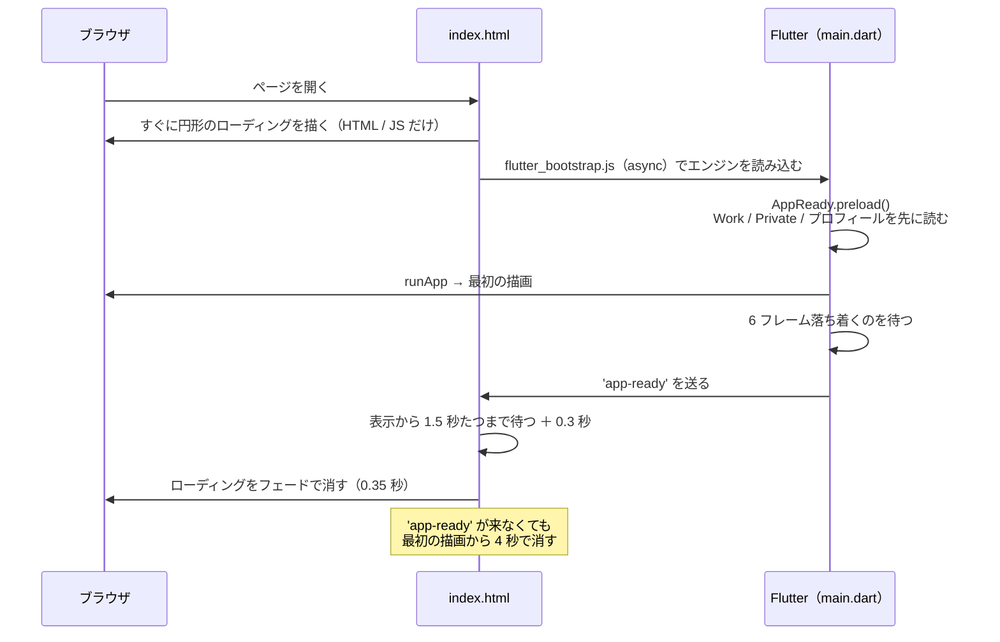

# パフォーマンス（ユーザーの体感）

> 起動から操作までの待ち時間の設計、重い処理、配信の設定、測り方、課題。見た目は [デザインシステム](design-system.md)、操作の流れは [UI / UX](ui-ux.md)。
> 2026-11-06 時点。**数値はコードに書かれた設計値で、実際の速さはまだ測っていない**（7 章で測り方と目標の案）。

---

## 1. 考え方

- **何も出ない時間を作らない**：Flutter Web は起動に時間がかかる（エンジンの読み込み）。HTML だけで描くローディングを最初から出し、アプリが描き終わるまで見せる。
- **ちらつかせない**：一瞬だけ出て消えるローディングや、描きかけの画面は見せない（最低表示時間と「落ち着くまで待つ」）。
- **サーバーを待たない**：表示するデータはブラウザの中にある（サンプルと sessionStorage）。読み込み・集計・Excel / PDF の作成も、すべてブラウザの中で行う。

## 2. 起動の流れ

- ローディングは Flutter の `CircularProgressIndicator` と同じ動き（1333ms で伸縮・2222ms で 1 周）を、HTML の SVG と JS で再現している。エンジンの読み込み中も止まらない。
- `preload` で先にデータを読むので、最初の描画のときにはデータが入っている（空の画面 → データ入りの画面と 2 回描かない）。

## 3. 待ち時間の設計

| どこ | 値 | 理由 | 場所 |
|---|---|---|---|
| 起動のローディングの最低表示 | **1.5 秒** | 一瞬だけ出て消えるちらつきを防ぐ | `web/index.html` の `MIN_MS` |
| 起動の合図のあと | 0.3 秒 | 描画を確実に終わらせてから消す | `SETTLE_MS` |
| 起動の合図が来ないとき | 最初の描画から 4 秒で消す | 出しっぱなしを防ぐ | `FALLBACK_MS` |
| 「落ち着いた」とみなすフレーム数 | 6 フレーム | 最初の描画のあと、データ入りの描き直しまで待つ | `AppSizes.settleFrames` |
| 重い描画（詳細・List / Collection の切替）のローディング | 最低 **0.8 秒** ＋ フェード 0.2 秒 | 中身を裏で描き、描き終わってから見せる（描きかけを見せない） | `SettledReveal`・`AppSizes.revealMinDuration` |
| アップロード後の作り直し | 最低 **5 秒**・最大 8 秒 | Skills / Projects を作り直す間、全画面のローディング | `AppSizes.reloadMinDuration` / `reloadMaxDuration` |
| ナビでのスクロール | 0.5 秒 | | `AppSizes.scrollDuration` |
| 保存の開始 | 0.08 秒 | ローディングを先に描いてから重い処理に入る | `AppSizes.downloadStartDelay` |

最低表示時間（1.5 秒・0.8 秒・5 秒）は、**速く終わっても待たせる**時間でもある。体感の速さとちらつきの少なさのバランスで決めた値で、測ってから見直す（5 章）。

## 4. 重い処理と、量の上限

| 処理 | どこで | 量を抑える工夫 |
|---|---|---|
| 集計（Skills の割合） | ブラウザ（メインのスレッド） | 表示は上位 10 件（`AppSizes.chartTopN`）、残りは「その他」 |
| 一覧（Projects） | ブラウザ | List は 1 ページ 5 件、Collection は列 × 行（最大 4 × 2）。一覧の中にスクロールを作らず、ページで分ける |
| 詳細・表示の切替 | ブラウザ | `SettledReveal` で裏で描いてから見せる |
| Excel の書き込み | ブラウザ（メインのスレッド） | テンプレートの zip の中のシートの XML だけを書き換え、ほかのファイルはそのまま |
| PDF の作成 | ブラウザ（メインのスレッド） | 書き込んだ Excel の見た目を読んで A4 に描く。フォント（IPA P ゴシック、約 6MB）を埋め込む |
| ファイルの保存 | ブラウザ | 保存先を先に選ばせ、決まってから作る（`showSaveFilePicker` はボタンを押した直後しか開けないため） |

- Excel / PDF の作成は Isolate（別のスレッド）を使っていない。件数が多いと、作っている間はローディングのアニメーションも止まる可能性がある（**未計測**）。

## 5. 課題と改善案

| 課題 | 影響 | 案 | 優先 |
|---|---|---|---|
| 実際の速さを測っていない | 遅いところが分からない | 7 章の方法で測り、目標と比べる | 高 |
| 最低表示時間で待たせている | 速い端末でも 1.5 秒・5 秒待つ | 測ったうえで短くする（例：アップロード後は描画の完了を待つだけにし、最低時間を 1 秒程度に） | 中 |
| Excel / PDF をメインのスレッドで作る | 件数が多いと画面が固まる | `compute`（Isolate）で作る。Web では Web Worker になる | 中 |
| フォントをアプリで指定していない | Flutter Web は既定のフォント（Roboto）と、足りない文字（日本語など）のフォントを、実行中に Google Fonts から取りに行く。初回の表示が遅れたり、通信できない環境で文字が出ないことがある | 使う日本語フォントを同梱して指定する（サイズとの兼ね合い） | 中 |
| 起動のエンジンの読み込みが重い | Flutter Web は最初に CanvasKit（数 MB の wasm）を読む | 配信の圧縮・キャッシュ（6 章）、WebAssembly でのビルド（`--wasm`）を試す | 中 |
| PDF のフォント（約 6MB）をアプリに同梱している | アプリの読み込みが重くなる | PDF を作るときだけ読む（遅延読み込み） | 低 |

## 6. 配信の設定

| 配信 | 設定 |
|---|---|
| Docker（nginx） | gzip（CSS・JS・JSON・wasm・SVG）。`index.html`・`flutter_service_worker.js`・`flutter_bootstrap.js`・`version.json` はキャッシュしない（新しいビルドがすぐ反映される）。それ以外は nginx の既定 |
| API（api-hono） | 公開ページ（`/api/public/:slug`）は `Cache-Control: public, max-age=60`（CDN で短くキャッシュできる）、本人のデータ（`/api/me/*`）と `/healthz` はキャッシュしない |
| GitHub Pages（今の公開ページ） | GitHub Pages の既定（圧縮・キャッシュは GitHub 側） |
| 今後（Cloudflare） | 静的アセットをエッジから配信、`/api/` をエッジでキャッシュ（[設計](design.md#今後)） |

## 7. 測り方と目標（案）

### 測り方

| 測るもの | 方法 |
|---|---|
| 起動の速さ（初回 / 2 回目） | Chrome DevTools の Lighthouse（モバイル・低速 4G の設定）、Performance パネル |
| 読み込むファイルの大きさ | DevTools の Network（`main.dart.js`・`canvaskit.wasm`・フォント・アセット） |
| 操作中のなめらかさ | DevTools の Performance パネルでフレームの時間を見る、`flutter run --profile` の DevTools |
| Excel / PDF の作成時間 | Work 12 件・50 件などで、ボタンを押してから保存のダイアログまでの時間を測る |

### 目標（案。測ってから決める）

| 指標 | 目標の案 |
|---|---|
| ローディングが出るまで | 0.5 秒以内（HTML だけで描く） |
| 操作できるようになるまで（PC・光回線） | 3 秒以内 |
| 操作できるようになるまで（スマホ・4G） | 6 秒以内 |
| スクロール・切替 | 60fps（1 フレーム 16ms）を大きく下回らない |
| Excel / PDF の作成（Work 50 件） | 3 秒以内、その間もローディングが動く |

測った結果はこのファイルに書き足し、改善の作業は [今後の動き](roadmap.md) に入れる。
