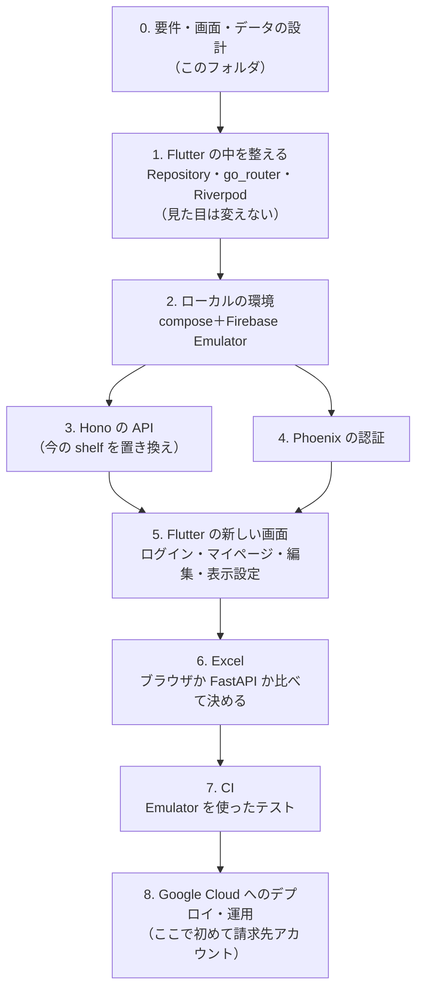

# 次の構成の計画（ログイン・マイページ・クラウド）

> 今のポートフォリオ（1 ページ・データはブラウザの中だけ）を、**ログインして自分のデータを編集・保存・公開できる**形にするための計画。今の作りは [設計](../design.md)・[画面仕様書](../screens/README.md)。
> 2026-11-06 時点の案。**費用は完全に無料**（無料枠の中だけで動かす）ことが前提。決まっていないことは [決めること](decisions.md) にまとめ、決まったらそれぞれのドキュメントに反映する。

| ファイル | 中身 |
|---|---|
| この README | 目的、進め方の段階、今の作りから何が変わるか |
| [requirements.md](requirements.md) | 要件定義：使う人と権限、機能、守ること（費用・個人情報・速さ・運用）、範囲外 |
| [screens.md](screens.md) | 画面設計：画面の一覧と URL、遷移、各画面でできること、Home の表示設定 |
| [data-model.md](data-model.md) | データ設計：Excel の構成、項目と型、Firestore のコレクション、編集中・保存・版・公開 |
| [architecture.md](architecture.md) | サービスの役割（Flutter・Phoenix・Hono・FastAPI・Firebase）、ローカルの構成、本番の構成、無料枠と守り方 |
| [decisions.md](decisions.md) | 決めること：選択肢・案・状態（未決 / 決定） |

---

## 1. 目的

- 自分のプロフィール・スキル・職務経歴を、**ログインして画面から編集・保存**できるようにする（今はタブを閉じると消える）。
- 保存したデータから、**公開ページ（Home）** と **スキルシート（Excel / PDF）** を作る。公開する項目は自分で選ぶ。
- 作る過程そのものを見せる：複数の言語のサービス（Dart・Elixir・TypeScript・Python）、Firebase / Google Cloud のサーバーレス、Terraform、CI/CD、監視と SLO を、**費用ゼロ**で。

## 2. 進め方

- 進み具合：0 は済み（未決の項目は [決めること](decisions.md)）。1 は済み（Repository は構造のデータで受け渡し、画面はすべて Riverpod の Provider から読み、URL は `/`・`/login`・`/me`・`/me/edit`。ログイン・マイページは `--dart-define=ENABLE_ACCOUNT=true` のときだけ）。
- 0〜7 は**ローカルだけ**で進められる（クラウドの契約・カードの登録はいらない）。
- `develop` に push すると今の GitHub Pages に公開されるので、1 以外は別のブランチで進めるか、新しい画面をビルドの設定（`--dart-define`）で隠す。

## 3. 今の作りから変わるところ

| | 今 | 次 |
|---|---|---|
| データの置き場所 | ブラウザの sessionStorage（タブを閉じると消える） | Firestore（ログインした本人だけが読み書き） |
| 入力 | YAML / Markdown / Excel のファイル、貼り付け、入力フォーム | 同じ（読み込んだものを Firestore に保存する） |
| 公開ページ | 開いた人が自分でデータを読み込む | 本人が「公開」した版を、誰でも URL で見られる |
| ログイン | なし | あり（Phoenix） |
| API | shelf（YAML を返すだけ。画面からは使っていない） | Hono（マイページの読み書き）・FastAPI（Excel のうち必要な処理だけ） |
| 画面 | 1 ページ＋ダイアログ | 公開ページ＋ログイン・マイページ・編集・表示設定（URL を分ける） |
| 配信 | GitHub Pages | Cloudflare（[決めること](decisions.md#d-04-フロントエンドの配信先)） |

今ある画面・部品・Excel の読み書き・テストは、できるだけそのまま使う（[要件定義](requirements.md#5-今あるものの扱い)）。
