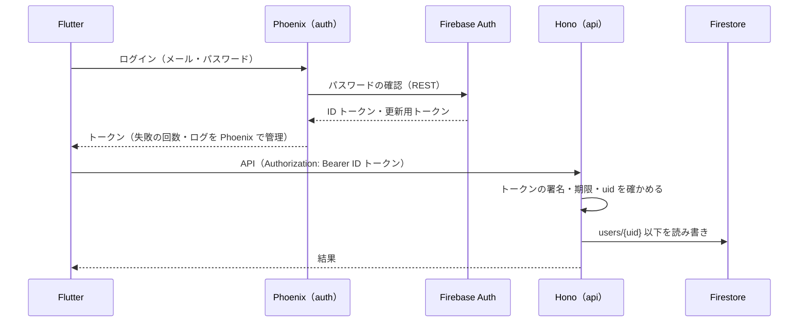
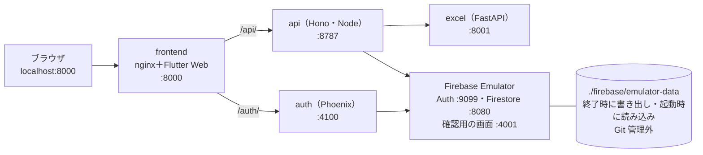
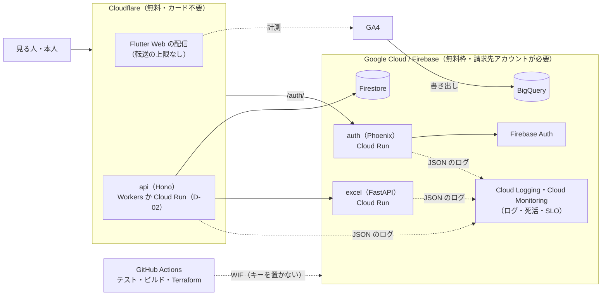

# サービスの構成

> 各サービスの役割、ローカルの構成、本番の構成、無料枠と守り方。要件は [要件定義](requirements.md)、データは [データ設計](data-model.md)、決まっていないことは [決めること](decisions.md)。今の構成は [設計](../design.md)。
> 2026-11-06 時点の案。無料枠の数字は 2026-11-06 に公式の料金ページで確かめたもの（変わることがあるので、デプロイの前にもう一度確かめる）。

---

## 1. 役割

| サービス | 言語・フレームワーク | 役割 | 持たないもの |
|---|---|---|---|
| frontend | Dart・Flutter Web | 公開ページ・ログイン・マイページの画面。Excel の読み込み・書き出し（[D-06](decisions.md#d-06-fastapi-に任せる範囲) で決めるまで今のまま） | データの保存（API を呼ぶだけ） |
| auth | Elixir・Phoenix | 登録・ログイン・ログアウト・パスワードの変更と再設定・トークンの発行と取り直し・総当たりの対策 | プロフィールなどのデータ |
| api | TypeScript・Hono | マイページの API（プロフィール・スキル・職務経歴・表示設定・編集中・版・公開）、公開ページのデータを返す。受け取ったデータの形を確かめる | パスワード |
| excel | Python・FastAPI | Excel の処理のうち、ブラウザでやらないと決めたものだけ | データの保存（api から呼ばれる） |
| Firebase Auth | （マネージド） | パスワードを安全に持つ・確認のメール・トークンの署名（[D-01](decisions.md#d-01-認証の形) の案 B） | ─ |
| Firestore | （マネージド） | データの置き場所 | ─ |

## 2. ローカルの構成

> 用意した（段階 2）。使い方・データの残り方・よくある失敗は [ローカルのクラウド](../local-cloud.md)。

`docker compose up` だけで全部が動く。クラウドの契約はいらない。

| 決まり | 中身 |
|---|---|
| フォルダ | `frontend/`・`services/auth-phoenix/`・`services/api-hono/`・`services/excel-fastapi/`・`firebase/`（`firebase.json`・ルール・Emulator の設定）。**`firebase/` と `services/` の置き場所は用意した**（2026-11-06。各サービスの中身はこれから） |
| ポート | Firebase Emulator の既定（確認用の画面 4000）と Phoenix の既定（4000）が重なるので、Phoenix を 4100、確認用の画面を 4001 にする |
| つなぎ先 | 環境変数 `FIREBASE_AUTH_EMULATOR_HOST`・`FIRESTORE_EMULATOR_HOST` があれば Emulator、なければ本物 |
| データ | Emulator のデータ（`firebase/emulator-data/`）は Git 管理外。止めたとき（SIGINT）に書き出し、次の起動で読み込む。動作確認はサンプルのデータだけ（`docker compose run --rm seed`。個人の情報は入れない） |
| 前の backend | Hono（`services/api-hono/`）に置き換えて `backend/`（shelf）を消した（2026-11-06）。ポートの 8081 も使わなくなった |

## 3. 本番の構成（案）

- Firebase Hosting は無料の転送が 360 MB/日しかなく、Flutter Web は初めて開くと数 MB を読むので、配信は Cloudflare にする案（[D-04](decisions.md#d-04-フロントエンドの配信先)）。
- Cloud Run は**無料プランの Firebase（Spark）では使えない**。請求先アカウント（カードの登録）を作り、無料枠の中で使う。

## 4. 無料枠と守り方

| サービス | 無料の範囲（月・日） | 超えないための設定 |
|---|---|---|
| Firestore | 保存 1 GiB・読み取り 5 万/日・書き込み 2 万/日・削除 2 万/日・転送 10 GiB/月 | 編集中は 1 件にまとめる、自動の保存は 3 秒止まってから、公開ページはエッジでキャッシュ（[見積もり](data-model.md#6-書き込みの回数と容量の見積もり)） |
| Firebase Auth | 5 万 MAU（電話番号のログインは無料プランで使えない） | メールとパスワードだけ |
| Firebase Hosting | 保存 10 GB・転送 360 MB/日 | 使わない（Cloudflare で配信） |
| Cloud Run | 200 万リクエスト・18 万 vCPU 秒・36 万 GiB 秒（リクエストのときだけ課金する設定） | 最小インスタンス 0・最大 1〜2、メモリ 256〜512 MiB、リクエストのときだけ課金。ロードバランサーは使わない |
| Artifact Registry | 0.5 GB | イメージを小さく（Phoenix は release、FastAPI は slim）、新しい 2 つ以外を自動で消す |
| Cloud Logging / Monitoring | ログの取り込みに無料の量がある | ログを出しすぎない（リクエストごとに 1 行、本番は info 以上） |
| BigQuery | サンドボックス（カード不要）か無料枠 | GA4 の書き出しは毎日の分だけ、古い表は期限で消す |
| Cloudflare Workers | 10 万リクエスト/日 | 公開ページの API をキャッシュ |
| GitHub Actions | 公開リポジトリは無料 | ─ |

**予算のアラートは知らせるだけで、使いすぎても止まらない**。次の 3 つを Terraform で最初に作る。

1. 予算（例：月 1 円）とアラートのメール。
2. 予算を超えたら Pub/Sub → 小さな関数で、プロジェクトから請求先アカウントを外す（サービスは止まるが、費用は出ない）。
3. 各 Cloud Run の最大インスタンス数、Artifact Registry の自動の削除、ログの保存期間。
