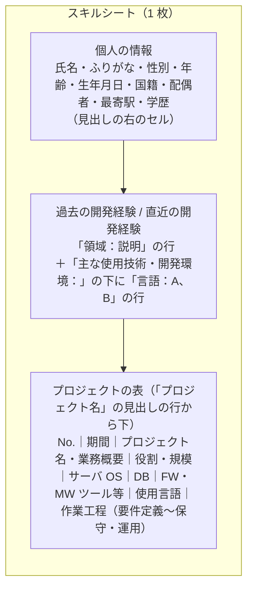
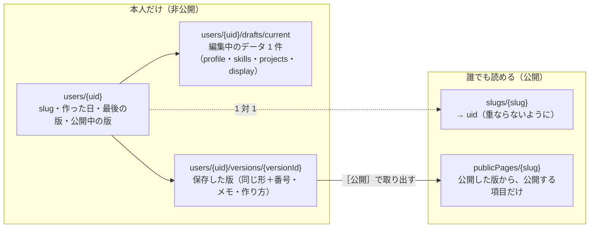
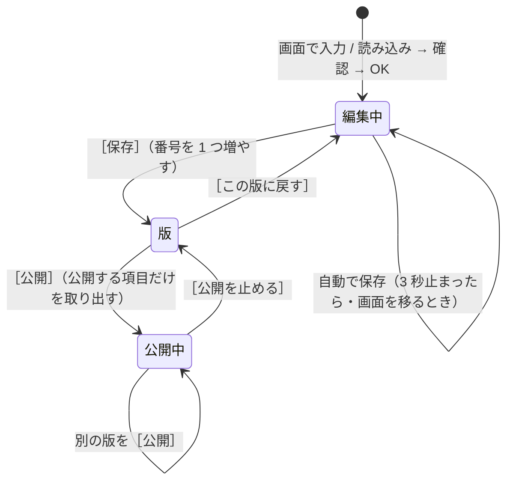

# データ設計

> スキルシート（Excel）の構成、項目と型、Firestore のコレクション、編集中・保存・版・公開の持ち方、セキュリティルール、無料枠に対する見積もり。要件は [要件定義](requirements.md)、画面は [画面設計](screens.md)。
> 2026-11-06 時点の案。項目の元は今のコード（`lib/models/profile.dart`・`lib/sections/projects/models/projects_model.dart`・`lib/utils/skill_sheet.dart`）とテンプレート（`assets/data/format_*.yaml`・`format_skill_sheet.xlsx`）。

---

## 1. スキルシート（Excel）の構成

テンプレートは `frontend/assets/data/format_skill_sheet.xlsx`。**シートは 1 枚**で、セルの位置ではなく**見出しの文字**で場所を探す（行や列が多少ずれても読める）。



| 場所 | 読み方 | 入る先 |
|---|---|---|
| 氏名 | 見出しの右のセル | `profile.home.name` |
| ふりがな〜学歴 | 見出しの右のセル。生年月日は日付として読み、年齢は生年月日から出す | `profile.sheet.*`（非公開） |
| 過去 / 直近の開発経験 | 「領域：説明」の行、その下の「分類：技術、技術」の行 | `profile.about.past` / `recent`、`skills.pastTech` / `recentTech` |
| プロジェクトの表 | 「No.」に番号がある行から次の番号の前までが 1 件。1 行目がプロジェクト名、2 行目からが業務概要 | `projects[]` |
| 役割・規模 | 「役割：PG」「規模：10名」の形 | `role[]`・`scale` |
| FW・MW ツール等・使用言語 | 1 つの列に色々な分類の技術が入るので、技術名の辞書（`tech_catalog.dart`）で分類に振り分ける | `tech.*` |
| 作業工程 | 列に ● など何か書いてあれば担当 | `workflow.*` |
| Work / Private | プロジェクト名に「プライベート」「個人開発」が入っていれば Private（作業工程は使わない） | `kind` |

- Excel は画面の分類より粗い（FW・MW・ツールが 1 列）ので、**Excel → データ → Excel** で分類の情報は戻らない（書き出すときは分類をまとめて 1 列に書く）。
- Home の紹介文・About の自己紹介など Excel にない項目は、読み込みのときに開発経験から作る（今と同じ）。

## 2. 項目と型

型は Firestore に置くときの形。今のアプリの `Project` はカンマ区切りの文字列で持っているが、保存するときは**配列**にする（集計・絞り込みのため）。

### 2.1 プロフィール

| 項目 | キー | 型 | 必須 | 公開 | 今の YAML |
|---|---|---|---|---|---|
| 名前 | `home.name` | string（〜50） | ✓ | 設定による | `home.name` |
| 職種 | `home.role` | string（〜50） | ✓ | 設定による | `home.role` |
| 紹介文 | `home.tagline` | string（複数行、〜500） | ✓ | 設定による | `home.tagline` |
| 自己紹介 | `about.intro` | string（複数行、〜2000） | ✓ | 設定による | `about.intro` |
| 得意な領域 | `about.domains` | string[]（〜20） | | 設定による | `about.domains` |
| 強み・開発スタイル・締めの一言 | `about.strengths` / `style` / `closing` | string | | 設定による | 同じ |
| 直近 / 過去の開発経験 | `about.recent` / `past` | string（複数行） | | 設定による | 同じ |
| スキルシートだけの項目 | `sheet.furigana` ほか | string。`sheet.birthday` は `YYYY-MM-DD` | | **公開しない** | `sheet.*` |

`home.card` は今は使っていないので持たない。

### 2.2 スキル

| 項目 | キー | 型 | 説明 |
|---|---|---|---|
| 直近 / 過去の主な技術 | `skills.recentTech` / `pastTech` | map<分類, string[]> | 分類のキーはプロジェクトの技術と同じ（下の表） |

プロジェクトから集計するスキル（今の Skills のグラフ）は保存しない（読むときに作る）。

### 2.3 プロジェクト（職務経歴）

| 項目 | キー | 型 | 必須 | 今の YAML |
|---|---|---|---|---|
| ID | `id` | string（作るときに決める。並びが変わっても変わらない） | ✓ | なし（新規） |
| 種類 | `kind` | `"work"` / `"private"` | ✓ | ファイルが別 |
| 並び | `order` | int | ✓ | 書いた順 |
| プロジェクト名 | `title` | string（〜100） | ✓ | `title` |
| 概要・詳細 | `description` / `details` | string | | 同じ |
| 役割 | `role` | string[]（PM・PL・SE・PG…） | | `role` |
| 規模 | `scale` | string（「全体 20名（チーム 5名）」） | | `scale` |
| 期間 | `period.start` / `period.end` | string `YYYY-MM`。`end` が `null` なら進行中（「現在」） | | `period: [開始, 終了]` |
| リンク | `link` | string（https の URL） | | `link` |
| 技術 | `tech.<分類>` | string[]。「利用なし」は**空の配列**にする | | 各キー（下の表） |
| 担当の工程（Work だけ） | `workflow.<工程>` | bool | Work は ✓ | `workflow.*` |

技術の分類（`tech.<分類>`）：`server_os`・`db`・`tools`・`backend_frameworks`・`frontend_frameworks`・`ui_frameworks`・`testing_frameworks`・`cloud_platforms`・`aws_services`・`azure_services`・`gcp_services`・`container`・`container_orchestration`・`ai_services`・`skills`（言語）。今の YAML のキーと同じ。

担当の工程（`workflow.<工程>`）：`requirements`・`basic_design`・`detailed_design`・`implementation_unit_test`・`integration_test`・`system_test`・`maintenance_operation`。

### 2.4 Home の表示設定

| キー | 型 | 既定 |
|---|---|---|
| `display.sections` | `{id: "about"|"skills"|"projects", visible: bool}[]`（並び順） | 全部出す |
| `display.home` / `display.about` | map<項目, bool> | 全部出す |
| `display.skills.categories` | string[]（出す分類） | 全部 |
| `display.projects.tabs` | `{work: bool, private: bool}` | 両方 |
| `display.projects.hidden` | string[]（隠すプロジェクトの `id`） | なし |
| `display.projects.fields` | map<項目, bool>（`details`・`link`・`role`・`scale`） | 全部出す |
| `display.projects.view` / `sort` | `"list"|"collection"`／並びの種類 | 今の既定 |
| `display.allowSheetDownload` | bool | `false` |
| `display.theme` | `"light"|"dark"|"system"` | `"system"` |

## 3. Firestore のコレクション



| コレクション | 1 件の中身 | 誰が読む | 誰が書く |
|---|---|---|---|
| `users/{uid}` | `slug`・`createdAt`・`updatedAt`・`latestVersion`・`publishedVersion` | 本人（Hono 経由） | Hono |
| `users/{uid}/drafts/current` | `data`（下の形）・`baseVersion`（元にした版）・`updatedAt` | 本人 | Hono（自動の保存） |
| `users/{uid}/versions/{versionId}` | `number`・`data`・`note`・`source`（`form`・`excel`・`yaml`・`markdown`・`restore`）・`createdAt` | 本人 | Hono（［保存］） |
| `slugs/{slug}` | `uid` | Hono | Hono |
| `publicPages/{slug}` | `data`（公開する項目だけ）・`version`・`publishedAt` | 誰でも（Hono 経由、エッジでキャッシュ） | Hono（［公開］） |

`data` の形（編集中・版で共通）：

```json
{
  "schemaVersion": 1,
  "profile": { "home": {}, "about": {}, "sheet": {} },
  "skills": { "recentTech": {}, "pastTech": {} },
  "projects": [ { "id": "p_01H…", "kind": "work", "order": 0, "title": "…", "period": { "start": "2023-04", "end": "2023-09" }, "tech": { "skills": ["Python"] }, "workflow": { "basic_design": true } } ],
  "display": { "sections": [], "projects": { "hidden": [] } }
}
```

### 3.1 この形にした理由

- **編集中のデータを 1 件の文書にまとめる**：読むのも保存するのも 1 回で済み（無料枠の読み書きの回数を抑える）、版を作るときは丸ごと写すだけでよい。1 件の上限は 1 MiB で、プロジェクト 100 件でも 200 KB ほど（下の見積もり）。
- **公開用を別のコレクションにする**：公開ページは「公開してよい項目だけ」を持つので、非公開の項目（`sheet` など）が漏れようがない。ルールも「公開は誰でも読める、ほかは読めない」と単純になる。
- **`schemaVersion` を持つ**：項目を変えたとき、古い版を読みながら新しい形に直せる。

## 4. 編集中・保存・版・公開



| 決まり | 中身 |
|---|---|
| 同時に編集したとき | 自動の保存は `updatedAt` を条件にして書く（Firestore の更新の前提条件）。別のタブ・端末で先に変わっていたら上書きせず、「別の場所で変更されました。読み込み直す / こちらで上書き」を出す |
| 版の番号 | `users/{uid}.latestVersion` をトランザクションで 1 増やし、その番号で版を作る |
| 版を残す数 | 新しい 20 件（案）。古いものから消す。公開中の版は消さない |
| 戻すとき | 版の `data` を編集中に写す。今の編集中に保存していない変更があれば、先に版にするか聞く |
| 公開するとき | 版の `data` から、表示設定で出すものだけを取り出し、`sheet` は必ず外して `publicPages/{slug}` に書く |
| 退会 | `users/{uid}` 以下・`slugs/{slug}`・`publicPages/{slug}` と認証のアカウントを消す |

## 5. セキュリティルール（案）

読み書きはすべて Hono（サービスアカウント）を通す案（[D-05](decisions.md#d-05-firestore-に誰がつなぐか)）。その場合、画面からの直接の読み書きは全部断る。

```text
rules_version = '2';
service cloud.firestore {
  match /databases/{database}/documents {
    match /{document=**} {
      allow read, write: if false;   // 画面からは直接読み書きしない（Hono が読み書きする）
    }
  }
}
```

画面から直接つなぐ案にする場合は、`users/{uid}` 以下を `request.auth.uid == uid` のときだけ、`publicPages` を読むだけ誰でも、とし、Emulator でルールのテストを書く。

## 6. 書き込みの回数と容量の見積もり

Firestore の無料枠（Spark）：保存 1 GiB、読み取り 5 万／日、書き込み 2 万／日、削除 2 万／日。

| 操作 | 1 回あたり | 1 日の見積もり（本人 1 人） |
|---|---|---|
| 公開ページを見る | 読み取り 1（エッジでキャッシュすれば、キャッシュが切れたときだけ） | 見る人 1000 人でも 1000 以下 |
| マイページを開く | 読み取り 2〜3（`users`・`drafts`・版の一覧） | 数十 |
| 自動の保存 | 書き込み 1 | 編集する日で 200〜300 |
| ［保存］ | 書き込み 2〜3（版・`users`・古い版の削除） | 数十 |
| ［公開］ | 書き込み 2（`publicPages`・`users`） | 数回 |

| もの | 大きさ |
|---|---|
| プロジェクト 1 件 | 1〜2 KB |
| `data` 1 件（プロジェクト 50 件） | 100 KB ほど |
| 1 人分（編集中 1・版 20・公開 1） | 2 MB ほど |

→ 1 人で使うなら無料枠の 1% にも届かない。新規登録を誰にでも開いても、数百人までは保存の量（1 GiB）に収まる。
