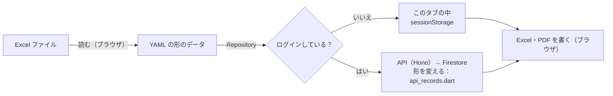

# Excel：ブラウザか FastAPI か（段階 6）

> 段階 6「Excel（FastAPI は必要な分だけ）」の比べた結果。決めたことは [決めること](decisions.md#d-06-fastapi-に任せる範囲) の D-06 に書く。
> 2026-11-06 に比べ、2026-11-08 に FastAPI の範囲を決めた。

## 1. 今あるもの（流用する）

Excel の読み込みと、Excel・PDF の書き出しは、今の Flutter のもの（`frontend/lib/utils/`）をそのまま使う。どれも Flutter に依存しない Dart で、ブラウザの中で動く。

| 処理 | ファイル | 中身 |
|---|---|---|
| Excel を読む | `xlsx_reader.dart`・`skill_sheet.dart` | .xlsx（zip の中の XML）を開き、見出しの文字で探してプロフィール・Work / Private の YAML を作る |
| Excel を書く | `skill_sheet_writer.dart`・`xlsx_layout.dart` | テンプレート（`assets/data/format_skill_sheet.xlsx`）の書式を変えずに、セルの値だけを書き換える |
| PDF を作る | `skill_sheet_pdf.dart` | 書いた Excel の見た目（列幅・結合・罫線・文字）のまま A4 に描く。フォントは IPA P ゴシック（約 6MB。PDF を作るときだけ読む） |

ログインしているときも同じものを使う。データの読み書きは Repository（段階 1）を通すので、保存先がこのタブの中から API（Firestore）に替わるだけで、Excel の処理は変わらない。

### 段階 6 で直したこと

| 直したこと | 理由 |
|---|---|
| API に送る前に、文字数を API と同じ上限にする（名前・職種・スキルシートだけの項目は 100 文字、文章は 5000 文字） | Excel から読んだ学歴などが長いと、ログイン中は保存で 400 になっていた |
| 生年月日は API では `YYYY-MM-DD`、アプリでは「1990年04月01日」に変える（読めない書き方なら送らない） | API は日付の形を確かめるので、Excel の書き方のままでは保存できなかった |
| 保存に失敗したら「保存できませんでした：理由」を出す（`runReloading` が理由を返す） | 失敗しても「読み込みました」と出ていた（ログイン中は API が弾くことがある） |

確かめるテスト：`test/excel_api_roundtrip_test.dart`。テンプレートの Excel を読み、「そのまま書き出したもの」と「API の形にして JSON を通して戻してから書き出したもの」が同じになることを確かめる。

## 2. 比べたこと

| 観点 | ブラウザ（今のまま） | FastAPI に移す |
|---|---|---|
| 個人の情報 | Excel（生年月日・最寄駅など）を**サーバーに送らない**。読み込みはファイルを外に出さない | サーバーがファイルを受け取る。ログに残さない・一時ファイルを消す、などの守りが要る |
| 費用（無料枠） | かからない（静的なファイルの配信だけ） | Cloud Run の無料枠に入る見込み。ただし PDF を Python で同じ見た目に作るには LibreOffice など大きなイメージ（数百 MB）が要り、Artifact Registry の無料枠（0.5 GB）を圧迫する |
| 見た目の再現 | 今のもので、テンプレートの見た目をそのまま PDF にできている（テストあり） | openpyxl＋reportlab などで**作り直し**になる。2 つの実装を同じ見た目に保つ手間が続く |
| 速さ | 下の計測。Isolate（Web Worker）を使っていないので、件数が多いと作っている間は画面が止まる可能性がある | 端末の速さに左右されない。代わりに通信と、コールドスタート（数秒）がかかる |
| 最初の読み込み | Excel・PDF のコード（archive・xml・pdf）が `main.dart.js` に入っている。フォントは PDF を作るときだけ読む | 画面からそのコードを外せる |
| 見る人へのスキルシートの配布（表示設定の「スキルシートのダウンロードを許す」） | 見る人のブラウザで作れるが、公開ページを開いてボタンを押す必要がある。リンクで渡せない | サーバーで作り、決まった URL で配れる（ログインもアプリの読み込みもいらない） |
| オフライン・ログインなし | 動く（今の公開ページと同じ） | 動かない |

## 3. 計測

`frontend/` で `dart run tool/measure_skill_sheet.dart` を実行すると表が出る（Dart VM で測る。ブラウザの JavaScript では数倍遅くなりうるので目安）。`flutter build web --release` のあとなら `main.dart.js` の大きさも出る。

| Work の件数 | Excel を作る | PDF を作る | Excel を読む | Excel の大きさ | PDF の大きさ |
|---|---|---|---|---|---|
| 12 | （未計測） | | | | |
| 50 | | | | | |
| 200 | | | | | |

目標（[性能](../performance.md)）：Work 50 件で 3 秒以内。

## 4. 結論

**Excel の読み込みと、本人がダウンロードするスキルシート（Excel・PDF）は、ブラウザ（今の Flutter）のまま。FastAPI には、見る人向けのスキルシート（Excel・PDF）を作ることだけを任せる**（2026-11-08。[D-06](decisions.md#d-06-fastapi-に任せる範囲)）。

| 処理 | 置き場所 | 理由 |
|---|---|---|
| Excel を読む | ブラウザ | スキルシートには生年月日・最寄駅などがある。サーバーに送らずに済む |
| 本人がダウンロードする Excel・PDF | ブラウザ | テンプレートの見た目のまま作れている。生年月日などの項目も入るので、サーバーに送らない |
| **見る人向けのスキルシート（Excel・PDF）** | **FastAPI**（`services/excel-fastapi/`） | 「サーバーで作って決まった URL で配るファイル」。見る人はログインせず、`/api/public/{slug}/skill-sheet.pdf`（Excel は `.xlsx`）を開くだけで受け取れる（リンクを送れる）。公開ページのデータだけから作るので、個人の情報は入らない |

見る人向けのスキルシートの作り：

- 公開ページのデータ（`publicPages/{slug}`）を API（Hono）が読み、FastAPI に渡す。FastAPI は Firestore につながない（[D-05](decisions.md#d-05-firestore-に誰がつなぐか)）。
- 表示設定の「スキルシートのダウンロードを許す」（`display.allowSheetDownload`）が `true` のときだけ。許していなければ 404（公開していないときと区別しない）。
- **形は本人がダウンロードするものと同じ**：Excel のテンプレート（`frontend/assets/data/format_skill_sheet.xlsx`）に書き、PDF はその Excel の見た目のまま作る（2026-11-08。オーナーの指定）。
- 作るのは Python ではなく、**ブラウザと同じ Dart の処理**（`frontend/bin/skill_sheet.dart`。`lib/utils/skill_sheet_data.dart`・`skill_sheet_writer.dart`・`skill_sheet_pdf.dart`）。Docker のビルドで `dart compile exe` し、FastAPI から呼ぶ。Python で作り直すと実装が 2 つになり、見た目がずれていくため。LibreOffice のような大きな変換も要らない。
- FastAPI が受け持つのは、受け付け（形の確認・大きさ・`INTERNAL_TOKEN`）、時間切れ（30 秒）、同時に作る数（2）、ログ。
- スキルシートだけの項目（ふりがな・生年月日・最寄駅など）の欄は空になる（公開ページのデータに入っていない。入っていても使わない）。
- 詳しくは [services/excel-fastapi/README.md](../../services/excel-fastapi/README.md)。

ブラウザ側で先にやること：

1. 計測（上の表）。50 件で 3 秒を超えたら、Excel・PDF の作成を Isolate（`compute`。Web では Web Worker）に移す。
2. `main.dart.js` が重ければ、Excel・PDF のコードを遅延読み込み（`import ... deferred as`）にして、［ダウンロード］を押したときだけ読む。

### FastAPI に移すものを増やすのを考え直すとき

- ブラウザでは間に合わない重さ（上の 2 つをしても 50 件で 3 秒を超える、スマホで落ちる）
- ほかにサーバーで作って保存・共有したいファイル（メールに付けるなど）
- ブラウザでは扱いにくい形式（古い .xls、Word など）の変換
