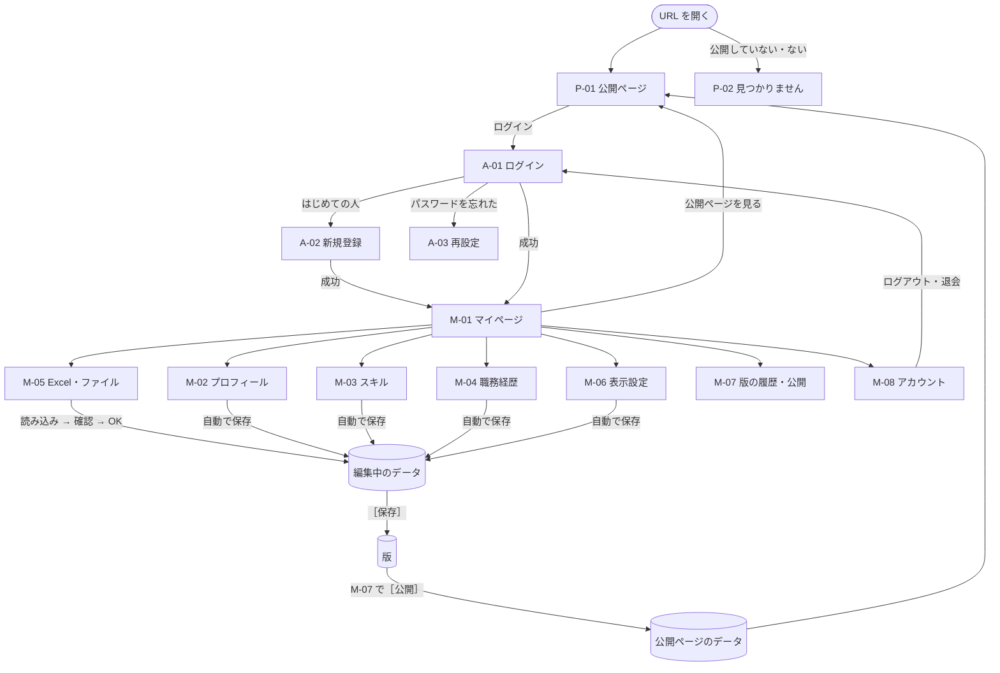
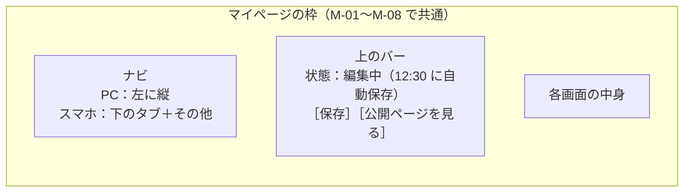

# 画面設計

> 次の構成の画面の一覧・URL・遷移と、各画面でできること。要件は [要件定義](requirements.md)、データは [データ設計](data-model.md)。今の画面の細かい仕様は [画面仕様書](../screens/README.md)（公開ページはこれを引き継ぐ）。
> 2026-11-06 時点の案。★ は最初の一覧になかったが、要件を満たすのに要る画面。

---

## 1. 画面の一覧

| ID | 画面 | URL（案） | ログイン | 主にできること | 今の画面との関係 |
|---|---|---|---|---|---|
| P-01 | 公開ページ（Home） | `/u/{slug}` | いらない | 公開した版の Home・About・Skills・Projects を見る、案件の詳細 | 今のメイン画面（SCR-01）・詳細（MDL-01）をそのまま |
| P-02 | 見つかりません | ─ | いらない | 公開していない・ない URL のとき | 新規 |
| A-01 | ログイン | `/login` | いらない | メールアドレスとパスワードでログイン | 新規 |
| A-02 | 新規登録 ★ | `/signup` | いらない | 登録、確認のメール | 新規 |
| A-03 | パスワードの再設定 ★ | `/reset-password` | いらない | 再設定のメールを送る・新しいパスワード | 新規 |
| M-01 | マイページ | `/me` | いる | 今の状態（編集中・保存した版・公開中の版）、各画面への入口、公開ページを見る | 新規 |
| M-02 | プロフィールの編集 | `/me/profile` | いる | Home / About の項目、スキルシートだけの項目（非公開） | 入力画面（DLG-01）の中身をフォームに |
| M-03 | スキルの編集 | `/me/skills` | いる | 直近 / 過去の主な技術、技術名の分類の確認 | 新規（集計は今の Skills と同じ） |
| M-04 | 職務経歴の編集 | `/me/projects`・`/me/projects/{id}` | いる | 一覧・追加・編集・削除・並び替え、Work / Private | ［データ］（DLG-03）・入力フォーム（DLG-04） |
| M-05 | Excel・ファイル | `/me/files` | いる | Excel / YAML / Markdown の読み込み（→ 確認 → 編集中へ）、Excel / PDF の書き出し、テンプレートの保存 | アップロード画面（DLG-07）・［ダウンロード］（MNU-01） |
| M-06 | Home の表示設定 | `/me/display` | いる | 公開する項目・セクション・プロジェクトの選択、並び、既定の表示 | 新規 |
| M-07 | 版の履歴・公開 ★ | `/me/versions` | いる | 版の一覧・違いを見る・戻す、公開・公開を止める | 新規 |
| M-08 | アカウント ★ | `/me/account` | いる | パスワードの変更、ログアウト、退会 | 新規 |

- `/`（トップ）に何を出すか（サイトの持ち主の公開ページか、紹介とログインか）は [D-08](decisions.md#d-08-url-の形とトップに出すもの)。
- `slug` は公開ページの URL に使う名前（英数字とハイフン）。M-08 で変えられる。

## 2. 画面の遷移

- `/me` 以下をログインしないで開くと A-01 に移り、ログインしたら元の画面に戻る。
- トークンの期限が切れたら、更新用のトークンで自動で取り直す。取り直せなければ A-01 へ（編集中のデータは自動で保存済みなので消えない）。

## 3. マイページの共通の作り

| 要素 | 決まり |
|---|---|
| 状態の表示 | 「保存していない変更あり」「12:30 に自動保存」「版 5 を公開中」。保存に失敗したら赤で出し、もう一度試す |
| ［保存］ | 編集中のデータから版を作る（メモを付けられる）。変更がなければ押せない |
| 自動の保存 | 入力が止まって 3 秒後と、画面を移るときに編集中のデータを保存（書き込みの回数を抑える。[データ設計](data-model.md#6-書き込みの回数と容量の見積もり)） |
| 離れるとき | 保存できていない変更があれば知らせる |
| 部品・色 | 今のデザインシステム（[デザインシステム](../design-system.md)）のまま。ナビは M3 の NavigationRail / NavigationBar |

## 4. 各画面でできること

### A-01 ログイン・A-02 新規登録・A-03 再設定

- 項目：メールアドレス、パスワード（表示の切り替え）。新規登録は確認用にもう一度。
- 誤り：「メールアドレスかパスワードが違います」（どちらが違うかは言わない）、続けて失敗すると「しばらくしてからお試しください」。
- 新規登録を招待だけにする場合（[D-03](decisions.md#d-03-新規登録を誰に開くか)）、許可していないメールアドレスは登録できない。

### M-01 マイページ

- 状態のカード：編集中の変更の有無、最後に保存した版、公開中の版と公開ページの URL（コピー）。
- 入口：プロフィール・スキル・職務経歴・Excel・表示設定・版の履歴。
- はじめてのとき：「Excel かファイルから読み込む」「画面で入力する」の 2 つを大きく出す（今の入力画面の役割）。

### M-02 プロフィールの編集

| まとまり | 項目 | 公開 |
|---|---|---|
| Home | 名前★・職種★・紹介文★ | 表示設定による |
| About | 自己紹介★・得意な領域・強み・開発スタイル・締めの一言・直近 / 過去の開発経験 | 表示設定による |
| スキルシートだけ | ふりがな・性別・生年月日（年齢は自動）・国籍・配偶者・最寄駅・学歴 | **公開しない**（鍵の印を付ける） |

★ は必須（今のテンプレートと同じ）。

### M-03 スキルの編集

- 直近 / 過去の主な技術（分類 → 技術のタグ）。入力は今の入力フォームのタグ入力（候補・カンマ区切り）。
- プロジェクトから集計したスキル（今の Skills のグラフ）を見て、表記ゆれ・分類の確認をする。

### M-04 職務経歴の編集

- 一覧：Work / Private の切り替え、並び替え（ドラッグ・上下のボタン）、公開 / 非公開の印。
- 追加・編集：今の入力フォーム（技術はグループごとのボタン＋タグ、期間は年月の選択、役割・規模、Work は担当の工程）。
- 削除は確認してから。消したものも、前の版に戻せば戻る。

### M-05 Excel・ファイル

- 読み込み：Excel / YAML / Markdown を選ぶ・貼り付ける → 確認画面（今の上書きの確認と同じ、なくなる・変わる・追加される件数）→ OK で編集中のデータに入る（まだ保存・公開はしない）。
- 書き出し：版を選んで、スキルシート（Excel / PDF）・YAML・Markdown を保存。
- テンプレートの保存・コピー（今と同じ）。

### M-06 Home の表示設定

| 対象 | 設定できること |
|---|---|
| セクション | About・Skills・Projects を出す / 出さない、並び（Home は必ず先頭） |
| Home | 職種・紹介文・まとめ（開発経験・件数・直近のプロジェクト）を出す / 出さない |
| About | 自己紹介・得意な領域・強み・開発スタイル・締めの一言・開発経験・主な技術を出す / 出さない |
| Skills | 出す分類（言語・FW・DB…）、既定の分類 |
| Projects | Work / Private のタブを出す / 出さない、**プロジェクトごとに公開 / 非公開**、項目（詳細・リンク・役割・規模）を出す / 出さない、既定の表示（List / Collection）と並び |
| スキルシート | 見る人にスキルシートの保存を許すか（許す場合もスキルシートだけの項目は入れない） |
| 見た目 | 既定のテーマ（ライト / ダーク / 端末に合わせる） |

- 右側（スマホは切り替え）に**公開ページのプレビュー**を出し、設定がすぐ分かるようにする。
- 設定は編集中のデータの一部で、［保存］→［公開］で公開ページに反映する。

### M-07 版の履歴・公開

- 版の一覧：番号・日時・メモ・作り方（画面・Excel・ファイル）・公開中の印。
- 2 つの版の違い（プロジェクトの追加・変更・削除、プロフィールの変わった項目）を見る。
- ［この版に戻す］：その版の中身を編集中のデータにする（今の編集中のデータは、先に版として残すか聞く）。
- ［公開］：選んだ版を公開する。確認画面で「公開される項目」を一覧で出す。［公開を止める］。

### M-08 アカウント

- メールアドレスの表示、公開ページの URL（slug）の変更、パスワードの変更、ログアウト（すべての端末から）、退会（確認の文字を入力してから。すべてのデータを消す）。
