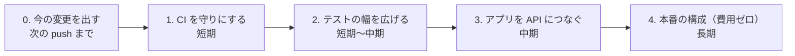
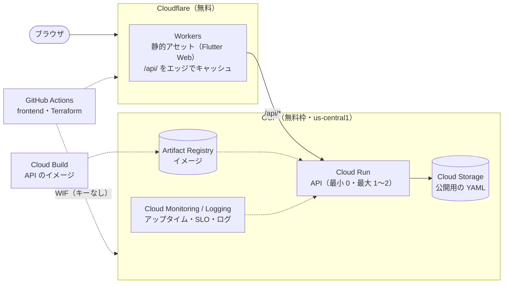

# 今後の動き

> テスト・CI・アプリ・インフラを、これからどの順で進めるか。終わったものは「済」にして、[CI の状況](ci/ci-status.md) や [設計](design.md) に反映する。
> 更新：2026-11-06

---

## 段階の一覧

| 段階 | 目安 | 中身 |
|---|---|---|
| 0. 今の変更を出す | 次の push まで | 残りのテストの確認、push、CI が初めて動くのを確かめる |
| 1. CI を「守り」にする | 短期 | デプロイをテストの成功のあとに、ブランチの保護、Docker のビルドの確認、api の網羅率 |
| 2. テストの幅を広げる | 短期〜中期 | 仕様の確認待ちの 2 件、ゴールデンテスト、E2E、依存関係の更新 |
| 3. アプリを API につなぐ | 中期 | 状態管理の整理（Riverpod）、Repository 層、frontend と api のつなぎのテスト |
| 4. 本番の構成（費用ゼロ） | 長期 | Cloudflare＋GCP の無料枠、Terraform、Cloud Build、監視・SLO |

---

## 0. 今の変更を出す（次の push まで）

| 作業 | 完了の目安 |
|---|---|
| `flutter test test/coverage_extra_test.dart`（ページ送りの修正の確認） | 成功 |
| `flutter analyze` をローカルで | 指摘 0 件 |
| `develop` に push | Actions の Test・Deploy の両方が成功、公開ページが開ける |
| 結果を [CI の状況](ci/ci-status.md) に書く | 1・2 章が更新されている |

## 1. CI を「守り」にする（短期）

| 作業 | 内容 | 完了の目安 |
|---|---|---|
| デプロイをテストの成功のあとに | Deploy を Test の成功で動かす（`workflow_run`、または 1 つのワークフローの中で `needs: [frontend, api-hono]`） | テストが失敗すると公開されない |
| ブランチの保護 | `develop` / `main` はプルリクエストで入れ、Test の成功を必須にする（GitHub の設定） | 失敗したままでは入らない |
| Docker のビルドの確認 | `docker compose build` と、起動して `/healthz`・`/api/profile` に 200 が返るかのジョブ | Dockerfile・nginx の設定が壊れたら CI が気づく |
| api の網羅率 | `node --test --experimental-test-coverage`（Node の標準）で行・分岐を測り、frontend と同じく 90% 以上 | 基準を CI で確かめている |
| 網羅率の推移を見えるようにする | プルリクエストに網羅率の差をコメントする（任意） | 下がったときに気づける |

## 2. テストの幅を広げる（短期〜中期）

| 作業 | 内容 | 完了の目安 |
|---|---|---|
| 仕様の確認待ちの 2 件を決める | 期間で絞り込むと期間のない案件が残る／Skills のグラフとフィルターで区切り方が違う。直すなら、先に期待する動きのテストを書く | 決めた仕様のテストがある |
| ゴールデンテスト | 主な画面（Home・Skills・Projects・詳細・入力画面）を、ライト / ダーク × スマホ / PC で画像として固定し、見た目の変化に気づく | 意図しない見た目の変化で失敗する |
| E2E | `docker compose up` した実物を Playwright で開き、入力画面 → アップロード → Skills / Projects の表示までを実ブラウザで確かめる。CI でも動かす | 主な流れが実ブラウザで通る |
| 手動の確認を減らす | [テスト計画書](testing/test-plan.md#7-手動で確かめること) の手動の項目のうち、E2E にできるものを移す | 手動の項目が減っている |
| 依存関係の更新 | Dependabot（pub・GitHub Actions・Docker イメージ）。更新のプルリクエストでも Test が動く | 古い版に気づける |

## 3. アプリを API につなぐ（中期）

> ログイン・マイページ・Firestore への保存まで含めた詳しい計画は [次の構成の計画](plan/README.md)。backend（shelf）は 2026-11-06 に Hono（`services/api-hono/`）に置き換えた。

| 作業 | 内容 | 完了の目安 |
|---|---|---|
| 状態管理の整理 | Riverpod で、データの読み込みと作り直しをまとめる（画面の見た目・操作は変えない。ゴールデンテストで確かめながら）。**済み**（2026-11-06）：テーマ・プロフィール・Work / Private・Skills の集計・Projects の一覧を Provider にし、Home・About・Skills・Projects は Provider から読む。データが変わったときに Skills / Projects を作り直す `ValueKey` は、タブ・フィルターを初めに戻すために残した（前と同じ動き） | 画面が Provider から読む |
| Repository 層 | 読み先（サンプル・sessionStorage・API）を切り替えられるようにし、API から自分のデータを最初に表示する。**済み**（2026-11-06）：`PortfolioRepository`（`lib/data/`）は構造のデータ（Map）で受け渡し、実装が書くのは 5 つの読み書きだけ。書き込みはすべて Repository 経由。残り：API の実装 | 画面を変えずに API から読める |
| 画面の URL | go_router で URL を分ける。**済み**（2026-11-06）：`/`、`ENABLE_ACCOUNT` のときだけ `/login`・`/me`・`/me/edit`（空の画面。`#` 付きのまま）。残り：中身（[画面設計](plan/screens.md)） | 画面ごとに URL がある |
| 共通の検証 | `utils/data_format.dart` を共通のパッケージに分け、frontend と api で同じ形の確認を使う（言語が違うので、形の定義を 1 か所に置いて両方で使う方法を考える） | 検証が 1 か所 |
| つなぎのテスト | api の応答を frontend の読み込みに通すテスト（契約テスト） | 応答の形が変わったら気づける |

## 4. 本番の構成（費用ゼロ、長期）

> サービスごとの置き場所と無料枠の守り方は [サービスの構成](plan/architecture.md)。

| 作業 | 内容 |
|---|---|
| 配信 | Cloudflare（Workers の静的アセット）。`/api/` は Cloud Run へ転送し、エッジでキャッシュ |
| API | GCP の無料枠：Cloud Run（最小 0・最大 1〜2 インスタンス）、Artifact Registry、Cloud Storage（us-central1） |
| IaC | Terraform（google / cloudflare プロバイダ、state は GCS）。プルリクエストで plan、マージで apply。GitHub Actions からは Workload Identity Federation（キーを置かない） |
| CI/CD | frontend と IaC は GitHub Actions、API のイメージは Cloud Build（`services/` が変わったときだけ） |
| 監視 | Cloud Monitoring のアップタイムチェック、SLO（可用性 99.5%・レイテンシ）のバーンレートアラート、構造化ログ（api は対応済み）、予算のアラート（$1） |

決まりごと：無料枠を超えないこと（最大インスタンス数・キャッシュ・イメージの世代の整理・予算の通知）。費用の詳細と構成案は [設計](design.md#今後)。
