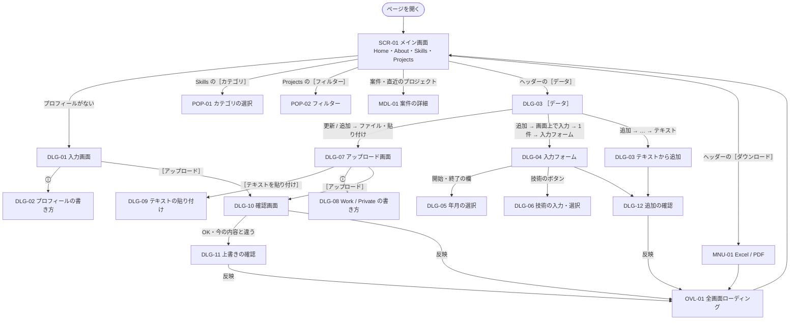

# 画面仕様書

> 各画面の目的・開き方・レイアウト・項目・動き・メッセージ・画面の幅による違い。見た目の決まりは [デザインシステム](../design-system.md)、UX の決まりとブレークポイントは [UI / UX](../ui-ux.md)、操作の手順は [操作説明書](../manual.md)。
> 2026-11-06 時点のコード（`frontend/lib/`）から書き起こした。文言は `lib/constants/app_texts.dart` のとおり。画面を変えたら、ここも直す。

| ファイル | 中身 |
|---|---|
| この README | 画面の一覧、画面の遷移、共通の仕様 |
| [main.md](main.md) | メイン画面（ヘッダー・Home・About・Skills・Projects）、ポップアップ（カテゴリ・フィルター）、案件の詳細 |
| [dialogs.md](dialogs.md) | 入力画面、アップロード画面、［データ］、入力フォーム、確認画面、［ダウンロード］ |

---

## 1. 画面の一覧

| ID | 画面 | 種類 | 開き方 | 主なファイル |
|---|---|---|---|---|
| SCR-01 | メイン画面 | ページ（1 枚） | ページを開く | `pages/home_page.dart` |
| SCR-01-H | ヘッダー（PC / スマホ）・メニュー | メイン画面の上部・ドロワー | 常に表示 | `sections/header/` |
| SEC-01 | Home | メイン画面のセクション | ナビ「Home」 | `sections/hero_section.dart` |
| SEC-02 | About | 同上 | ナビ「About」 | `sections/about_section.dart` |
| SEC-03 | Skills | 同上 | ナビ「Skills」、Home の［スキルを見る］ | `sections/skills/` |
| SEC-04 | Projects | 同上 | ナビ「Projects」、Home の［プロジェクトを見る］・件数 | `sections/projects/` |
| POP-01 | カテゴリの選択 | ポップアップ | Skills の［カテゴリ］ | `skills/widgets/skills_category_filter.dart` |
| POP-02 | フィルター | ポップアップ | Projects の［フィルター］ | `projects/filters/ui/project_filter_panel.dart` |
| MDL-01 | 案件の詳細 | ダイアログ / 全画面 | 一覧の案件、Home の直近のプロジェクト | `projects/views/project_list/project_list_modal_function.dart` |
| DLG-01 | 入力画面（プロフィール） | ダイアログ（閉じられない） | プロフィールがないとき自動 | `widgets/profile_setup_dialog.dart` |
| DLG-02 | プロフィールの書き方 | ダイアログ | DLG-01 の ⓘ | 同上 |
| DLG-03 | ［データ］ | ダイアログ（段階式） | ヘッダーの［データ］ | `sections/header/project_data_dialog.dart` |
| DLG-04 | 入力フォーム | DLG-03 の段階 | ［データ］→ 追加 → … → 入力フォーム | `sections/header/project_form.dart` |
| DLG-05 | 年月の選択 | ダイアログ | DLG-04 の開始・終了の欄 | `widgets/year_month_picker.dart` |
| DLG-06 | 技術の入力・選択 | ポップアップ | DLG-04 の技術の項目のボタン | `widgets/tag_input_field.dart` ほか |
| DLG-07 | アップロード画面（Work / Private） | ダイアログ | ［データ］→ 更新 / 追加 → ファイル・貼り付け | `sections/header/yaml_upload_dialog.dart` |
| DLG-08 | Work / Private の書き方 | ダイアログ | DLG-07 などの ⓘ | `sections/header/yaml_format_help.dart` |
| DLG-09 | テキストの貼り付け | ダイアログ | ［テキストを貼り付け］ | `widgets/upload_parts.dart` |
| DLG-10 | 確認画面（アップロード） | ダイアログ | ［アップロード］ | 同上（`confirmUpload`） |
| DLG-11 | 上書きの確認 | ダイアログ | DLG-10 の OK のあと、今の内容と違うとき | 同上（`confirmOverwrite`） |
| DLG-12 | 追加の確認 | ダイアログ | ［データ］で追加するとき | `sections/header/project_add_confirm.dart` |
| MNU-01 | ［ダウンロード］のメニュー | メニュー | ヘッダーの［ダウンロード］ | `sections/header/download_menu.dart` |
| OVL-01 | 全画面ローディング | 画面全体を覆う | 反映中・スキルシートの作成中 | `widgets/upload_parts.dart`（`runReloading`） |

## 2. 画面の遷移

- 段階のあるダイアログ（DLG-03・DLG-07）は［戻る］で 1 つ前に戻れる。［データ］から開いた DLG-07 の［戻る］は、［データ］の直前の段階に戻る。
- ［キャンセル］・× ・外側のタップ・Esc で閉じると、何も変えずに元の画面に戻る（DLG-01 だけは閉じられない）。

## 3. 共通の仕様

### 3.1 レイアウト

- 対応する最小の幅は 320px。それより狭いと、320px のレイアウトを縮小して表示する。
- スクロールはメイン画面全体の 1 つだけ。ダイアログ・ポップアップは本文だけがスクロールし、見出しとボタンは固定。
- ポップアップ（POP-01・POP-02・DLG-06）は、幅 600px 以上は中央のダイアログ、未満は下からのシート。
- ブレークポイントの一覧は [UI / UX](../ui-ux.md#21-ブレークポイント)。

### 3.2 ボタンの決まり

| 種類 | 部品 | 例 |
|---|---|---|
| その画面の主な操作（1 つ） | FilledButton | ［アップロード］［反映］［OK（アップロード）］［OK（追加）］ |
| 補助の操作 | TextButton / OutlinedButton | ［キャンセル］［戻る］［テンプレートを保存］ |
| 押せない状態 | 薄い表示（隠さない） | 読み込む前の［アップロード］、最初の案件の［前へ］ |

### 3.3 メッセージ

| 種類 | 出し方 | 例 |
|---|---|---|
| 入力の誤り | 画面の中に、理由を「・」の箇条書き（赤）で。何件目・何行目を付ける | 「2 件目：title（プロジェクト名）がありません」「3 行目：使えない項目があります：skils」 |
| 処理の結果 | 画面の下に SnackBar | 「プロフィールを読み込みました」「スキルシート（Excel） を保存しました（skill_sheet_20261106.xlsx）」 |
| 空の状態 | その場所に文言 | 「データがありません」「ヒットしませんでした」 |
| 確認 | ダイアログ | 「この内容でアップロードしますか？」「今の内容が上書きされます」 |

### 3.4 テーマ・データの保存

- ライト / ダークは、ヘッダーで切り替える（保存しない。開くといつもライト）。
- 読み込んだデータ（プロフィール・Work・Private）は、ブラウザの sessionStorage（このタブの中だけ）に保存する。サーバーには送らない。
