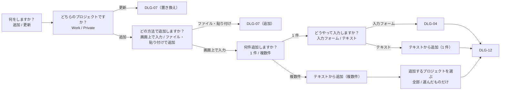

# 画面仕様書：ダイアログ

> DLG-01〜DLG-12（入力画面・アップロード・［データ］・入力フォーム・確認）、MNU-01（［ダウンロード］）、OVL-01（全画面ローディング）。一覧と遷移は [画面仕様書](README.md)。

---

## DLG-01 入力画面（プロフィール）

| 項目 | 内容 |
|---|---|
| 目的 | Home / About に出すプロフィールを読み込む（同じファイルに書いた Work / Private も一緒に） |
| 開き方 | メイン画面を開いたとき、プロフィールがなければ自動で |
| 閉じ方 | **正しいプロフィールを読み込んでアップロードするまで閉じられない**（外側のタップ・Esc・ブラウザの戻るでも閉じない） |

| No | 項目 | 種類 | 表示・内容 | 操作・動き | 条件 |
|---|---|---|---|---|---|
| 1 | 見出し | 表示 | 「あなたのことを教えてください」 | ― | |
| 2 | ⓘ | アイコンボタン | ツールチップ「書き方の説明」 | DLG-02 を開く | |
| 3 | 説明 | 表示 | 読み込むもの・閉じられないこと | ― | |
| 4 | 入力方法 | 切替 | 「Excel（スキルシート）」「YAML / Markdown」 | 切り替えると、選んでいたファイルは取り消す | はじめは YAML / Markdown |
| 5 | 手順 | 番号付きの並び | 入力方法ごとの 3 つの手順 | ― | |
| 6 | 起動時のエラー | 表示（赤） | 「起動時に指定した YAML を読み込めませんでした」と理由 | ― | 起動時に指定したファイルが読めず、まだファイルを選んでいないとき |
| 7 | テンプレート（YAML / Markdown） | 切替＋ボタン | 形式「YAML」「Markdown」、［テンプレートを保存］［テンプレートをコピー］ | 保存：名前を付けて保存。コピー：クリップボードへ（「… の内容をコピーしました」） | 入力方法が YAML / Markdown |
| 8 | データ（YAML / Markdown） | ボタン | ［ファイルを選択］（2 回目からは［別のファイルを選択］）、［テキストを貼り付け］ | ファイル（.yaml / .yml / .md / .markdown）を選ぶ・DLG-09 を開く。読んだ時点で形式を確かめる | 同上 |
| 9 | テンプレート（Excel） | ボタン | ［Excel テンプレートを保存］ | 名前を付けて保存（`skill_sheet.xlsx`） | 入力方法が Excel |
| 10 | データ（Excel） | ボタン | ［Excel を選択］（2 回目からは［別の Excel を選択］） | .xlsx / .xlsm を選ぶ → YAML を作って確かめる | 同上 |
| 11 | 読み込みの状態 | 表示 | 「まだ読み込んでいません（…）」／「me.yaml（読み込めます）」（緑）／「me.yaml（読み込めません）」（赤）と理由の箇条書き | ― | |
| 12 | 一緒に読み込むもの | 表示 | 「Work 2 件・Private 1 件 も一緒に読み込みます（Skills と Projects も切り替わります）」 | ― | Work / Private も書かれているとき |
| 13 | ［作った YAML を保存］ | ボタン | 説明「Excel から作った YAML を保存しておくと、次回はその YAML を指定して起動できます」 | 名前を付けて保存 | Excel から読み込めたとき |
| 14 | 次回の起動方法 | 表示（コード） | 「dart run tool/run.dart あなたのファイル.yaml（.md・.xlsx も可）」 | 選んでコピーできる | |
| 15 | ［アップロード］ | ボタン（主） | | DLG-10 を開く | 読み込めるときだけ押せる |

| 誤りのメッセージ（例） | いつ |
|---|---|
| 「.yaml / .yml / .md / .markdown のファイルだけ選べます」 | 拡張子が違う |
| 「.xlsx / .xlsm のファイルだけ選べます（.xls は …）」 | Excel で拡張子が違う |
| 「ファイルの読み込みに失敗しました: …」 | 選ぶ途中のエラー、UTF-8 でない中身 |
| 「YAML の書き方に誤りがあります（…）」「必須の項目が空です：about.intro」「使えない項目があります：projects」 | 中身の誤り |
| 「Excel（.xlsx）として読み込めません。…」「「氏名」の欄が見つからないか、空です」 | Excel の中身の誤り |
| 「保存に失敗しました: …」（SnackBar） | テンプレートの保存に失敗 |

アップロードできたら：画面を閉じ → OVL-01 → SnackBar「プロフィールを読み込みました」。

## DLG-02 プロフィールの書き方

| No | 項目 | 内容 |
|---|---|---|
| 1 | 見出し | 「プロフィール YAML の書き方」 |
| 2 | 基本ルール | home: と about: に分ける、インデントは半角スペース 2 つ、★ は必須、複数行は「|」 |
| 3 | 各項目 | home.name ★ 〜 about.recent_tech / past_tech（★ 必須 / 任意） |
| 4 | Markdown で書く場合 | 「# home」「# about」、「- キー: 値」、「## キー」の下に複数行 など |
| 5 | Work / Private も一緒に | YAML は `work:` / `private:`、Markdown は「# work」「# private」 |
| 6 | ［閉じる］ | 閉じて DLG-01 に戻る |

---

## DLG-03 ［データ］

| 項目 | 内容 |
|---|---|
| 目的 | Work / Private のプロジェクトを追加・更新する |
| 形 | 1 つのダイアログの中で段階を進める。上にこれまでの選択（「追加 › Work › …」）、［戻る］で 1 つ前、［キャンセル］で閉じる |

| 段階 | 選択肢（説明） |
|---|---|
| 何をしますか？ | 追加（今の一覧はそのままで、新しいプロジェクトを後ろに足します）／更新（ファイルや貼り付けた内容で、丸ごと置き換えます） |
| どちらのプロジェクトですか？ | Work（業務のプロジェクト）／Private（個人開発のプロジェクト） |
| どの方法で追加しますか？ | 画面上で入力／ファイル・貼り付けで追加 |
| 何件追加しますか？ | 1 件／複数件（YAML / Markdown のテキストやファイルから、まとめて追加します） |
| どうやって入力しますか？ | 入力フォーム（項目ごとに入力します）／テキスト（YAML / Markdown） |

### テキストから追加

| No | 項目 | 種類 | 表示・内容 | 操作・動き |
|---|---|---|---|---|
| 1 | テンプレート・データ | DLG-07 と同じ部品 | 形式、［テンプレートを保存］［テンプレートをコピー］、［ファイルを選択］［テキストを貼り付け］、ⓘ | |
| 2 | ［サンプルを入力欄に入れる（上で選んだ形式）］ | ボタン | 1 件：テンプレート、複数件：3 件入ったサンプル | 入力欄に入れる |
| 3 | 入力欄 | 複数行のテキスト | 例「- title: プロジェクト名 …」 | 書く・貼り付ける |
| 4 | 結果 | 表示 | 「3 件のプロジェクトが見つかりました」／誤りの箇条書き | |
| 5 | 追加するプロジェクトを選ぶ（複数件） | チェック | ［全部追加する］／［選んだものだけ追加する］、「5 件中 3 件を選んでいます」、［すべて選ぶ］［すべて外す］ | |

| 誤りのメッセージ | いつ |
|---|---|
| 「プロジェクトが見つかりません（「projects:」の下か、「- title:」から書いてください）」 | 空・プロジェクトがない |
| 「2 件目：title（プロジェクト名）がありません」「1 件目：Work は workflow（担当した工程）が必要です」「1 件目：Private には workflow を書きません」「3 件目：「title: …」などの項目の形で書いてください」 | 項目の誤り |
| 「2 件あります。1 件だけ書くか、前の画面で「複数件」を選んでください」 | 1 件を選んだのに 2 件以上 |
| 「1 件以上選んでください」 | 選んだものだけで 0 件 |

## DLG-04 入力フォーム

| No | 項目 | 種類 | 表示・内容 | 操作・動き | 制約・メッセージ |
|---|---|---|---|---|---|
| 1 | プロジェクト名 ★ | 入力欄 | | | 必須：「プロジェクト名を入れてください」 |
| 2 | 説明（1 行） | 入力欄 | | | |
| 3 | 詳細（複数行） | 入力欄（複数行） | | | |
| 4 | 開始・終了 | 欄（押して選ぶ） | 「2024年4月」。ツールチップ「押すと年月を選べます」、［消す］ | DLG-05 を開く | 「開始を入れてください」「終了を入れるか、「進行中」にチェックしてください」「終了は開始と同じか、より後にしてください」 |
| 5 | 進行中（終わりは「現在」） | チェック | | 終了を「現在」にする | |
| 6 | リンク（URL） | 入力欄 | | | |
| 7 | 役割 | ボタン（バッジ） | 「押すと入力欄と候補（PM・PL・SE・PG など）が開きます」 | DLG-06 | |
| 8 | 規模 | 入力欄 | 例「全体 20名（チーム 5名）」 | | |
| 9 | 使った技術 | ボタン（項目ごと、入れた数のバッジ）＋一覧「項目：A, B」 | Skills・Tools はグループごと | DLG-06 | |
| 10 | そのほかの技術 | 同上 | UI・テスト・クラウド・コンテナ・AI | DLG-06 | |
| 11 | 担当した工程 | チップ | 要件定義 〜 保守・運用 | 選ぶ | Work だけ |
| 12 | ⓘ・［戻る］・［次へ］ | ボタン | | ［次へ］で確かめて DLG-12 | |

## DLG-05 年月の選択

| No | 項目 | 種類 | 表示・内容 | 操作・動き |
|---|---|---|---|---|
| 1 | 年 | 表示＋ボタン | 「2024年」、‹ ›（「前の年」「次の年」） | 押すと年の一覧（12 年ずつ、‹ › で「前の 12 年」「次の 12 年」） |
| 2 | 月 | ボタン × 12 | 「1月」〜「12月」 | 選ぶ |
| 3 | ［キャンセル］［OK］ | ボタン | | OK で選んだ年月を返す（欄には「2024年4月」、保存は「2024-04」） |

- 選べる範囲：1980 年 〜 今年の 5 年先。終了は開始より前を、開始は終了より後を選べない（押せない）。

## DLG-06 技術の入力・選択

| No | 項目 | 種類 | 表示・内容 | 操作・動き |
|---|---|---|---|---|
| 1 | 入力（打つと候補が出ます） | タグ入力 | 入れたタグ（× で消す） | 打つと今の Work / Private にある名前が候補に出る（↑↓・Enter でも選べる）。カンマ（, 、 ，）か Enter で区切る。空の欄で Backspace 1 回目で直前を強調、2 回目で消す。日本語の変換中は区切らない |
| 2 | すでにある項目（押すと追加、もう一度押すと外す） | チップ | 今の Work / Private にある名前（表記ゆれは 1 つ） | 押すと追加・外す。ないときは「まだありません。上の欄に入力してください」 |
| 3 | ［完了］ | ボタン | | 閉じる（打ちかけの文字もタグにする） |

- 同じもの（表記ゆれを含む）は 2 つ入らない。

---

## DLG-07 アップロード画面（Work / Private）

| 項目 | 内容 |
|---|---|
| 目的 | YAML / Markdown のファイルかテキストを読み込み、Work / Private を置き換える（更新）か、後ろに足す（追加） |
| 見出し | 更新：「Work用 YAMLのアップロード」「Private用 YAMLのアップロード」／追加：「Work に追加（ファイル・貼り付け）」 |

| No | 項目 | 種類 | 表示・内容 | 操作・動き | 条件 |
|---|---|---|---|---|---|
| 1 | ⓘ | アイコンボタン | 「書き方の説明」 | DLG-08 | |
| 2 | 説明・手順 | 表示 | 3 つの手順 | | |
| 3 | テンプレート（ひな形） | 切替＋ボタン | 形式「YAML」「Markdown」、［テンプレートを保存］［テンプレートをコピー］ | 保存・コピー | |
| 4 | データを読み込む | ボタン | ［ファイルを選択］／［別のファイルを選択］、［テキストを貼り付け］ | 選ぶ・DLG-09。読んだ時点で確かめる | |
| 5 | 読み込みの状態 | 表示 | DLG-01 の 11 と同じ | | |
| 6 | 案内 | 表示 | 「「ファイルを選択」か「テキストを貼り付け」で正しい YAML を読み込むと、アップロードできます」、「読み込んだ内容はこのタブの中だけで使います（…サーバーには送りません）」 | | |
| 7 | ［戻る］ | ボタン | | ［データ］の直前の段階に戻る | ［データ］から開いたとき |
| 8 | ［キャンセル］［アップロード］ | ボタン | | ［アップロード］で DLG-10 | 読み込めるときだけ押せる |

| 誤りのメッセージ | いつ |
|---|---|
| 「フォーマットが一致しません。このファイルは work 用ではありません（format_work.yaml の構造を満たしていません）」 | Work に Private の形式、など |
| 「3 行目：使えない項目があります：skils」など（行番号付き） | Markdown の書き方の誤り |
| 「ファイルの読み込みに失敗しました: …」 | 選ぶ途中のエラー、UTF-8 でない中身 |

## DLG-08 Work / Private の書き方

見出し「Work 用 YAML の書き方」/「Private 用 YAML の書き方」。基本ルール（Work は workflow が必須、Private は書かない）、各項目、工程の一覧（Work だけ）、サンプル（YAML・Markdown のテンプレートの中身。読めなければ「サンプルを読み込めませんでした」、読み込み中はローディング）、Markdown で書く場合、［閉じる］。

## DLG-09 テキストの貼り付け

| No | 項目 | 種類 | 表示・内容 | 操作・動き |
|---|---|---|---|---|
| 1 | 見出し・説明 | 表示 | 「YAML / Markdown を貼り付け」、形式は自動で見分けること | |
| 2 | ［クリップボードから貼り付け］ | ボタン | | 入力欄に貼る。空なら「クリップボードにテキストがありません」、読めなければ「クリップボードを読めませんでした。…」 |
| 3 | 入力欄 | 複数行（8〜16 行） | 例（YAML・Markdown）。前に貼ったテキストが入っている | × で消す |
| 4 | ［クリア］ | ボタン | | 入力欄を空にする |
| 5 | ［キャンセル］［読み込む］ | ボタン | | ［読み込む］で読んで確かめる（空なら押せない） |

## DLG-10 確認画面（アップロード）

| No | 項目 | 表示・内容 |
|---|---|---|
| 1 | 見出し | 「この内容でアップロードしますか？」 |
| 2 | 読み込み元 | 「読み込み元：me.yaml」 |
| 3 | 置き換わるもの | 「今表示している プロフィール（Home / About）・Work 2 件 の内容は、この内容に置き換わります。」 |
| 4 | 中身 | プロフィール：Home（名前・職種・紹介文）、About（自己紹介・得意な領域 …）。Work / Private：「Work：プロジェクト 3 件」と番号付きの案件名（最大の高さ 320 でスクロール） |
| 5 | ［戻る］［OK（アップロード）］ | 戻る：何も変えずに前の画面へ。OK：今の内容と違えば DLG-11、同じなら反映 |

## DLG-11 上書きの確認

| No | 項目 | 表示・内容 |
|---|---|---|
| 1 | 見出し・説明 | 「今の内容が上書きされます」「アップロードすると今の内容は上書きされ、元には戻せません。」 |
| 2 | 違い | 「なくなるプロジェクト（n 件）」「内容が変わるプロジェクト（n 件）」「追加されるプロジェクト（n 件）」と案件名（各 8 件まで、残りは「…ほか n 件」） |
| 3 | 質問 | 「それでもアップロードしますか？」 |
| 4 | ［やめる］［上書きしてアップロード］ | やめる：何も変えずに戻る。上書き：反映 |

- 書き方だけの違い（YAML / JSON、キーの順番、末尾の改行など）は、違いとして数えない。

## DLG-12 追加の確認

| No | 項目 | 表示・内容 | 操作 |
|---|---|---|---|
| 1 | 見出し | 「この内容で追加しますか？」 | |
| 2 | 説明 | 「Work の今の 3 件の後ろに、2 件を追加します。」 | |
| 3 | 追加するもの | 案件名の一覧 | |
| 4 | 同じ名前 | 「同じ名前のプロジェクトがすでにあります：A（両方とも残ります）」 | 同じ名前があるときだけ |
| 5 | サンプルを外す | チェック「今表示しているサンプルは外す（追加したものだけにする）」 | サンプルを表示中のときだけ。はじめはチェックあり |
| 6 | ［戻る］［OK（追加）］ | | OK で反映 → SnackBar「Work に 2 件追加しました」 |

---

## MNU-01 ［ダウンロード］のメニュー

| No | 項目 | 操作・動き |
|---|---|---|
| 1 | 「Excel（.xlsx）で名前を付けて保存…」 | 先に保存のダイアログ（名前 `skill_sheet_YYYYMMDD.xlsx`）→ 保存先が決まったら OVL-01「スキルシートを作っています…」→ SnackBar |
| 2 | 「PDF で名前を付けて保存…」 | 同上（`.pdf`） |

| 結果 | SnackBar |
|---|---|
| 保存した（Chrome / Edge） | 「スキルシート（Excel） を保存しました（skill_sheet_20261106.xlsx）」 |
| ダウンロードした（Firefox / Safari） | 「… をダウンロードしました（…）」 |
| 保存をやめた | 「スキルシート（Excel） の保存をやめました」 |
| 失敗 | 「スキルシート（Excel） を出力できませんでした：…」 |

## OVL-01 全画面ローディング

| 項目 | 内容 |
|---|---|
| 表示 | 画面全体を覆い、中央に円形のローディングと「読み込み中…」（スキルシートの作成中は「スキルシートを作っています…」） |
| 時間 | 反映のあと：最低 5 秒・最大 8 秒（Skills / Projects を作り直す間）。スキルシート：作り終わるまで |
| 操作 | できない（終わると自動で消え、SnackBar で結果を出す） |
