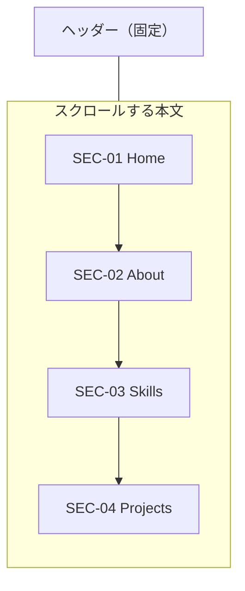

# 画面仕様書：メイン画面

> SCR-01 メイン画面（ヘッダー・Home・About・Skills・Projects）、POP-01・POP-02、MDL-01 案件の詳細。一覧と遷移は [画面仕様書](README.md)。
> 表の「種類」：表示＝文字・図、ボタン、切替＝SegmentedButton、チップ＝FilterChip / InputChip。

---

## SCR-01 メイン画面

| 項目 | 内容 |
|---|---|
| 目的 | プロフィール・経験の要約・技術の割合・プロジェクトを 1 ページで見せる |
| 開き方 | ページを開く（GitHub Pages・`flutter run`・Docker） |
| 構成 | 上：ヘッダー（固定）／ 下：Home → About → Skills → Projects（縦にスクロール） |
| 最初の動き | プロフィールがなければ DLG-01 を自動で開く。データは、起動の前に先に読み込んでから描く |

### SCR-01-H ヘッダー・メニュー

| No | 項目 | 種類 | 表示・内容 | 操作・動き | 条件 |
|---|---|---|---|---|---|
| 1 | タイトル | 表示 | 「DevPortfolio」 | ― | 幅 760 以上 |
| 2 | ナビ | ボタン × 4 | Home / About / Skills / Projects（アイコン）。今見ているセクションに丸いインジケーター | 押すとそのセクションへスクロール（0.5 秒） | PC 版（幅 600 以上）。文字は幅 900 以上 |
| 3 | ［データ］ | ボタン（tonal） | 「データ」。ツールチップ「Work / Private のプロジェクトを追加・更新」 | DLG-03 を開く | 文字は幅 1100 以上（未満はアイコン） |
| 4 | ［ダウンロード］ | ボタン（tonal） | 「ダウンロード」。ツールチップ「スキルシート（Work / Private を含む）を Excel か PDF で保存」 | MNU-01 を開く | スマホはアイコン |
| 5 | テーマの切替 | Switch（PC）/ アイコンボタン（スマホ） | ☀️ / 🌙。ツールチップ「ライトモードにする」/「ダークモードにする」 | ライト / ダークを切り替える | ― |
| 6 | メニュー | アイコンボタン | ≡ | ドロワーを開く | スマホ版（幅 600 未満） |
| 7 | ドロワー | NavigationDrawer | 「DevPortfolio」と Home / About / Skills / Projects。今見ているセクションを選択中に | 押すと閉じて、そのセクションへスクロール | スマホ版 |

---

## SEC-01 Home

| No | 項目 | 種類 | 表示・内容 | 操作・動き | 条件 |
|---|---|---|---|---|---|
| 1 | 職種 | 表示 | プロフィールの `home.role` | ― | すべて中央寄せ |
| 2 | 名前 | 表示（大） | `home.name` | ― | |
| 3 | 紹介文 | 表示 | `home.tagline`（最大幅 560） | ― | |
| 4 | ［スキルを見る］ | ボタン（主） | 「スキルを見る」 | Skills へスクロール | |
| 5 | ［プロジェクトを見る］ | ボタン（副） | 「プロジェクトを見る」 | Projects へスクロール | |
| 6 | 開発経験 | カード | 「開発経験」、長さ（例「7年5か月」）、「2019年7月から」 | ― | 業務のいちばん古い開始から今日まで。業務がなければ個人開発から。期間が読めなければ出さない |
| 7 | プロジェクト | カード（押せる） | 「プロジェクト」、「12件」、「業務 8件・個人開発 4件」。ツールチップ「Projects を見る」 | Projects へスクロール | 期間がなくても数える |
| 8 | 直近のプロジェクト | カード（押せる） | 「直近のプロジェクト」、案件名、「2026年3月 〜 現在」、個人開発なら「個人開発」。ツールチップ「このプロジェクトの詳細を見る」 | MDL-01 を開く | 開始がいちばん新しい案件（同じなら業務）。期間が読める案件がなければ出さない |

- 6〜8 は幅 720 以上で横に 3 つ、未満は縦に積む。案件が 0 件なら 6〜8 を出さない。
- ［データ］で案件を変えると作り直す。

## SEC-02 About

| No | 項目 | 種類 | 表示・内容 | 条件 |
|---|---|---|---|---|
| 1 | 見出し | 表示 | 「About」 | |
| 2 | 自己紹介 | 表示 | `about.intro` | 必須 |
| 3 | 得意な領域 | 行（タグ） | `about.domains` をタグで | 書いたときだけ |
| 4 | 直近の開発経験 | 行 | `about.recent`（「領域：説明」の行は「領域：」を太字）と、`about.recent_tech`（分類ごとにタグ） | どちらかを書いたときだけ |
| 5 | 過去の開発経験 | 行 | `about.past`・`about.past_tech`（同上） | 同上 |
| 6 | 強み | 行 | `about.strengths` | 書いたときだけ |
| 7 | 開発スタイル | 行 | `about.style` | 書いたときだけ |
| 8 | 締めの一言 | 表示（左に縦線） | `about.closing` | 書いたときだけ |

- 3〜7 は「見出し｜説明」の行。幅 640 以上は横に並べ、未満は見出しの下に説明。行の間は細い線で区切る。

---

## SEC-03 Skills

| No | 項目 | 種類 | 表示・内容 | 操作・動き | 条件 |
|---|---|---|---|---|---|
| 1 | 見出し | 表示 | 「Skills」 | ― | |
| 2 | Work / Private | 切替 | 「Work」「Private」 | 切り替えると、その種類の集計を出す | はじめは Work |
| 3 | ［カテゴリ］ | ボタン | 今のカテゴリ名（例「OS」「Skills：プログラミング言語」） | POP-01 を開く | はじめは最初の分類（OS） |
| 4 | 棒 / 円 | 切替（アイコン） | ツールチップ「棒グラフ」「円グラフ」 | グラフの形を変える | はじめは棒 |
| 5 | グラフ | 棒グラフ / 円グラフ | 技術ごとの割合（%）。上位 10 件、残りは「その他」。色は系列の 8 色 | 棒：マウスを乗せると強調。円：扇・凡例を押すと選ぶ（もう一度で外す）、マウスを乗せると強調 | カードの最大幅 800 |
| 6 | 凡例 | 表示 | 色・技術名・% | 押す（円）・マウスを乗せる | 幅 560 未満はグラフの下、以上は横 |
| 7 | 空の表示 | 表示 | 「データがありません」 | ― | そのカテゴリに 1 件もないとき |

- 割合：そのカテゴリで、各技術を使った案件の数 ÷ 全体の数。「利用なし」は数えない。表記ゆれ（大文字・小文字・全角など）は 1 つにまとめる。Workflow は「その工程を担当した案件の割合」。

### POP-01 カテゴリの選択

| No | 項目 | 種類 | 表示・内容 | 操作・動き |
|---|---|---|---|---|
| 1 | 見出し・× | 表示・ボタン | 「カテゴリ」 | × で閉じる（変えない） |
| 2 | グループ | 見出し＋チップ | インフラ（OS・DB・Container・Container Orchestration）／開発（Backend・Frontend・UI Frameworks・Testing Frameworks）／スキル（Skills：プログラミング言語 ほか 6）／ツール（Tools：バージョン管理 ほか 7）／クラウド・AI（Cloud Platforms・AWS・Azure・GCP・AI Services）／工程（Workflow。Work のときだけ） | 1 つ選ぶ |
| 3 | ［キャンセル］［反映］ | ボタン | | ［反映］で選んだカテゴリに変える |

---

## SEC-04 Projects

| No | 項目 | 種類 | 表示・内容 | 操作・動き | 条件 |
|---|---|---|---|---|---|
| 1 | 見出し | 表示 | 「Projects」 | ― | |
| 2 | Work / Private | 切替（件数付き） | 「Work 8」「Private 4」 | 切り替える。フィルターは外れる、1 ページ目に戻る | はじめは Work |
| 3 | ［フィルター］ | ボタン（バッジ） | 「フィルター」、適用中の条件の数 | POP-02 を開く | |
| 4 | ［並び］ | メニュー | 「並び：開始が古い順」 | 開始が古い順 / 開始が新しい順 / 終了が新しい順 / 期間が長い順 / 期間が短い順 / 名前順 から選ぶ。1 ページ目に戻る | Work / Private を切り替えても並びはそのまま |
| 5 | リスト / コレクション | 切替（アイコン） | ツールチップ「リスト表示」「コレクション表示」 | 表示の形を変える（描き終わるまでローディング） | はじめはリスト |
| 6 | 適用中の条件 | 表示＋チップ | 「適用中」と、条件ごとのチップ（期間・進行中のみ・技術など）。［すべて解除］ | チップの × で 1 つ外す（ツールチップ「「Dart」を外す」） | 条件があるときだけ |
| 7 | 一覧（リスト） | 年表 | 左に開始の年・月（「開始」）と縦線・点、案件名、期間の枠（「2024年4月 → 現在」）と長さの札（「6か月」）、進行中の札、技術のタグ 4 つまで（残りは「+3」） | 押すと MDL-01 | 1 ページ 5 件 |
| 8 | 一覧（コレクション） | カード | カバー（案件名から決まる色、頭文字、長さの札）、案件名、説明 2 行、期間、タグ | 押すと MDL-01 | 1 列〜4 列 × 2〜4 行（幅で決まる） |
| 9 | ページ送り | ボタン | ‹ 番号 ›。幅に合わせて「1 … 4 5 6 … 10」「3 / 10」に省略 | 押すとそのページ | 2 ページ以上のとき |
| 10 | 空の表示 | 表示 | 「ヒットしませんでした」「フィルターの条件を減らすと表示されます」 | ― | 表示する案件が 0 件のとき（フィルターを使っていなくても同じ文言） |

### POP-02 フィルター

| No | 項目 | 種類 | 表示・内容 | 操作・動き | 条件 |
|---|---|---|---|---|---|
| 1 | 見出し・× | 表示・ボタン | 「フィルター」 | × で閉じる（変えない） | |
| 2 | 期間 | スライダー（範囲） | 「指定なし（すべての期間）」／「2020年〜2024年」 | 年の範囲を選ぶ。その範囲に少しでも重なる案件を残す | 年が 1 つだけなら「すべて 2024 年のプロジェクトです」 |
| 3 | 進行中のみ | チップ | 「進行中のみ」 | 終わりが「現在」の案件だけ | |
| 4 | 役割 | チップ | 案件に書かれた役割（PM・PL など） | 選んだものを**すべて**担当した案件 | 候補があるときだけ |
| 5 | 規模（人数） | チップ | 〜5名 / 6〜10名 / 11〜30名 / 31〜100名 / 101名〜 | 選んだ区分の**どれか** | 同上 |
| 6 | 技術 | チップ（分類ごと） | Server OS・DB・Tools（グループごと）・Backend・Frontend・UI Frameworks・Testing Frameworks・Cloud Platforms・AWS・Azure・GCP・Container・Container Orchestration・AI Services・Skills（グループごと） | 選んだものを**すべて**含む案件（部分一致・表記ゆれは無視） | 候補のない分類は出さない |
| 7 | Workflow | チップ | 要件定義 〜 保守・運用 | 選んだ工程をすべて担当した案件 | Work のときだけ |
| 8 | ［クリア］［キャンセル］［反映］ | ボタン | | ［クリア］でパネルの中の選択を全部外す（一覧にはまだ反映しない）。［反映］で一覧に反映し、1 ページ目に戻る。期間のスライダーが全範囲のままなら「指定なし」として扱う | |

- 幅 720 以上は 2 列で並べる。

---

## MDL-01 案件の詳細

| 項目 | 内容 |
|---|---|
| 開き方 | 一覧の案件・Home の直近のプロジェクトを押す |
| 形 | 幅 1024 以上：最大幅 760 のダイアログ、‹ › は左右／未満：全画面、文字 1.15 倍、‹ › は下 |
| 前後の範囲 | 今の絞り込み・並び順の全件（ページをまたぐ）。閉じると、最後に見ていた案件のページに一覧を合わせる |

| No | 項目 | 種類 | 表示・内容 | 操作・動き | 条件 |
|---|---|---|---|---|---|
| 1 | 位置 | 表示 | 「3 / 12」 | ― | |
| 2 | ［A−］［100%］［A＋］ | ボタン | 文字の大きさ（100〜250%：1.0 / 1.15 / 1.3 / 1.5 / 1.75 / 2.0 / 2.5） | ［A−］［A＋］で 1 段ずつ、［100%］で元に戻す（大きく表示も戻す） | 端では押せない |
| 3 | ［大きく表示］ | ボタン | ツールチップ「大きく表示（画面共有向け・F）」/「元の大きさに戻す（F / Ctrl＋0）」 | PC でも全画面のレイアウトにする | 幅 1024 以上だけ |
| 4 | × | ボタン | 「閉じる」 | 閉じる | |
| 5 | 案件名 | 表示 | `title` | ― | |
| 6 | 期間 | 表示 | 「2024年4月 → 現在」と長さ | ― | 期間を書いたときだけ |
| 7 | 役割 | タグ | `role` | ― | 書いたときだけ |
| 8 | 規模 | 表示 | `scale`（文章のまま） | ― | 書いたときだけ |
| 9 | 説明・詳細 | 表示 | `description`・`details`（複数行） | ― | 書いたときだけ |
| 10 | Workflow | 工程の並び | 7 工程を「担当 / 担当外」で | ― | Work だけ |
| 11 | 技術 | 見出し＋タグ | 分類ごと（Skills・Tools はグループごと：「Skills：プログラミング言語」など）。書いたままの名前 | ― | 空・「利用なし」だけの分類は出さない |
| 12 | ［公開ページを見る］ | ボタン | | 新しいタブでリンクを開く（開けないリンクなら何もしない） | `link` を書いたときだけ |
| 13 | ‹ ›（［前へ］［次へ］） | ボタン | ツールチップ「前の案件」「次の案件」／端では「最初の案件です」「最後の案件です」 | 前後の案件に移る | 端では押せない |

| キー | 動き |
|---|---|
| ← → | 前後の案件 |
| − ＋（＝） | 文字を小さく / 大きく |
| 0 | 文字の大きさだけ元に戻す |
| F | 大きく表示 / 戻す（PC だけ） |
| ⌘（Mac）/ Ctrl ＋ 0 | 文字の大きさも大きく表示も元に戻す |
| ⌘ / Ctrl ＋ ＋ − （JIS の「;」も） | 拡大 / 縮小（開いている間は、ブラウザ自体の拡大・縮小を止める） |

- 選んだ大きさは、ページを開いている間は次に開いたときも引き継ぐ。
