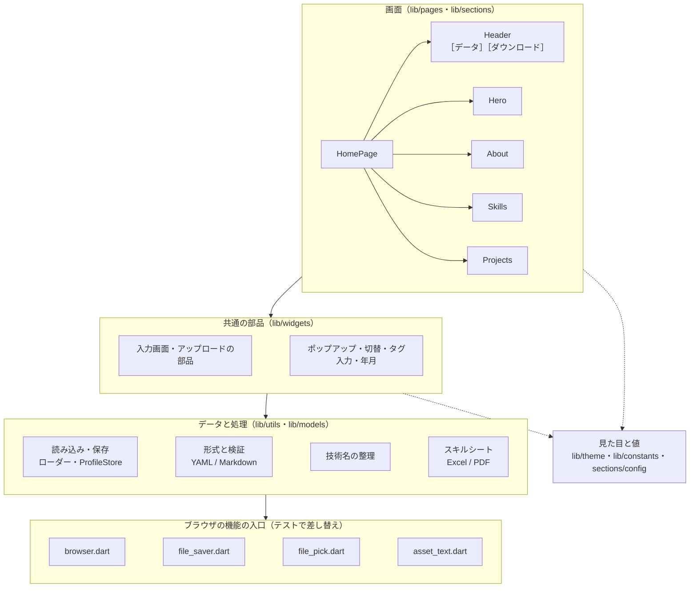

# ファイル構成

> リポジトリのディレクトリ構成と、コンポーネントごとのファイルと中身。
> プロジェクトの紹介は [README](../README.md)。

## ディレクトリ構成

```
dev-portfolio-site/
├── README.md                      # プロジェクトの紹介（詳しい説明は docs/ へ案内）
├── CLAUDE.md                      # Claude（AI）向けの入口。詳細は docs/claude/
├── docs/
│   ├── manual.md                  # 操作説明書（使い方・データの書き方・カスタマイズ）
│   ├── design.md                  # 設計（構成・データの流れ・API・技術スタック・課題・今後）
│   ├── structure.md               # ファイル構成（このファイル）
│   ├── development.md             # 開発ガイド（起動・テスト・CI のコマンドと案内）
│   ├── design-system.md           # デザインシステム（色・文字・形・余白・部品・スタイルを書く場所）
│   ├── screens/                   # 画面仕様書：README.md（一覧・遷移・共通）・main.md（メイン画面）・dialogs.md（ダイアログ）
│   ├── ui-ux.md                   # UI / UX（レイアウト・ブレークポイント・操作の流れ・UX の決まり・アクセシビリティ）
│   ├── performance.md             # パフォーマンス（起動・待ち時間・重い処理・配信・測り方）
│   ├── roadmap.md                 # 今後の動き（テスト・CI・アプリ・インフラの段階）
│   ├── testing/                   # test-plan.md（テスト計画書）・test-catalog.md（テスト一覧）
│   ├── ci/                        # ci-design.md（CI の設計）・ci-status.md（CI の状況）
│   └── claude/                    # AI 向けの開発メモ：architecture / data-flow / conventions / testing / operations / status
├── compose.yaml                   # frontend と backend をまとめて起動（docker compose up --build）
├── .gitignore                     # リポジトリ全体（OS・エディタ・ビルド結果・秘密情報・Terraform など）
├── .github/workflows/
│   ├── test.yml                   # テストと網羅率（行・分岐 90% 以上）、backend のテスト
│   └── deploy.yml                 # GitHub Pages への自動デプロイ
├── skill_sheet_yaml/              # 自分のスキルシート・YAML の置き場（中身は Git 管理外）
├── backend/                       # API サーバー（shelf + shelf_router）
│   ├── bin/server.dart            # 起動・停止・ヘルスチェック
│   ├── lib/src/                   # app（ルーティング）・data_store（YAML の読み込みと確認）・logging（JSON ログ）
│   ├── data/                      # 返す YAML（profile / work / private）
│   ├── test/app_test.dart
│   ├── Dockerfile                 # dart compile exe → scratch
│   └── README.md
└── frontend/                      # Flutter アプリ（Dart のパッケージ名は dev_portfolio）
    ├── Dockerfile                 # flutter build web → nginx
    ├── nginx/default.conf.template # 配信と /api/ の転送
    ├── assets/
    │   ├── data/                  # ひな形・サンプル（format_profile / format_work / format_private / format_skill_sheet.xlsx / sample_*_multi）
    │   ├── fonts/                 # PDF の日本語フォント（IPA P ゴシック）
    │   └── profile/               # 起動時に指定したプロフィール（Git・Docker イメージの管理外）
    ├── tool/
    │   ├── run.dart               # プロフィール YAML（.md・.xlsx も可）を指定して起動
    │   └── coverage_check.dart    # 網羅率の集計と基準の確認（--update-imports で全ファイルを読み込むテストを作る）
    ├── web/index.html             # 起動時のローディング表示
    ├── lib/
    │   ├── main.dart
    │   ├── pages/                 # HomePage
    │   ├── models/                # プロフィール（読み込みと検証）
    │   ├── sections/              # header / hero / about / skills / projects と config
    │   ├── theme/                 # 色・テーマ切替・共通スタイル
    │   ├── constants/             # 文言・数値
    │   ├── controllers/           # セクションへのスクロール・表示中セクション
    │   ├── widgets/               # 共通部品
    │   └── utils/                 # 読み込み・検証・技術名の整理・スキルシート・ブラウザの機能の入口
    └── test/                      # テスト（*_test.dart）と補助（test_assets.dart・test_xlsx.dart）
```

---

## コンポーネント

層の関係（上が下を使う。点線は見た目と値の参照）：



### frontend：画面（`lib/pages/`・`lib/sections/`）

| コンポーネント | 主なファイル | 中身 |
|---|---|---|
| **HomePage** | `pages/home_page.dart` | Header と 4 つのセクションを縦に並べる 1 ページ（スクロールはページ全体の 1 本だけ）。スマホのメニュー（NavigationDrawer）。プロフィールがなければ最初に入力画面を出す |
| **Header** | `sections/header/header.dart`・`desktop_header.dart`・`mobile_header.dart`・`header_parts.dart` | Material 3 のトップアプリバー。幅 600px で PC / スマホを切り替え。ナビ（表示中のセクションを強調）・［データ］・［ダウンロード］・テーマ切替 |
| **［データ］** | `sections/header/project_data_dialog.dart`・`project_form.dart`・`project_add_confirm.dart`・`yaml_upload_dialog.dart`・`yaml_format_help.dart` | プロジェクトの追加・更新を 1 つの画面の中で順に選ぶ。入力フォーム（年月の選択・タグ入力）、テキスト・ファイルからの追加、置き換え（アップロード画面）、確認画面、書き方の説明（ⓘ） |
| **［ダウンロード］** | `sections/header/download_menu.dart` | スキルシートを Excel / PDF で「名前を付けて保存」 |
| **Hero（Home）** | `sections/hero_section.dart`（計算は `utils/hero_summary.dart`） | 名前・職種・紹介文、Skills / Projects へのボタン、開発経験・件数・直近のプロジェクトのまとめ |
| **About** | `sections/about_section.dart` | 自己紹介と、得意な領域・直近 / 過去の開発経験・強み・開発スタイルの定義リスト、締めの一言（書いた項目だけ） |
| **Skills** | `sections/skills/skills_section.dart`、`data/`（集計）、`charts/`（`skills_bar_chart`・`skills_pie_chart` と `bar_chart/`・`pie_chart/`）、`widgets/`（カテゴリの選択・グラフの切替・カード） | Work / Private ごと、分類ごとの技術の割合を棒 / 円グラフで。上位 10 件より多ければ「その他」にまとめる。凡例を押す・マウスを乗せると強調 |
| **Projects** | `sections/projects/projects_section.dart`・`projects_toolbar.dart`、`views/`（List の年表・Collection のカード・詳細ダイアログ）、`filters/`（`logic`・`state`・`ui`）、`sort/`、`pagination/`、`models/`（`Project`） | 一覧（List / Collection）、フィルター（技術 16 分類・役割・規模・工程・期間・進行中）、並び替え 6 通り、ページ送り（幅に合わせて省略表示）、詳細（‹ › で前後、画面共有向けの拡大） |
| レイアウトの値 | `sections/config/**/*_config.dart` | セクションごとのブレークポイント・大きさ（色と文言は置かない） |

### frontend：共通の部品（`lib/widgets/`）

| 部品 | 中身 |
|---|---|
| `app_segment.dart` | 切替（M3 の SegmentedButton）。Work / Private・グラフ・表示の切替など |
| `app_filter_modal.dart` | ポップアップ（幅 600px 以上は中央のダイアログ、未満は下からのシート） |
| `profile_setup_dialog.dart` | 最初の入力画面（YAML / Markdown / Excel。読み込むまで閉じられない） |
| `upload_parts.dart` | アップロードの部品：手順・テンプレートの保存 / コピー・ファイルの状態・確認画面・上書きの確認・全画面ローディング |
| `tag_input_field.dart` / `year_month_picker.dart` | 入力フォームのタグ入力（候補・カンマ・Backspace）と年月の選択 |
| `settled_reveal.dart` / `app_loading_indicator.dart` | 重い描画の間のローディング（M3 の円形インジケーター） |
| `min_width_scaler.dart` | 320px より狭い画面で、320px のレイアウトを縮小して表示 |
| `filter_chips_section.dart` | 見出し付きのチップの並び |

### frontend：データと処理（`lib/utils/`・`lib/models/`）

| 分野 | ファイル | 中身 |
|---|---|---|
| 読み込み・保存 | `work_yaml_loader.dart`・`private_yaml_loader.dart`・`profile_store.dart`・`app_ready.dart` | データを読む順番、プロフィールの保持、起動時の先読みと「準備できた」の知らせ |
| ブラウザの機能（差し替えの入口） | `browser/browser.dart`・`file_saver.dart`・`file_pick.dart`・`asset_text.dart` | sessionStorage・ファイルの保存・ファイルの選択・アセットの読み込み。Web では本物、テストでは代わりの実装（`*_stub.dart`）や差し替えた関数を使う |
| 形式と検証 | `data_format.dart`・`models/profile.dart`・`projects_yaml_validator.dart`・`profile_bundle.dart`・`project_append.dart`・`projects_diff.dart`・`yaml_writer.dart` | YAML / Markdown の見分けと変換、プロフィール・Work / Private の検証、追加、上書きの違いの判定、YAML の書き出し |
| 技術名の整理 | `skill_name.dart`・`tech_catalog.dart`・`string_utils.dart`・`language_utils.dart` | 表記ゆれのまとめ、本来の分類への振り分け、Skills / Tools のグループ分け、工程名の日本語化 |
| スキルシート | `xlsx_reader.dart`・`skill_sheet.dart`・`skill_sheet_writer.dart`・`xlsx_layout.dart`・`skill_sheet_pdf.dart` | Excel → YAML の読み込み、テンプレートへの書き込み、Excel の見た目の読み取り、同じ見た目の PDF |

### frontend：見た目と値（`lib/theme/`・`lib/constants/`）

| ファイル | 中身 |
|---|---|
| `theme/app_colors.dart` | 色（Material 3：seed → ColorScheme → トークン）。ライト / ダークの両方 |
| `theme/app_theme.dart` | テーマ（`ThemeController` で切替）、`context.colors` / `context.isDark` |
| `theme/app_styles.dart` | 共通の見た目（文字・角丸・カード・タグ・ボタン・グラフ・ダイアログ） |
| `constants/app_texts.dart` / `app_sizes.dart` | 画面の文言すべて／余白・時間・大きさ |

### backend（`backend/`）

| ファイル | 中身 |
|---|---|
| `bin/server.dart` | 起動（`PORT`・`DATA_DIR`・`ALLOWED_ORIGIN`）、SIGTERM で処理中のリクエストを終えてから停止、`server healthcheck`（コンテナのヘルスチェック用） |
| `lib/src/app.dart` | ルーティング（shelf_router）、JSON の応答とエラー、CORS、キャッシュの指定 |
| `lib/src/data_store.dart` | `data/*.yaml` を読み、アップロード時と同じ必須項目を確かめる。更新日時が変わったときだけ読み直す |
| `lib/src/logging.dart` | 1 リクエスト 1 行の JSON ログ（`severity`・`httpRequest`。Cloud Logging がそのまま読める形） |
| `data/` | 返す YAML（`profile.yaml`・`work.yaml`・`private.yaml`）。最初は frontend のひな形のコピー |
