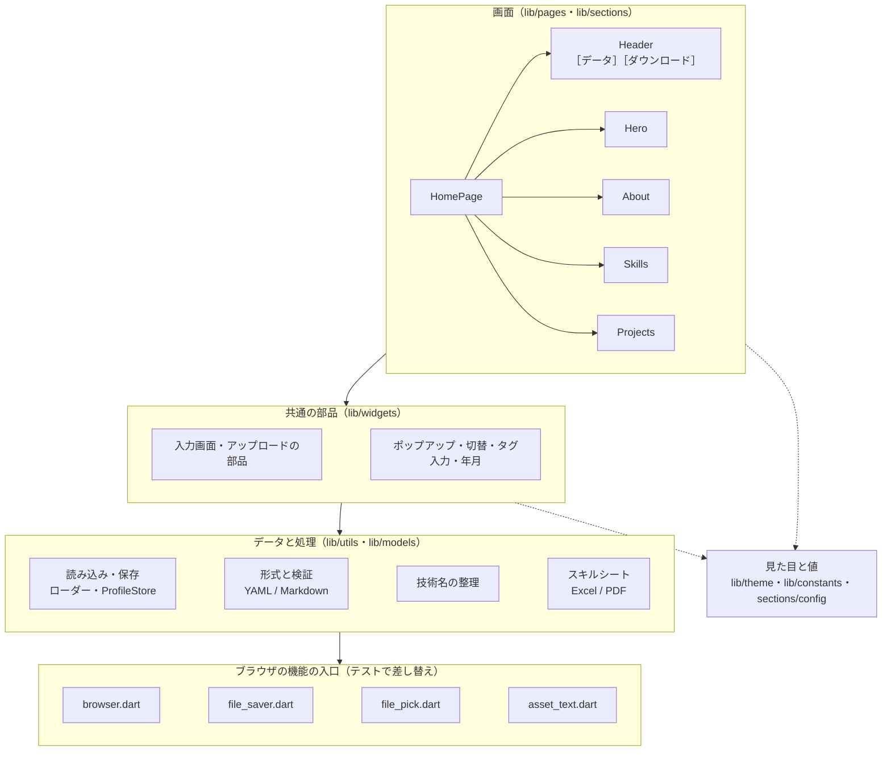

# ファイル構成

> リポジトリのディレクトリ構成と、コンポーネントごとのファイルと中身。
> プロジェクトの紹介は [README](../README.md)。

## ディレクトリ構成

```
dev-portfolio-site/
├── README.md                      # プロジェクトの紹介（詳しい説明は docs/ へ案内）
├── CLAUDE.md                      # Claude（AI）向けの入口。詳細は docs/claude/
├── CHANGELOG.md                   # 更新履歴（コミットごとの追加・変更・修正）
├── docs/
│   ├── manual.md                  # 操作説明書（使い方・データの書き方・カスタマイズ）
│   ├── design.md                  # 設計（構成・データの流れ・API・技術スタック・課題・今後）
│   ├── structure.md               # ファイル構成（このファイル）
│   ├── development.md             # 開発ガイド（起動・テスト・CI のコマンドと案内）
│   ├── libraries-and-styling.md   # ライブラリとスタイリング（CSS の有無・ライブラリの一覧・画面ごとの使い方）
│   ├── design-system.md           # デザインシステム（色・文字・形・余白・部品・スタイルを書く場所）
│   ├── screens/                   # 画面仕様書：README.md（一覧・遷移・共通）・main.md（メイン画面）・dialogs.md（ダイアログ）
│   ├── ui-ux.md                   # UI / UX（レイアウト・ブレークポイント・操作の流れ・UX の決まり・アクセシビリティ）
│   ├── performance.md             # パフォーマンス（起動・待ち時間・重い処理・配信・測り方）
│   ├── roadmap.md                 # 今後の動き（テスト・CI・アプリ・インフラの段階）
│   ├── local-cloud.md             # ローカルのクラウド（Firebase Emulator と compose：構成・ポート・データの残り方・サンプル・よくある失敗）
│   ├── plan/                      # 次の構成の計画（要件定義・画面設計・データ設計・サービスの構成・決めること）
│   ├── testing/                   # test-plan.md（テスト計画書）・test-catalog.md（テスト一覧）
│   ├── ci/                        # ci-design.md（CI の設計）・ci-status.md（CI の状況）
│   └── claude/                    # AI 向けの開発メモ：architecture / data-flow / conventions / testing / operations / status
├── compose.yaml                   # frontend・api・auth・Firebase Emulator をまとめて起動（docker compose up --build）。seed でサンプルを入れる
├── firebase/                      # Firebase Emulator（Dockerfile・firebase.json・firestore.rules・entrypoint.sh・seed/。書き出したデータ emulator-data/ は Git 管理外）
├── services/                      # サービス（次の構成）
│   ├── api-hono/                  # マイページの API（Hono・TypeScript）。src/・test/・Dockerfile・README
│   ├── auth-phoenix/              # 認証（Elixir・Phoenix）。lib/・config/・test/・Dockerfile（mix release）・README
│   └── excel-fastapi/             # 見る人向けのスキルシート（Excel・PDF）を作る（FastAPI。api から呼ぶ）
├── .gitignore                     # リポジトリ全体（OS・エディタ・ビルド結果・秘密情報・Terraform など）
├── .github/workflows/
│   ├── test.yml                   # テストと網羅率（行・分岐 90% 以上）、api（Hono）の型とテスト、Emulator のサンプルのスクリプトのテスト
│   └── deploy.yml                 # GitHub Pages への自動デプロイ
├── skill_sheet_yaml/              # 自分のスキルシート・YAML の置き場（中身は Git 管理外）
└── frontend/                      # Flutter アプリ（Dart のパッケージ名は dev_portfolio）
    ├── Dockerfile                 # flutter build web → nginx
    ├── nginx/default.conf.template # 配信と /api/ の転送
    ├── assets/
    │   ├── data/                  # ひな形・サンプル（format_profile / format_work / format_private / format_skill_sheet.xlsx / sample_*_multi）
    │   ├── fonts/                 # PDF の日本語フォント（IPA P ゴシック）
    │   └── profile/               # 起動時に指定したプロフィール（Git・Docker イメージの管理外）
    ├── tool/
    │   ├── run.dart               # プロフィール YAML（.md・.xlsx も可）を指定して起動
    │   └── coverage_check.dart    # 網羅率の集計と基準の確認（--update-imports で全ファイルを読み込むテストを作る）
    ├── web/index.html             # 起動時のローディング表示
    ├── lib/
    │   ├── main.dart
    │   ├── pages/                 # HomePage
    │   ├── models/                # プロフィール（読み込みと検証）
    │   ├── sections/              # header / hero / about / skills / projects と config
    │   ├── theme/                 # 色・テーマ切替・共通スタイル
    │   ├── constants/             # 文言・数値
    │   ├── controllers/           # セクションへのスクロール・表示中セクション
    │   ├── widgets/               # 共通部品
    │   └── utils/                 # 読み込み・検証・技術名の整理・スキルシート・ブラウザの機能の入口
    └── test/                      # テスト（*_test.dart）と補助（test_assets.dart・test_xlsx.dart）
```

---

## コンポーネント

層の関係（上が下を使う。点線は見た目と値の参照）：



### frontend：画面（`lib/pages/`・`lib/sections/`）

| コンポーネント | 主なファイル | 中身 |
|---|---|---|
| **HomePage** | `pages/home_page.dart` | Header と 4 つのセクションを縦に並べる 1 ページ（スクロールはページ全体の 1 本だけ）。スマホのメニュー（NavigationDrawer）。プロフィールがなければ最初に入力画面を出す |
| **Header** | `sections/header/header.dart`・`desktop_header.dart`・`mobile_header.dart`・`header_parts.dart` | Material 3 のトップアプリバー。幅 600px で PC / スマホを切り替え。ナビ（表示中のセクションを強調）・［データ］・［ダウンロード］・テーマ切替 |
| **［データ］** | `sections/header/project_data_dialog.dart`・`project_form.dart`・`project_add_confirm.dart`・`yaml_upload_dialog.dart`・`yaml_format_help.dart` | プロジェクトの追加・更新を 1 つの画面の中で順に選ぶ。入力フォーム（年月の選択・タグ入力）、テキスト・ファイルからの追加、置き換え（アップロード画面）、確認画面、書き方の説明（ⓘ） |
| **［ダウンロード］** | `sections/header/download_menu.dart` | スキルシートを Excel / PDF で「名前を付けて保存」 |
| **Hero（Home）** | `sections/hero_section.dart`（計算は `utils/hero_summary.dart`） | 名前・職種・紹介文、Skills / Projects へのボタン、開発経験・件数・直近のプロジェクトのまとめ |
| **About** | `sections/about_section.dart` | 自己紹介と、得意な領域・直近 / 過去の開発経験・強み・開発スタイルの定義リスト、締めの一言（書いた項目だけ） |
| **Skills** | `sections/skills/skills_section.dart`、`data/`（集計）、`charts/`（`skills_bar_chart`・`skills_pie_chart` と `bar_chart/`・`pie_chart/`）、`widgets/`（カテゴリの選択・グラフの切替・カード） | Work / Private ごと、分類ごとの技術の割合を棒 / 円グラフで。上位 10 件より多ければ「その他」にまとめる。凡例を押す・マウスを乗せると強調 |
| **Projects** | `sections/projects/projects_section.dart`・`projects_toolbar.dart`、`views/`（List の年表・Collection のカード・詳細ダイアログ）、`filters/`（`logic`・`state`・`ui`）、`sort/`、`pagination/`、`models/`（`Project`） | 一覧（List / Collection）、フィルター（技術 16 分類・役割・規模・工程・期間・進行中）、並び替え 6 通り、ページ送り（幅に合わせて省略表示）、詳細（‹ › で前後、画面共有向けの拡大） |
| レイアウトの値 | `sections/config/**/*_config.dart` | セクションごとのブレークポイント・大きさ（色と文言は置かない） |

### frontend：共通の部品（`lib/widgets/`）

| 部品 | 中身 |
|---|---|
| `app_segment.dart` | 切替（M3 の SegmentedButton）。Work / Private・グラフ・表示の切替など |
| `app_filter_modal.dart` | ポップアップ（幅 600px 以上は中央のダイアログ、未満は下からのシート） |
| `profile_setup_dialog.dart` | 最初の入力画面（YAML / Markdown / Excel。読み込むまで閉じられない） |
| `upload_parts.dart` | アップロードの部品：手順・テンプレートの保存 / コピー・ファイルの状態・確認画面・上書きの確認・全画面ローディング |
| `tag_input_field.dart` / `year_month_picker.dart` | 入力フォームのタグ入力（候補・カンマ・Backspace）と年月の選択 |
| `settled_reveal.dart` / `app_loading_indicator.dart` | 重い描画の間のローディング（M3 の円形インジケーター） |
| `min_width_scaler.dart` | 320px より狭い画面で、320px のレイアウトを縮小して表示 |
| `filter_chips_section.dart` | 見出し付きのチップの並び |

### frontend：データと処理（`lib/utils/`・`lib/models/`）

| 分野 | ファイル | 中身 |
|---|---|---|
| データの入口（Repository） | `lib/data/portfolio_repository.dart`・`lib/data/local_portfolio_repository.dart`・`lib/data/records.dart` | データの読み書きの入口（`PortfolioRepository`）。実装が書くのは構造のデータ（`DataRecord`。Firestore の文書と同じ形）の読み書き 5 つだけで、YAML の文字・サンプルはそこから作る。今の実装（このタブの sessionStorage・起動時の指定）は元の文字を保つ。API の実装に差し替える場所 |
| 状態・画面の URL | `lib/state/providers.dart`・`lib/router/app_router.dart`・`lib/pages/placeholder_page.dart` | Riverpod の Provider（テーマ・Repository・データが変わった回数・プロフィール・Work / Private・Skills の集計・Projects の一覧）、go_router の URL（`/`。`ENABLE_ACCOUNT` のときだけ `/login`・`/me`・`/me/edit`（編集はまだ空の画面）） |
| ログイン・マイページ | `lib/auth/{auth_api,auth_controller}.dart`・`lib/pages/{login,my}_page.dart` | 認証（services/auth-phoenix）の呼び出し、ログインの状態（ID トークンの取り直し・このタブで続けてログイン・ログインで Repository を API に切り替え）、ログイン・登録・パスワードの再設定、公開ページの名前・公開する／止める・ログアウト・退会 |
| API | `lib/api/{json_client,portfolio_api}.dart`・`lib/data/{api_records,api_portfolio_repository}.dart` | JSON の送受信とエラー、API（services/api-hono）の呼び出し、アプリのデータ（YAML の形）⇔ API（Firestore）の形、ログイン中の Repository（編集中のデータを通して読み書き。重なったら 3 回までやり直す） |
| 読み込み・保存 | `work_yaml_loader.dart`・`private_yaml_loader.dart`・`profile_store.dart`・`app_ready.dart` | Work / Private の YAML を読む手伝い（中身は Repository）、表示中のプロフィールの保持、起動時の先読みと「準備できた」の知らせ |
| ブラウザの機能（差し替えの入口） | `browser/browser.dart`・`file_saver.dart`・`file_pick.dart`・`asset_text.dart` | sessionStorage・ファイルの保存・ファイルの選択・アセットの読み込み。Web では本物、テストでは代わりの実装（`*_stub.dart`）や差し替えた関数を使う |
| 形式と検証 | `data_format.dart`・`models/profile.dart`・`projects_yaml_validator.dart`・`profile_bundle.dart`・`project_append.dart`・`projects_diff.dart`・`yaml_writer.dart` | YAML / Markdown の見分けと変換、プロフィール・Work / Private の検証、追加、上書きの違いの判定、YAML の書き出し |
| 技術名の整理 | `skill_name.dart`・`tech_catalog.dart`・`string_utils.dart`・`language_utils.dart` | 表記ゆれのまとめ、本来の分類への振り分け、Skills / Tools のグループ分け、工程名の日本語化 |
| スキルシート | `xlsx_reader.dart`・`skill_sheet.dart`・`skill_sheet_writer.dart`・`xlsx_layout.dart`・`skill_sheet_pdf.dart` | Excel → YAML の読み込み、テンプレートへの書き込み、Excel の見た目の読み取り、同じ見た目の PDF |

### frontend：見た目と値（`lib/theme/`・`lib/constants/`）

| ファイル | 中身 |
|---|---|
| `theme/app_colors.dart` | 色（Material 3：seed → ColorScheme → トークン）。ライト / ダークの両方 |
| `theme/app_theme.dart` | ThemeData、`context.colors` / `context.isDark`（ライト / ダークの切り替えは `themeModeProvider`、`lib/state/providers.dart`） |
| `theme/app_styles.dart` | 共通の見た目（文字・角丸・カード・タグ・ボタン・グラフ・ダイアログ） |
| `constants/app_texts.dart` / `app_sizes.dart` | 画面の文言すべて／余白・時間・大きさ |

### api（`services/api-hono/`）

| ファイル | 中身 |
|---|---|
| `src/app.ts` | ルート（Hono）、ログ、CORS、エラーの JSON |
| `src/portfolio.ts` | 本人のデータの読み書き（編集中のデータ・プロフィール・スキル・表示設定・職務経歴・公開ページ） |
| `src/validate.ts` | 受け取ったデータの形の確認 |
| `src/auth.ts` | Firebase の ID トークンの確認（RS256 の署名。Emulator は中身だけ） |
| `src/firestore.ts`・`src/values.ts` | Firestore の REST（Emulator は `Bearer owner`、本物はメタデータサーバーのアクセストークン）、値の変換 |
| `src/config.ts`・`src/log.ts`・`src/setup.ts` | 環境変数と安全の確認、1 行 1 件の JSON ログ、組み立て |
| `src/server.ts`・`src/worker.ts` | Node の入口（SIGTERM で止まる・`healthcheck`）、Workers の入口（wrangler dev） |
| `test/` | 単体・ルート・Emulator の上でのテスト（`npm test`・`npm run test:emulator`） |

### auth（`services/auth-phoenix/`）

| ファイル | 中身 |
|---|---|
| `lib/auth_service/accounts.ex` | 決まり（入力の確認・登録できる人・総当たりの対策）と Firebase の呼び出しをまとめる |
| `lib/auth_service/firebase.ex`・`access_token.ex` | Firebase Auth の REST（Emulator / 本物）、管理者のトークン（Emulator は `owner`、本物はメタデータサーバー） |
| `lib/auth_service/login_throttle.ex`・`error.ex` | ログインの失敗の数（ETS）、エラーと Firebase のエラーの日本語 |
| `lib/auth_service_web/` | Endpoint・Router・コントローラー・JSON のログ・CORS |
| `config/` | 設定（`runtime.exs` は起動のときに環境変数から） |
| `test/` | ルート（Firebase は Req.Test の偽物）・つなぎ先と入力の確認・Emulator の上（`mix test --only emulator`） |
