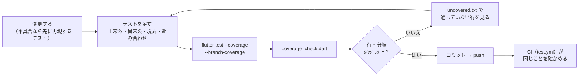

# テスト計画書

> 何を・どの観点で・どこまで確かめれば「合格」とするかを決めた計画。個々のテストの一覧は [テスト一覧](test-catalog.md)、CI での実行は [CI の設計](../ci/ci-design.md)。
> 作成：2026-11-06（初版）

---

## 1. 目的

- 画面とデータ処理が、**正しいデータでも壊れたデータでも**決めたとおりに動くことを、自動テストで毎回確かめる。
- 画面の幅・テーマ・プラットフォームの違いで崩れないこと（はみ出し・押せないボタン）を、実機を使わずに見つける。
- 変更のたびに同じ確認を CI で繰り返し、直した不具合が戻らないようにする。

## 2. 対象と範囲

| 区分 | 対象 | 方法 |
|---|---|---|
| 対象 | frontend の `lib/` 全体（99 ファイル） | flutter_test（VM 上の単体・ウィジェット・画面のテスト） |
| 対象 | API（`services/api-hono/src/`） | Node の標準のテスト（`node --test`。ルートは Hono の `app.request`、Firestore はメモリ上の偽物、Emulator の上のテストもある） |
| 対象外（自動） | `lib/main.dart`（runApp だけ）、`*_web.dart`（ブラウザの機能の本物の実装） | 代わりの実装（`*_stub.dart`）でテストし、本物は実機で確認 |
| 対象外（自動） | OS のファイル選択ダイアログ・保存ダイアログ、実際のブラウザでの見た目、GitHub Pages への配信、Docker イメージのビルド | 手動の確認（7 章）。Docker と E2E は [今後の動き](../roadmap.md) で自動化する |

## 3. テストのレベル

| レベル | 何を確かめるか | 例 |
|---|---|---|
| 単体 | 関数・クラスの入出力（Flutter に依存しない処理） | 期間の解釈、表記ゆれ、集計、フィルター、並び替え、ページ分け、YAML の読み書き、Excel の読み書き |
| ウィジェット | 1 つの部品・ダイアログの表示と操作 | グラフ、ページ送り、書き方の説明、入力画面、タグ入力、年月の選択 |
| 画面の結合 | 画面全体・複数の画面をまたぐ流れ | HomePage の描画と操作、［データ］の流れ、アップロード → 確認 → 上書きの確認 → 反映 |
| API | 各エンドポイントの応答とエラー、本人のデータだけ、セキュリティルール | `/healthz`・`/api/public/:slug`・`/api/me/*`（[テスト一覧](test-catalog.md#apiservicesapi-honotest)） |
| 手動 | 実機・実ブラウザでしか分からないこと | 7 章 |

## 4. テストの観点

すべての関数・画面で、次の観点を**それぞれ**考える（当てはまらないものは書かなくてよい）。

| 観点 | 中身 | 例 |
|---|---|---|
| 正常系 | 決めた入力で決めた結果になる | 正しい YAML を読み込むと反映される |
| 異常系 | 壊れた入力・失敗で、落ちずに決めた振る舞いをする | YAML の誤り、UTF-8 でない中身、壊れた Excel、読み込みの失敗、保存の失敗、選ぶ途中のエラー |
| 空・0 件 | 何もないときに落ちない・空の表示になる | データ 0 件、項目のない案件、プロフィールなし |
| 境界値 | 区切りの前後で結果が変わるところ | ページがちょうど埋まる / 1 件はみ出す、範囲の最初の月・最後の月に重なる期間、拡大の上限・下限、月 0 と 13 |
| キャンセル・戻る | 操作をやめたときに前の状態のまま | ファイル選択のキャンセル、確認画面の［戻る］、上書きの確認の［やめる］ |
| 表記・形式のゆれ | 同じものとして扱うべき書き方の違い | 大文字・小文字・全角・記号・空白、AWS などの先頭、YAML / Markdown、`現在` / `present` |
| 組み合わせ | 環境の違い | 5 章 |
| 回帰 | 一度見つけた不具合が戻らない | 見つけた不具合ごとに、まず再現するテストを書いてから直す |

入力と期待の組み合わせが多いものは、表にして回す（`for (final (入力, 期待) in cases)`）。失敗したときに、どの組み合わせかがテスト名に出る。

## 5. 組み合わせの設計

画面のテストは、次の軸を掛け合わせて描画し、**はみ出し（overflow）・例外が 1 つでもあれば失敗**とする。

| 軸 | 値 | 理由 |
|---|---|---|
| テーマ | ライト / ダーク | 色の取り違え・ダークだけの分岐 |
| 画面の幅 | スマホ 360 / タブレット 800 / PC 1280（部品によって 320〜1280 の 6 通り） | ブレークポイントごとのレイアウト。最小の対応幅は 320px |
| データ | サンプル / たくさん（Work 12 件・Private 7 件）/ 1 件ずつ / 0 件 / 項目なし | ページ送り・「その他」へのまとめ・空の表示 |
| プラットフォーム | 既定（Android）/ iOS・Android（`TargetPlatformVariant.mobile()`）/ macOS・Windows | ボタンの当たり判定の広がり、⌘ / Ctrl のキー |

例：Home 画面はテーマ 2 × 幅 3 × データ 3 ＝ 18 通り。ページ送りはプラットフォーム 2 × 幅 6 × ページの位置 7 ＝ 84 通り。

## 6. テスト環境とテストデータ

| もの | 内容 |
|---|---|
| Flutter / Dart | Flutter 3.41.6（Dart 3.11）。CI も同じ版（`test.yml`） |
| 実行の場所 | VM（`flutter test`）。ブラウザは使わない |
| フォント | 同梱の IPA P ゴシックを既定のフォントとして読み込む（`loadAppFont`）。テスト用の既定のフォントは英字の幅が広く、実際には収まる文字が「はみ出し」になるため |
| ブラウザの機能 | `*_stub.dart`（sessionStorage はメモリ、保存は `FileSaver.lastSaved` に残す、送ったイベントは `dispatchedEvents` に残す） |
| ファイル選択・アセット | `pickFile`・`loadAssetText` / `loadAssetBytes` を差し替えて、選んだ・キャンセル・読めない・読み込み中を作る |
| テストデータ | `assets/data/` のテンプレートとサンプル（本物と同じもの）、テストの中で件数を指定して作る YAML（`_workYaml(n)` など）、小さな .xlsx（`testXlsx`）、backend は一時フォルダーに書いた YAML |

差し替えの入口の一覧は [テスト一覧](test-catalog.md#補助ファイル差し替えの入口)。

## 7. 手動で確かめること

自動テストでは確かめられないので、大きな変更のあとに実機で見る。

| 項目 | 見るところ |
|---|---|
| 実ブラウザでの見た目 | Chrome / Safari / Firefox、PC とスマホ（実機）で、各セクション・ダイアログが崩れないか |
| ファイルの選択・保存 | OS のダイアログが開き、選んだ・保存したファイルが正しいか（Chrome / Edge は名前を付けて保存、ほかは通常のダウンロード） |
| キーボード・日本語入力 | 詳細の ← → ・拡大のキー、タグ入力の変換中に区切らないこと、ブラウザの拡大との兼ね合い |
| Excel / PDF | 書き出したファイルを Excel・PDF ビューアで開いて、書式・ページの分け方が崩れていないか |
| Docker | `docker compose up --build` で両方が起動し、`/api/` が転送されるか |
| 公開ページ | GitHub Pages で開けるか（入力画面が出る） |

## 8. 合格の基準（完了の条件）

| 基準 | 内容 | 確かめる場所 |
|---|---|---|
| 全件成功 | frontend・API・seed のテストがすべて通る | ローカル・CI |
| 静的解析 | `flutter analyze` / `dart analyze` の指摘 0 件 | ローカル・CI |
| 網羅率 | **行（C0）・分岐（C1）とも 90% 以上**（集計の対象は 2 章の対象） | `tool/coverage_check.dart`・CI |
| 集計の漏れ 0 | lib/ のすべてのファイルが集計に入っている（`all_files_loaded_test`） | `tool/coverage_check.dart`・CI |
| 回帰 | 見つけた不具合には、再現するテストがある | レビュー |

網羅率から除くのは、テストでは本当に通れない行（呼ばれない private コンストラクタ、ブラウザのダイアログを開くだけの数行）だけ。網羅率のためだけに、使われていないコードをテストしない（使われていなければ消す）。

## 9. 進め方

1. 変更する（不具合なら、先に再現するテストを書く）
2. 正常系・異常系・境界・組み合わせのテストを足す
3. `flutter test --coverage --branch-coverage` → `dart run tool/coverage_check.dart`
4. 基準に届かなければ `coverage/uncovered.txt` で通っていない行を見て、テストを足す
5. lib/ にファイルを足したら `dart run tool/coverage_check.dart --update-imports`
6. コミット → push → CI（`test.yml`）が同じことを確かめる

| 役割 | 担当 |
|---|---|
| テストを書く・結果を分析する | 開発者（Claude を含む。Claude の作業環境には Flutter がないので、実行結果を貼ってもらって分析する） |
| テストの実行・実機の確認・コミット | オーナー |

## 10. リスクと対策

| リスク | 対策 |
|---|---|
| テスト用のフォントの幅が実際と違い、はみ出しを誤って検出・見逃す | 同梱の日本語フォントで描く（`loadAppFont`） |
| testWidgets の仮の時間の中でアセットの読み込みが終わらない | `useFileAssets` でファイルから直接読む |
| プラットフォームで部品の大きさが違う（スマホのボタンの当たり判定） | 幅を計算して並べる部品は `TargetPlatformVariant.mobile()` でも確かめる |
| 今日の日付で結果が変わる（進行中の案件） | 期待値を `DateTime.now()` から計算する、日付に左右されない順だけを見る |
| 終わらないアニメーション（読み込み中の表示）で `pumpAndSettle` が止まる | `pump(Duration)` を何回か呼んで進める |
| 網羅率の数字を上げるためだけのテストが増える | 観点（4 章）のどれを確かめるテストかを、テスト名に書く |

## 11. 実績（2026-11-06）

- テスト：frontend 39 ファイル（定義 約 600、表を展開して実行するのは 約 730 件。実行時間 約 20 秒）、API 51 件（Emulator の上の 4 件を含む）、seed 6 件
- 網羅率：行 96.3%・分岐 90.7%（99 ファイル）→ 基準を満たした
- テストで見つけて直した不具合：4 件（円グラフの扇を押しても選べない、並び替えが毎回揺れる、スマホ幅のはみ出し、スマホでページ送りの › が画面の外に出る）
- 仕様の確認待ち：2 件（期間で絞り込むと期間のない案件が残る、Skills のグラフとフィルターで区切り方が違う）

今後の改善（ゴールデンテスト・E2E・Docker のテストなど）は [今後の動き](../roadmap.md)。
