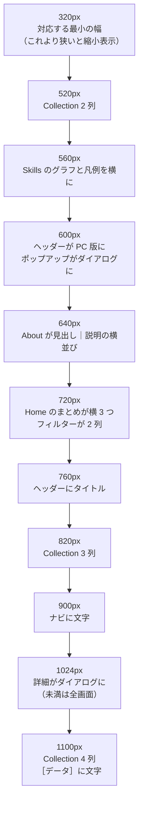
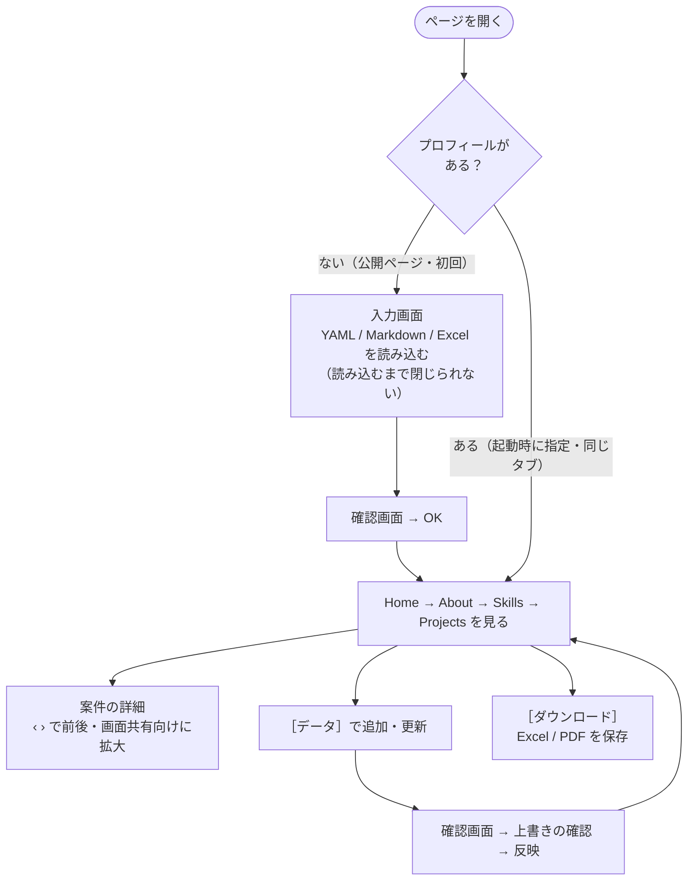

# UI / UX

> 画面の組み立て（レイアウト・レスポンシブ）、操作の流れ、UX の決まり（確認・戻る・エラー・空・待ち）、アクセシビリティ、課題。色や部品の決まりは [デザインシステム](design-system.md)、表示の速さは [パフォーマンス](performance.md)、操作の手順は [操作説明書](manual.md)。
> 2026-11-06 時点。

---

## 1. 想定する使う人と場面

| 使う人 | 場面 | 大事にすること |
|---|---|---|
| 見る人（採用担当・面接官など） | 履歴書と一緒に、PC やスマホで開く。面接の画面共有で見せられる | すぐに要点（経験の長さ・件数・直近の案件・技術の割合）が分かる。画面共有でも読める |
| 作る人（開発者本人） | 自分の YAML / Markdown / Excel を読み込み、追加・更新し、スキルシートを書き出す | 間違ったデータで壊さない。反映の前に必ず確かめられる。ファイルを扱えない端末でも使える |

## 2. 画面の組み立て

- **1 ページ・縦スクロール**：Header（固定）の下に Home → About → Skills → Projects を並べる。**スクロールはページ全体の 1 つだけ**（セクションの中にスクロールを作らない。スマホで内側だけ動いてページが動かなくなるのを防ぐ）。
- ナビは、今見ているセクションを丸いインジケーターで示す（スクロールに合わせて切り替わる）。

### 2.1 ブレークポイント

| 幅 | 変わるところ | 値の場所 |
|---|---|---|
| 320 未満 | 320px のレイアウトを画面の幅に合わせて縮小（はみ出し防止） | `AppSizes.minSupportedWidth`・`MinWidthScaler` |
| 520 / 820 / 1100 | Projects の Collection が 1 → 2 → 3 → 4 列。1 ページは列 × 行（スマホ 1 × 4、タブレット 2 × 3、PC 3〜4 × 2） | `ProjectsCollectionConfig` |
| 560 | Skills のグラフと凡例を、未満は縦に積む・以上は横に並べる | `SkillsCardConfig.stackBreakpoint` |
| 600 | ヘッダーのスマホ版（メニュー）/ PC 版、ポップアップ（フィルター・カテゴリ）が下からのシート / 中央のダイアログ | `HeaderConfig.mobileBreakpoint`・`AppSizes.filterModalBreakpoint` |
| 640 | About の「見出し｜説明」を縦に積む / 横に並べる | `AboutSectionConfig.wideBreakpoint` |
| 720 | Home のまとめ 3 つを縦 / 横、フィルターのパネルを 1 列 / 2 列 | `HeroSectionConfig.summaryRowBreakpoint` ほか |
| 760 / 900 / 1100 | ヘッダーのタイトル、ナビの文字、［データ］の文字を出す | `HeaderConfig` |
| 1024 | 案件の詳細を全画面（‹ › は下）/ ダイアログ（‹ › は左右） | `ProjectsListConfig.modalFullscreenBreakpoint` |

- ツールバーは `Row` ではなく `Wrap` にして、狭いと折り返す。
- ページ送りは幅に合わせて「全部の番号 → 1 … 4 5 6 … 10 → ‹ 3 / 10 ›」と省略する。

## 3. 主な操作の流れ

画面ごとの手順は [操作説明書](manual.md)。

## 4. UX の決まり

| 決まり | 中身 | 例 |
|---|---|---|
| **反映の前に必ず確かめる** | データを変える操作は、確認画面で中身を見せ、OK のときだけ反映する。今の内容が消える・変わるときは、もう一度「上書きされます」と知らせる | アップロード、［データ］の追加、まとめて読み込み |
| **戻れる** | 何段もある操作は、上にパンくず（「追加 › Work › …」）を出し、［戻る］で 1 つ前に戻れる | ［データ］、アップロード画面 |
| **間違いはその場で、理由を付けて** | 読み込んだ時点で形式を確かめ、間違っていれば理由（何件目・何行目）を出し、先へ進むボタンを押せなくする | YAML / Markdown の誤り、拡張子違い、必須の不足 |
| **壊さない** | 読み込めないデータで表示を壊さない。読み込みに失敗しても画面は出す（空の表示） | 0 件、項目のない案件、プロフィールなし |
| **待たせるときは見せる** | 時間のかかる処理は全画面のローディングを出し、終わったら SnackBar で結果を知らせる | アップロード後の作り直し、Excel / PDF の作成 |
| **ファイルを扱えない人にも** | ファイルの選択・保存のほかに、テキストの貼り付け・クリップボードへのコピーでも同じことができる | テンプレートの［コピー］、［テキストを貼り付け］ |
| **押せないものは薄く** | 前・次がない、まだ読み込んでいない、などのボタンは押せない見た目にする（隠さない） | 詳細の ‹ ›、アップロード、ページ送りの端 |
| **見せる人の画面共有に配慮** | 詳細の文字を 100〜250% に、PC は画面いっぱいにできる。キーボードでも操作できる | ［A−］［100%］［A＋］［大きく表示］、− ＋ 0 F、⌘ / Ctrl ＋ 0 |
| **最初の入力画面は閉じられない** | 正しいプロフィールを読み込むまで閉じない（外側のタップ・Esc・戻るでも閉じない） | 入力画面 |

### 4.1 状態ごとの表示

| 状態 | 表示 |
|---|---|
| 読み込み中（起動） | `web/index.html` の円形のローディング（Flutter のものと同じ動き） |
| 読み込み中（重い描画） | 円形のローディング → フェードで中身（`SettledReveal`） |
| 反映中 | 全画面のローディング（5〜8 秒） |
| 空 | プロフィールなし → 入力画面、案件 0 件 → 空の一覧、書いていない項目 → 出さない |
| エラー | ダイアログの中に理由の箇条書き（赤）、保存の失敗は SnackBar |
| 成功 | SnackBar（保存した・アップロードした・ダウンロードした） |

## 5. 文言

- 日本語。です・ます調で、短く、操作の名前はボタンと同じ言葉を使う（「［アップロード］を押せません」）。
- 専門用語は避け、YAML のキーなどはコードの書き方（`workflow`）で示す。
- 文言はすべて `lib/constants/app_texts.dart` に置く（[デザインシステム](design-system.md#4-スタイルを書く場所)）。

## 6. アクセシビリティ

| 項目 | 今の状態 |
|---|---|
| 色のコントラスト | 文字と背景は M3 の ColorScheme のロールの組み合わせ（M3 が読みやすいコントラストになるよう作る）。**測ってはいない** |
| グラフの色 | 系列はアクセント色の固定 8 色。凡例に名前と % を文字で出すので、色だけに頼っていない。黄・緑・ティールは白い背景で薄く見える（**未計測**） |
| 文字の大きさ | 詳細は 100〜250% に変えられる。ブラウザ・OS の文字の大きさの設定への追従は**確かめていない** |
| キーボード | 詳細の ← → ・拡大のキー、ダイアログの Esc、Tab での移動（Flutter の標準）。全画面で通しての確認は**していない** |
| スクリーンリーダー | ボタンのツールチップ・期間の読み上げ（`Semantics`）など一部だけ（`Semantics` 9 か所・ツールチップなど 42 か所）。Flutter Web のセマンティクスは既定で**オフ**（読み上げを使う人が有効にする）なので、通しての確認は**していない** |
| 動き | スクロール・フェードは短い（〜500ms）。OS の「視差効果を減らす」への追従は**していない** |
| 最小の幅 | 320px で崩れない（テストで確かめている）。それより狭いと縮小 |
| タップの大きさ | M3 の既定（48px）。ページ番号だけは見た目どおり 40px（はみ出しを防ぐため。[パフォーマンス](performance.md) ではなく UI の判断） |

## 7. 確かめ方

| 確かめること | 方法 |
|---|---|
| 幅・テーマ・データの組み合わせで崩れない | 自動テスト（`home_page_test` など。[テスト計画書](testing/test-plan.md#5-組み合わせの設計)） |
| 実機・実ブラウザでの見た目と操作 | 手動（[テスト計画書](testing/test-plan.md#7-手動で確かめること)） |
| 見た目の変化 | ゴールデンテスト（未導入。[今後の動き](roadmap.md)） |
| アクセシビリティ | Lighthouse・axe（Chrome）、VoiceOver / TalkBack（未実施） |

## 8. 課題

| 課題 | 影響 | 案 |
|---|---|---|
| テーマを保存しない・OS の設定に合わせない | 開くたびにライト | `prefers-color-scheme` を初期値にし、選んだものを保存する |
| アクセシビリティを測っていない | コントラスト・読み上げ・キーボードの問題に気づけない | Lighthouse / axe を手動で → E2E に組み込む |
| 棒グラフはタップで強調できない | スマホでは強調が見られない | タップで選ぶ（円グラフと同じ） |
| Projects のページを切り替えても一覧の先頭に戻らない | 一覧が短くなると、何もない所を見ている | ページを変えたら一覧の先頭へスクロール |
| 反映の待ち時間が長め（5〜8 秒） | 待たされる感じ | [パフォーマンス](performance.md#5-課題と改善案) |
| データはタブを閉じると消える | 作る人がやり直しになる | 仕様（個人情報を残さない）。注意を画面に出すか検討 |
| Projects が 0 件のとき、フィルターを使っていなくても「フィルターの条件を減らすと表示されます」と出る | 何をすればよいかが合わない | フィルターがないときは「プロジェクトがありません。［データ］から追加できます」などにする |
| 使われていない文言がある（「No projects」「Private のため表示できません」） | 整理されていない | 使うか消す |
