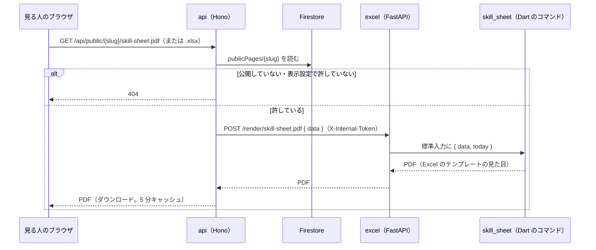

# services/excel-fastapi

公開ページを**見る人向けのスキルシート（Excel・PDF）**を作るサービス（Python・FastAPI）。段階 6 で、ブラウザでは向かない「サーバーで作って決まった URL で配るファイル」だけをここに置いた（[比べた結果](../../docs/plan/excel.md)・[D-06](../../docs/plan/decisions.md#d-06-fastapi-に任せる範囲)）。

| | |
|---|---|
| 言語・フレームワーク | Python 3.12・FastAPI・uvicorn。Excel・PDF を作るのは Dart のコマンド（下） |
| 役割 | 公開ページのデータ（JSON）を受け取り、スキルシート（Excel・PDF）にして返す |
| 形 | **本人がダウンロードするスキルシートと同じ**：Excel のテンプレート（`frontend/assets/data/format_skill_sheet.xlsx`）に書き、PDF はその Excel の見た目のまま |
| 持たないもの | データ（Firestore にはつながない。D-05：Firestore は Hono だけ）、ログイン |
| 呼ぶもの | API（`services/api-hono`）だけ。画面（nginx）からは直接つながない |
| ポート（ローカル） | 8001 |

## 作り

Excel・PDF を作る処理は、ブラウザ（本人の［ダウンロード］）と**同じ Dart のコード**を使う。Python で作り直すと実装が 2 つになり、見た目がずれていくため。

| 部品 | 場所 | 中身 |
|---|---|---|
| 書く中身を作る | `frontend/lib/utils/skill_sheet_data.dart` | 公開ページのデータ（API の形）→ スキルシートの中身。並び（開始の古い順）・技術の分類は本人の［ダウンロード］と同じ |
| Excel を書く・PDF にする | `frontend/lib/utils/skill_sheet_writer.dart`・`skill_sheet_pdf.dart` | 本人の［ダウンロード］と同じもの |
| コマンド | `frontend/bin/skill_sheet.dart`（中身は `lib/utils/skill_sheet_cli.dart`） | 標準入力の JSON → 標準出力に Excel か PDF |
| コマンドを作る | `dart/build.sh`・`dart/pubspec.yaml` | frontend の `lib/`・`bin/` を、Flutter なしの pubspec（パッケージの版は frontend と同じに固定）で `dart compile exe` |
| FastAPI | `app/main.py`・`app/sheet.py` | 受け付け（形の確認・大きさ・`INTERNAL_TOKEN`）、コマンドを呼ぶ（時間切れ 30 秒・同時に 2 つまで）、ログ |

Docker のビルドは 2 段：Dart のイメージでコマンドを作り、python:3.12-slim にコマンド・テンプレート・フォント（frontend と同じファイル）だけを写す。ビルドには frontend も要る（`compose.yaml` の `additional_contexts`）。



- 許すかどうか：表示設定の `display.allowSheetDownload` が `true` のときだけ（既定は `false`。サンプルの利用者は確かめやすいように `true`）。
- 個人の情報：公開ページのデータには、スキルシートだけの項目（ふりがな・生年月日・最寄駅など）が入っていない（`services/api-hono/src/publish.ts`）。その欄は空になる。データに入っていても使わない。
- ログ：1 リクエスト 1 行の JSON。名前などの中身は書かない。

## 起動

```bash
docker compose up -d --build excel                 # リポジトリの直下で。http://localhost:8001/healthz
```

Docker なしで（Python 3.10 以上と、Flutter の dart）：

```bash
cd services/excel-fastapi
python3 -m venv .venv && . .venv/bin/activate
pip install -r requirements-dev.txt
SKILL_SHEET_CMD="dart run ../../frontend/bin/skill_sheet.dart" \
SKILL_SHEET_TEMPLATE=../../frontend/assets/data/format_skill_sheet.xlsx \
FONT_PATH=../../frontend/assets/fonts/ipagp.ttf \
uvicorn app.main:app --port 8001 --reload
```

## 環境変数

| 名前 | 既定（Docker の中） | 中身 |
|---|---|---|
| `PORT` | 8001 | 待ち受けるポート |
| `INTERNAL_TOKEN` | なし | あれば、`X-Internal-Token` が同じときだけ受け付ける（api の `EXCEL_INTERNAL_TOKEN` と同じ値）。compose ではローカル用の値 |
| `SKILL_SHEET_CMD` | `/usr/local/bin/skill_sheet` | スキルシートを作るコマンド |
| `SKILL_SHEET_TEMPLATE` | `/opt/skill-sheet/format_skill_sheet.xlsx` | Excel のテンプレート |
| `FONT_PATH` | `/opt/skill-sheet/ipagp.ttf` | PDF の日本語フォント（IPA P ゴシック） |

## API

| メソッド | パス | 中身 |
|---|---|---|
| GET | `/healthz` | `{"status":"ok"}` |
| POST | `/render/skill-sheet.pdf` | `{ "data": 公開ページのデータ }` → PDF（Excel の見た目のまま） |
| POST | `/render/skill-sheet.xlsx` | 同じく Excel |

形が違えば 400、1 MB を超えれば 413、トークンが違えば 401、コマンド・テンプレート・フォントがなければ 503、作れなければ 500。エラーは `{"error": {"code", "message"}}`（ほかのサービスと同じ形）。

## テスト

```bash
pip install -r requirements-dev.txt
pytest --cov=app --cov-branch --cov-report=term-missing --cov-fail-under=90
```

| ファイル | 確かめていること |
|---|---|
| `tests/test_sheet.py` | コマンドに渡す引数（PDF はフォントも）・入力（データと作成日）、既定の場所、コマンド・ファイルがない、失敗、時間切れ（コマンドは偽物 `tests/fake_skill_sheet.py`） |
| `tests/test_app.py` | `/healthz`、PDF・Excel が返る、400・413、`INTERNAL_TOKEN`、404・405 も同じ形、503・500、ログに中身を書かない |
| `tests/test_real_sheet.py` | **本物のコマンド**で：Excel はテンプレートの形（Skill Sheet の見出し・氏名の欄）に中身が入り、スキルシートだけの項目は入らない。PDF も同じ。`SKILL_SHEET_REAL=1` のときだけ（CI はコマンドを作ってから動かす） |
